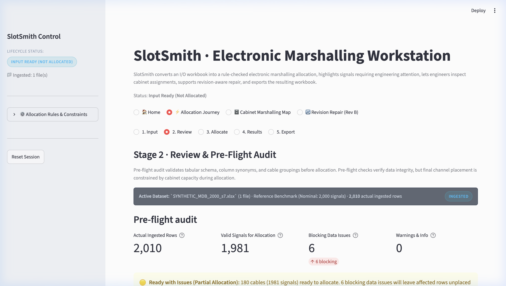
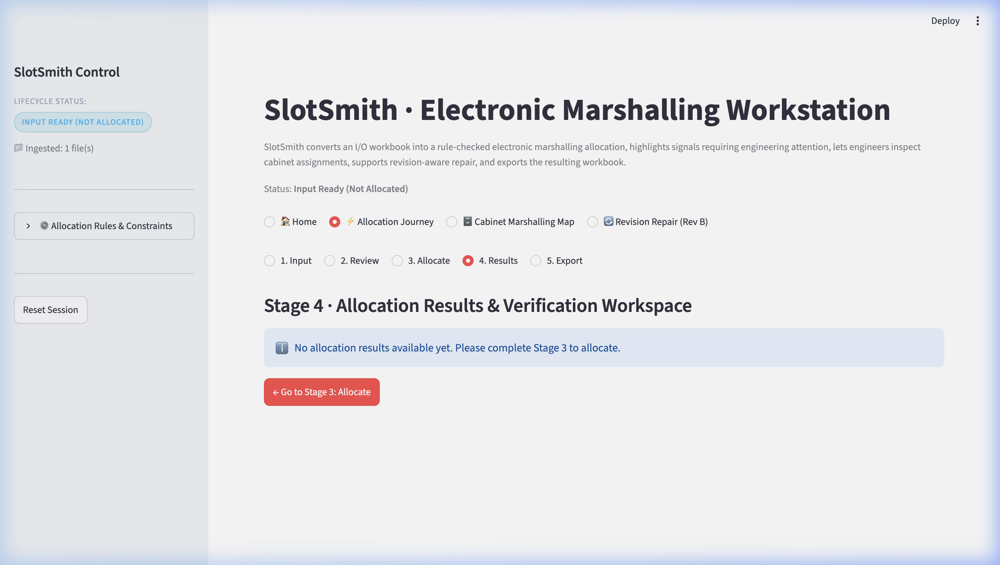
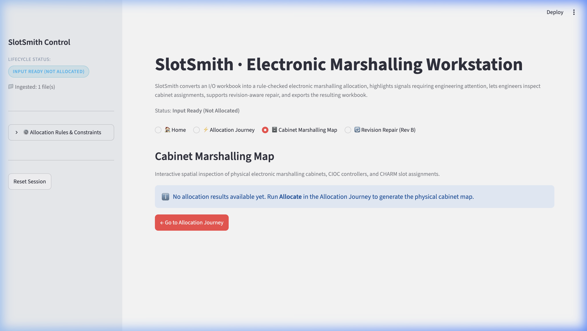
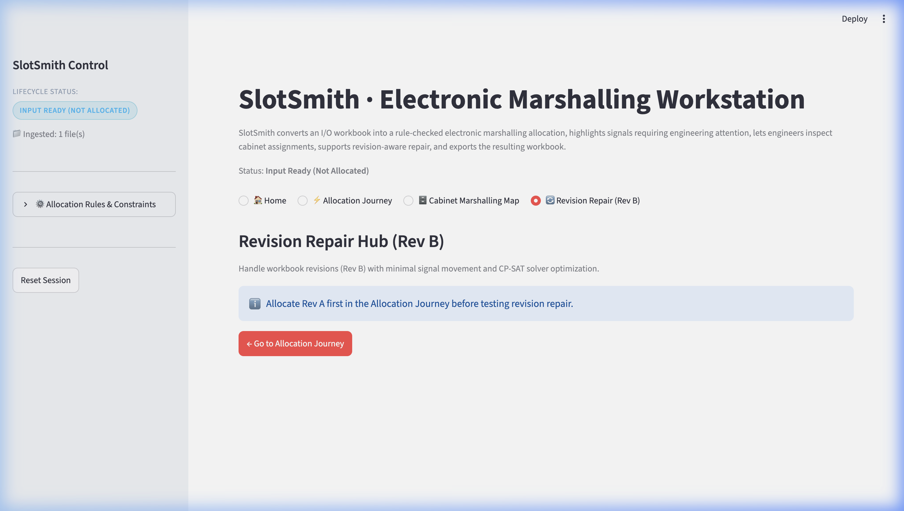
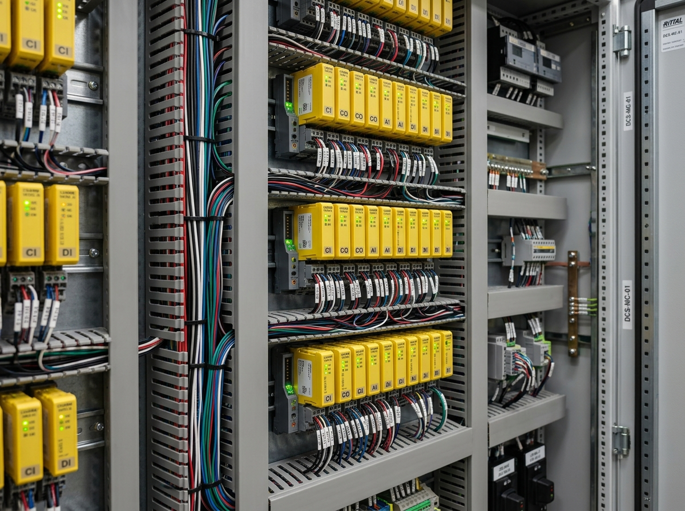
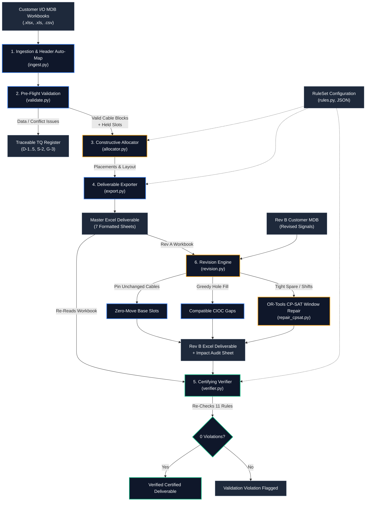
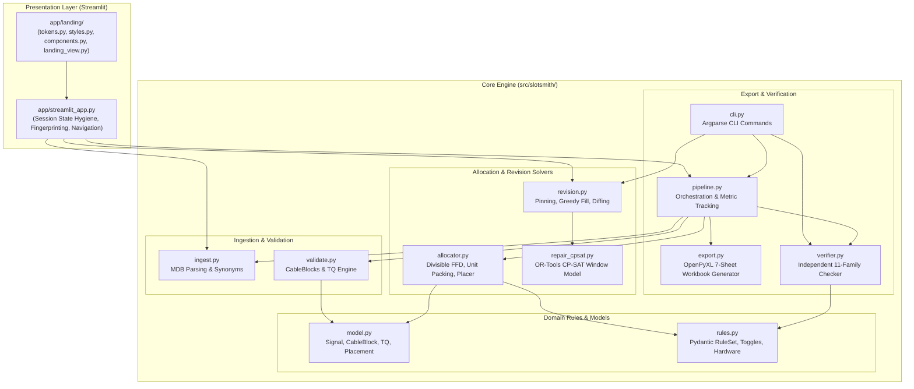

# <div align="center">⚡ SlotSmith</div>

<div align="center">

### Rule-Driven, Independently Checked, Revision-Aware DeltaV I/O Allocation

[](pyproject.toml)
[](https://developers.google.com/optimization)
[](app/streamlit_app.py)
[](tests/)
[](src/slotsmith/verifier.py)
[](deliverables/round1/SlotSmith_Round1.pdf)

**VIT Code Apex 3.0 · Track 1 (Emerson) · Problem Statement 1.2 "Project IO SIGNAL SUDOKU" · Team Mac_Enthu**

---

[At-a-Glance](#at-a-glance) •
[Product Showcase](#product-showcase) •
[Engineering Problem](#engineering-problem) •
[Features](#features) •
[Quick Start](#quick-start) •
[How It Works](#how-it-works) •
[Architecture](#architecture) •
[Allocation Algorithm](#allocation-algorithm) •
[Revision Repair](#revision-repair) •
[Verification & Testing](#verification-and-testing) •
[Benchmarks](#benchmarks) •
[Repository Map](#repository-map) •
[Developer Guide](#developer-guide) •
[Dossier & Deck](#dossier-and-deck) •
[Limitations](#limitations) •
[Roadmap](#roadmap)

---

</div>

<div align="center">
  
  <p><em>SlotSmith interactive engineering workstation: automated I/O ingestion, deterministic First-Fit-Decreasing allocation, independent mathematical verification, and minimal-move revision repair.</em></p>
</div>

> [!NOTE]
> **Prototype Data Provenance Disclosure**  
> All benchmark results, timing profiles, and demonstrations in this repository were evaluated on **synthetic Instrument Master Databases (MDBs)** synthesized from the official competition rulebook via [`src/slotsmith/generator.py`](src/slotsmith/generator.py). The competition organizers did not publicly release sample customer MDBs or official Excel allocation templates. Consequently, passing tests and verification checks demonstrate strict mathematical and architectural consistency against published engineering rules, not compatibility with unreleased hidden evaluation datasets.

---

## <a id="at-a-glance"></a>⚡ At-a-Glance

SlotSmith eliminates the high-friction manual spreadsheet puzzle of allocating industrial process control signals to **Emerson DeltaV™ Electronic Marshalling** hardware.

| Dimension | Manual Engineering Reality (Status Quo) | SlotSmith Solution | Verified Result |
|---|---|---|---|
| **Signal Placement** | 10,000+ signals manually mapped in Excel across multi-core cables, baseplates, and CIOCs | Deterministic First-Fit-Decreasing (FFD) packing preserving cable integrity and pair ordering | **20,033 signals allocated & verified in 5.99 s** (median, Apple M5) |
| **Constraint Enforcement** | Complex, error-prone manual checking for A/B segregation, group boundaries, and 10–20% spare space | Automated constraint propagation with configurable JSON rule sets and hardware selection tables | **0 verifier violations** across all 12 benchmark runs (500 to 20,000 signals) |
| **Data Integrity & TQs** | Duplicate tags, pair mismatches, and mixed-group cables discovered late during cabinet commissioning | Pre-flight schema validation generating traceable Technical Queries (TQs) with `file:sheet:row` provenance | **100% recall** (81 of 81 injected errors flagged as TQs; 100% signal coverage) |
| **Project Revisions (Rev B)** | Late client instrumentation changes trigger cascading manual reworks or from-scratch re-runs | Revision engine: pins unchanged cables, greedy hole fills, and solves localized OR-Tools CP-SAT window repairs | **429–470 moved signals vs. 49,805 from scratch** (>99% reduction in rewiring churn) |
| **Audit & Certification** | Manual visual inspection of spreadsheet columns | Completely decoupled certifying verifier re-checking 11 rule families directly from exported deliverables | **11 rule families re-audited** without sharing solver data structures |

---

## <a id="product-showcase"></a>🖥️ Product Showcase

SlotSmith pairs a high-performance Python constraint backend with a modern, high-contrast engineering interface designed for DCS systems engineers, EPC instrumentation leads, and panel shop wiremen.

### 1. Landing Page & Digital Workspace
The entry point provides one-click reference industrial benchmarks (2,000 signals with 6 injected edge cases), guided workflows, and live project session tracking.
<div align="center">
  
  <p><strong>Figure 1:</strong> <em>SlotSmith landing view with quick actions, capability cards, and session lifecycle monitoring.</em></p>
</div>

---

### 2. Input Ingestion & Pre-Flight Data Audit (Stage 1 & 2)
Upload heterogeneous customer spreadsheets (`.xlsx`, `.xls`, `.csv`). The engine detects header rows, normalizes column synonyms, scores mapping confidence, and flags data anomalies prior to solving.
<div align="center">
  
  <p><strong>Figure 2:</strong> <em>Stage 2 Review interface: transparent column mapping confidence (High/Fuzzy), pre-flight integrity audit, and pending Technical Queries (TQs).</em></p>
</div>

---

### 3. Allocation Results & Independent Certification (Stage 4)
View high-level cabinet utilization metrics, baseplate counts, and the certifying verifier badge confirming zero rule violations across all 11 constraint families.
<div align="center">
  
  <p><strong>Figure 3:</strong> <em>Allocation results dashboard: verifier certification banner, physical cabinet/CIOC summaries, and searchable Technical Query (TQ) exception register.</em></p>
</div>

---

### 4. Interactive 2D Cabinet Marshalling Map (Spatial Digital Twin)
Explore marshalling cabinets in high contrast. CIOC carriers, 12-channel baseplates, and CHARM slots are color-coded according to Emerson signal standards (AI, AO, DI, DO, Isolated DO, Relay Output, Spare, Free).
<div align="center">
  
  <p><strong>Figure 4:</strong> <em>Cabinet Marshalling Map: spatial digital twin showing CIOC racks, baseplate groupings, and channel-level slot inspection.</em></p>
</div>

---

### 5. Revision Repair & Move Churn Minimization (Rev B)
When client instrument revisions arrive, SlotSmith compares Rev B against Rev A, locks unchanged cables to their field slots, fills gaps greedily, and runs a localized CP-SAT solver to minimize costly wire moves.
<div align="center">
  
  <p><strong>Figure 5:</strong> <em>Revision Repair view: detailed move breakdown (Moved, Added, Deleted, Modified in Place, Unchanged), cabinet impact tally, and delta verification.</em></p>
</div>

---

### 6. Industrial Hardware Grounding
SlotSmith is modeled directly on Emerson DeltaV physical hardware conventions, ensuring slot assignments map 1:1 to real DIN rails and terminal blocks.
<div align="center">
  
  <p><strong>Figure 6:</strong> <em>DeltaV Electronic Marshalling cabinet hardware: redundant CIOC carriers, CHARM baseplates, and multi-core field cable entries.</em></p>
</div>

---

## <a id="engineering-problem"></a>🏭 The Engineering Problem

In modern process automation facilities (refineries, chemical plants, offshore platforms), 10,000 to 50,000 field instruments must connect to a Distributed Control System (DCS). Historically, this required cross-marshalling cabinets—massive field enclosures with thousands of individual terminal blocks requiring manual cross-wiring.

**Emerson DeltaV Electronic Marshalling** simplified physical wiring by introducing single-channel **CHARacterization Modules (CHARMs)**:
- Any signal type (AI, AO, DI, DO, RTD, TC) can land on any channel.
- Each **CHARM Baseplate** holds **12 CHARMs** and **12 Terminal Blocks**.
- Each **CHARM I/O Card (CIOC)** carrier supports up to **8 Baseplates (96 channels)**.
- Each **Marshalling Cabinet** houses up to **4 CIOCs (384 channels / 32 baseplates)** (per competition project specification).

### The "I/O Signal Sudoku" Bottleneck
While electronic marshalling eliminated physical cross-wiring ("without lifting a wire"), the combinatorial burden shifted into spreadsheet engineering. Systems engineers must allocate signals in Excel under strict industrial constraints:
1. **Cable Block Contiguity (Rule K-1):** Multi-pair field cables (2, 6, 12, or 24 pairs) must land as contiguous blocks in strict pair order ($1 \dots N$). Unused pairs become wired spares occupying slots.
2. **Redundancy & Safety Segregation (Rule S-1):** Duty/standby or risk-area signals classified as **A** and **B** must never share a CIOC (or cabinet, if configured).
3. **Logical Process Grouping (Rule G-1):** Signals belonging to the same process unit or functional area must cluster into the fewest contiguous cabinets.
4. **Spare Headroom Reservation (Rule P-1):** Marshalling cabinets must reserve space for future plant expansion (e.g., 10–20% empty baseplates reserved per cabinet).
5. **Hardware Selection (Rule H-1..6):** Correct CHARMs (e.g., Isolated DO) and Terminal Blocks (e.g., Fused Injected Power, Relay Output) must match signal electrical characteristics.
6. **Revision Churn (Rule R-1..5):** Instrument databases evolve constantly during EPC design phases. A minor revision (adding 5% instruments, deleting 3%) typically forces engineers to re-run allocations from scratch, shifting thousands of previously assigned signals and invalidating published loop diagrams and wiring schedules.

SlotSmith automates this entire lifecycle with mathematical guarantees, sub-second execution, and full traceability.

---

## <a id="features"></a>🧩 Feature Matrix

| Functional Area | Feature | Status | Architectural Implementation & Evidence |
|---|---|:---:|---|
| **Data Ingestion** | Header row auto-detection | **Built** | Scans top 15 rows for required column combinations ([`ingest.py:70`](src/slotsmith/ingest.py#L70)) |
| | Synonym & fuzzy column mapping | **Built** | Sequence matcher ($\ge 0.8$ confidence) with canonical normalization ([`ingest.py:42`](src/slotsmith/ingest.py#L42)) |
| | Provenance tracking | **Built** | Every signal preserves `file:sheet:row` origin through export ([`ingest.py:100`](src/slotsmith/ingest.py#L100)) |
| **Validation & TQs** | Pre-flight data validation | **Built** | Detects duplicate tags, illegal pair indices, unknown types ([`validate.py:54`](src/slotsmith/validate.py#L54)) |
| | Conflict detection | **Built** | Flags mixed A/B cables (S-2) and mixed process groups (G-3) ([`validate.py:177`](src/slotsmith/validate.py#L177)) |
| | Traceable Technical Queries (TQs) | **Built** | Categorized (blocking, warning, info) with rule IDs & source rows ([`validate.py:33`](src/slotsmith/validate.py#L33)) |
| | Slot holding for blocked signals | **Built** | Reserves slots for blocked signals so valid cable pairs keep alignment ([`validate.py:121`](src/slotsmith/validate.py#L121)) |
| **Allocation Solver** | Divisible-size First-Fit-Decreasing | **Built** | Provably optimal baseplate counts within packing classes ([`allocator.py:81`](src/slotsmith/allocator.py#L81)) |
| | Neutral cable top-up | **Built** | Neutral cables fill spare slots of A/B baseplates before opening new ones ([`allocator.py:123`](src/slotsmith/allocator.py#L123)) |
| | Group contiguity & look-ahead | **Built** | Prevents group fragmentation across non-adjacent cabinets ([`allocator.py:200`](src/slotsmith/allocator.py#L200)) |
| | Spare headroom reservation | **Built** | Enforces $\lceil \text{spare\%} \times 32 \rceil$ empty baseplates per cabinet ([`allocator.py:144`](src/slotsmith/allocator.py#L144)) |
| **Verification** | Decoupled 11-family verifier | **Built** | Imports zero solver internals; re-parses positions from workbook ([`verifier.py:58`](src/slotsmith/verifier.py#L58)) |
| | Format & naming regex audit | **Built** | Validates DCS cabinet, controller, CIOC, and CBP naming strings ([`verifier.py:34`](src/slotsmith/verifier.py#L34)) |
| **Revision Engine** | Rev A cable pinning | **Built** | Unchanged cables locked in place; zero moves for spare-pair additions ([`revision.py:95`](src/slotsmith/revision.py#L95)) |
| | Greedy hole filling | **Built** | Placed into available CIOC gaps adhering to group & spare rules ([`revision.py:152`](src/slotsmith/revision.py#L152)) |
| | OR-Tools CP-SAT window repair | **Built** | Solves minimum-move window optimization with Rev A hints ([`repair_cpsat.py:23`](src/slotsmith/repair_cpsat.py#L23)) |
| | Revision impact analysis | **Built** | Audits Added, Deleted, Moved, Modified in place, and Cabinets hit ([`revision.py:340`](src/slotsmith/revision.py#L340)) |
| **Export & Deliverables** | 7-Sheet Excel workbook | **Built** | Formatted OpenPyXL deliverable with auto-filters & freeze panes ([`export.py:151`](src/slotsmith/export.py#L151)) |
| **User Interface** | 5-Stage Guided Workbench | **Built** | Input $\to$ Review $\to$ Allocate $\to$ Results $\to$ Export flow ([`streamlit_app.py:983`](app/streamlit_app.py#L983)) |
| | 2D Spatial Cabinet Map | **Built** | High-contrast interactive digital twin with channel drill-down ([`streamlit_app.py:1498`](app/streamlit_app.py#L1498)) |
| | Session state hygiene & hashing | **Built** | SHA-256 fingerprinting prevents stale result presentation ([`streamlit_app.py:46`](app/streamlit_app.py#L46)) |
| **Assumptions & Scope** | Cable straddling across baseplates | **Partial** | Allocator never straddles; `allow_cable_straddle` only relaxes verifier ([`known_limitations.md`](docs/known_limitations.md)) |
| | Open-ended rule creation | **Partial** | Existing parameters live in JSON/UI; new rule types require code ([`known_limitations.md`](docs/known_limitations.md)) |
| | AI Assistive Helpers | **Planned** | LLM column mapping suggestions & TQ wording planned for Round 2 ([`docs/architecture.md`](docs/architecture.md#L74)) |

---

## <a id="quick-start"></a>🚀 Quick Start

### 1. Prerequisites
- **Python:** Version `3.11` or higher (tested on Python `3.12.13`).
- **Operating System:** macOS, Linux, or Windows (WSL recommended).
- **Environment:** Clean Python virtual environment recommended.

### 2. Installation
Clone the repository and install with all development and UI dependencies:

```bash
# Clone the repository
git clone https://github.com/Sidd927/SlotSmith.git
cd SlotSmith

# Create and activate a clean virtual environment
python3 -m venv .venv
source .venv/bin/activate  # On Windows: .venv\Scripts\activate

# Install SlotSmith in editable mode with dev and UI dependencies
pip install -e ".[dev,ui]"
```

Verify installation:
```bash
slotsmith --help
pytest -q
```
*(All 108 automated tests should pass in under 45 seconds.)*

---

### 3. Launching the Interactive Web Workstation

Launch the Streamlit engineering interface locally:

```bash
streamlit run app/streamlit_app.py
```
Open your browser at `http://localhost:8501`.

**Guided Initial Workflow:**
1. On the **Home** view, click **"Load Reference Benchmark (2,000 signals)"** or click **"⚡ Allocation Journey"** $\to$ **Stage 1: Input Setup**.
2. Advance to **Stage 2: Review** to inspect the auto-mapped column synonyms and pre-flight data audit.
3. Advance to **Stage 3: Allocate**, adjust spare percentage or group isolation toggles if desired, and click **"Run Allocation"**.
4. In **Stage 4: Results**, review KPI cards, the green **Verifier Certified** banner, and the searchable TQ register.
5. In **Stage 5: Export**, download the final multi-sheet Excel engineering deliverable.
6. Navigate to **🗄️ Cabinet Marshalling Map** to inspect physical CIOC and baseplate channel layouts, or **🔄 Revision Repair (Rev B)** to evaluate delta changes.

---

### 4. Common Setup Troubleshooting
- **Port Conflict (`Port 8501 is not available`):**  
  Run on an alternate port:
  ```bash
  streamlit run app/streamlit_app.py --server.port=8502
  ```
- **Headless / Sandbox Environments:**  
  If running on a remote server or in containerized CI environments without interactive TTY:
  ```bash
  STREAMLIT_SERVER_HEADLESS=true streamlit run app/streamlit_app.py
  ```
- **Missing Build Dependencies:**  
  Ensure `setuptools>=68` and `wheel` are installed in your virtual environment before running `pip install -e .`.

---

## <a id="how-it-works"></a>⚙️ How It Works

The SlotSmith end-to-end pipeline enforces strict data contracts at every transition:



---

## <a id="architecture"></a>🏛️ System Architecture

SlotSmith follows a layered, decoupled architecture designed for verification independence and computational determinism:



### Module Responsibilities & Verification Boundary
1. **[`src/slotsmith/ingest.py`](src/slotsmith/ingest.py):** Reads `.xlsx`, `.xls`, `.csv` workbooks, scans for candidate header rows, executes deterministic fuzzy synonym matching (0.8 threshold), and attaches `file:sheet:row` provenance.
2. **[`src/slotsmith/validate.py`](src/slotsmith/validate.py):** Validates raw signals, groups signals into multi-pair `CableBlock` structures, detects conflicts (mixed A/B, mixed groups, invalid pairs), and reserves slots for blocked signals ("Held for TQ") so companion pairs keep aligned positions.
3. **[`src/slotsmith/rules.py`](src/slotsmith/rules.py):** Defines the typed, pydantic-validated `RuleSet` schema with parameter toggles for R1 (Grouping), R2 (Segregation), R3 (Capacity), R4 (Cables), R5 (Spare), R6 (Hardware), and R7 (Naming).
4. **[`src/slotsmith/allocator.py`](src/slotsmith/allocator.py):** Executes constructive First-Fit-Decreasing channel packing into 12-channel baseplates. Groups are laid out contiguously into CIOCs and cabinets via look-ahead placement.
5. **[`src/slotsmith/verifier.py`](src/slotsmith/verifier.py):** **Deliberately imports zero solver internals.** Re-reads the generated workbook file from disk, parses physical coordinates back out of string names using regular expressions, and audits 11 rule families independently.
6. **[`src/slotsmith/revision.py`](src/slotsmith/revision.py) & [`src/slotsmith/repair_cpsat.py`](src/slotsmith/repair_cpsat.py):** Implements minimal-perturbation revision repair for Rev B. Pins unchanged cables, attempts greedy hole fills, and invokes Google OR-Tools CP-SAT over a sliding cabinet window to minimize moved signals.
7. **[`src/slotsmith/export.py`](src/slotsmith/export.py):** Emits a 7-sheet OpenPyXL workbook containing `IO Allocation`, `Cabinet Summary`, `TQ List`, `Rule Check`, `Revision Impact`, `Rule Set`, and `Run Info`.

---

## <a id="allocation-algorithm"></a>📐 Allocation Algorithm & Provable Packing

### Plain-Language Summary
In electronic marshalling, multi-pair field cables (2, 6, 12, or 24 pairs) must be placed without breaking pairs across non-adjacent slots. SlotSmith treats each multi-pair cable as a rigid block of consecutive channels. It groups cables by process area and safety segregation side (A, neutral, B), sorts them largest-to-smallest, and places each cable into the first baseplate that has sufficient room. Neutral cables top up remaining slots before new baseplates are opened.

---

### Technical Explanation & Proof of Optimality

#### Bin Packing with Divisible Item Sizes
Consider a single packing class (fixed logical group and segregation side). Standard cable sizes belong to the set:
$$\mathcal{S} = \{2, 6, 12\}$$
*(A 24-pair cable spans exactly two full 12-channel baseplates in the same CIOC and is handled as a 2-baseplate atomic unit).*

Notice that $\mathcal{S}$ forms a **divisible chain**:
$$2 \mid 6 \quad \text{and} \quad 6 \mid 12$$
Furthermore, the baseplate channel capacity $C = 12$ is an exact integer multiple of every item size in $\mathcal{S}$.

**Theorem (FFD Optimality on Divisible Sizes):**  
Let item sizes belong to $\mathcal{S} = \{2, 6, 12\}$ and let bin capacity $C = 12$. First-Fit-Decreasing (FFD) uses exactly:
$$\left\lceil \frac{\sum_{i} s_i}{C} \right\rceil \text{ bins}$$
which achieves the theoretical trivial lower bound and is therefore **strictly optimal** (Coffman, Garey & Johnson 1987).

**Proof Sketch:**
1. FFD places items in non-increasing order of size ($12 \to 6 \to 2$).
2. Consider the placement of an item of size $s \in \mathcal{S}$. Every item previously placed has size $s' \ge s$, and because $\mathcal{S}$ is a divisible chain, $s \mid s'$.
3. Because $s \mid C$ and $s \mid s'$, the used space in every open bin is an integer multiple of $s$.
4. Consequently, the remaining free space in any open bin is also an integer multiple of $s$.
5. Any open bin with non-zero free space must possess at least $s$ free slots. Thus, FFD never opens a new bin while an existing bin has non-zero free space.
6. At termination, all bins except possibly the final bin are 100% full. Therefore, the number of bins equals $\lceil \sum s_i / C \rceil$. $\blacksquare$

#### Verified Scope & Audit Reconciliations
- **Mathematically Proven:** Within any single segregation class whose cable sizes belong to $\{2, 6, 12\}$ (plus 24-pair whole-baseplate units), FFD provably achieves the minimum baseplate count.
- **Empirically Verified at Group Level:** In practical plant groups, unsegregated (neutral) cables first top up remaining slots on A and B baseplates before opening neutral baseplates. Because neutral items may not divide the remaining free space left by mixed A/B items, the proof does not strictly transfer to the top-up step.  
  However, extensive solver audits verified that the group total matched the exact integer programming minimum:
  - **19,682 of 19,682 exhaustive small instances** (0–2 cables of each side and size) matched an exact CP-SAT solver with **0 excess baseplates** ([`artifacts/audit/ffd_exact.json`](artifacts/audit/ffd_exact.json)).
  - **150 of 150 random larger groups** matched exact solver lower bounds (148 proven OPTIMAL, 2 FEASIBLE at timeout, allocator never worse) ([`artifacts/audit/lb_gap.json`](artifacts/audit/lb_gap.json)).
  - **12 of 12 benchmark runs (500 to 20,000 signals)** used exactly zero baseplates above the theoretical per-group minimum ([`artifacts/benchmarks.json`](artifacts/benchmarks.json)).
- **What Is Not Claimed as Optimal:** Minimum cabinet or CIOC counts are **not** claimed to be globally minimal, as cabinet boundaries also depend on group isolation, CIOC carrier limits, and project spare budgets. Non-standard cable sizes (e.g. 4, 8, 16 pairs) are packed by the same code without the divisibility optimality proof.

---

## <a id="revision-repair"></a>🔄 Revision-Aware Repair

During plant design, revisions to the Instrument Master Database (Rev B) are frequent. A standard from-scratch re-allocation on a revised database churns thousands of previously committed signal coordinates.

### The 4-Stage Minimal-Perturbation Engine
SlotSmith implements a minimal-perturbation repair workflow based on constraint programming principles (Barták et al. 2004):

1. **Tag & Cable Diffing:** Signals are matched by Tag primary key and classified into `Added`, `Deleted`, `Moved`, `Modified in Place` (e.g., CHARM or terminal block swapped in the same slot), or `Unchanged`.
2. **Cable Pinning:** Any cable whose size, logical group, and segregation side match Rev A is **pinned** to its exact Rev A physical coordinates. Signals added on the cable's existing wired spare pairs land with **zero moves**. Deleted signals revert to spare pairs.
3. **Greedy Hole Filling:** New or modified cables are placed into available slots, evaluating:
   - Existing free slots in compatible CIOCs of the group's assigned cabinets.
   - Empty baseplates, provided the cabinet's reserved spare headroom is respected.
   - New CIOC positions within existing cabinets.
   - A newly opened cabinet, preserving logical group contiguity.
4. **OR-Tools CP-SAT Window Repair:** If greedy filling fails (e.g., all group cabinets have reached their spare headroom limit), SlotSmith invokes Google OR-Tools CP-SAT across a localized cabinet window:
   - **Decision Variables:** Boolean indicators $x_{c, q, b, s}$ for candidate start positions of each cable in the window. Starts are aligned to multiples of cable size.
   - **Hard Constraints:** Slot exclusivity, cabinet spare headroom, CIOC A/B segregation, CIOC group isolation, and cross-cabinet group contiguity against fixed external cabinets.
   - **Mobility Bound:** Existing cables in the window may move at most $\pm 1$ cabinet away from their Rev A location.
   - **Objective Function:**
     $$\min \quad 1000 \times (\text{moved signals}) + \sum (\text{baseplates used})$$
     Rev A positions are provided to CP-SAT as solution hints.
   - **Solver Settings:** 10-second wall-clock limit, 5% relative optimality gap, 8 worker threads.
5. **Fallback Safety Guard:** If the CP-SAT window model fails or returns infeasible, SlotSmith falls back to a full from-scratch re-allocation, raises a warning TQ, and flags the fallback in run metrics (0 fallbacks occurred across all 10 benchmark cases).

---

## <a id="verification-and-testing"></a>🔍 Verification & Testing

### The Certifying Verifier Architecture
SlotSmith follows the principles of **certifying algorithms** (McConnell et al. 2011). A bug in an allocation algorithm can easily be mirrored in its internal validation checks if they share data structures. To eliminate this risk:
- [`src/slotsmith/verifier.py`](src/slotsmith/verifier.py) imports **only** [`rules.py`](src/slotsmith/rules.py).
- It re-reads the output Excel file from disk and parses slot addresses back from generated names (`001-CBP-1-05` $\to$ Baseplate 1, Slot 5).
- It independently verifies 11 distinct rule families:

| Check ID | Verification Rule | Verifier Check Method |
|---|---|---|
| **Q-1** | Signal Completeness | Partitions all MDB signals into placed or blocked with a valid TQ reference |
| **D-2** | Slot Exclusivity | Verifies no physical CHARM slot holds more than one signal |
| **C-1** | Physical Capacity | Checks $\le 12$ CHARMs/baseplate, $\le 8$ baseplates/CIOC, $\le 4$ CIOCs/cabinet |
| **K-1** | Cable Integrity | Verifies all pairs of a cable land consecutively in exact pair order $1 \dots N$ |
| **S-1** | A/B Segregation | Verifies A and B segregation sides never share a CIOC (or cabinet if configured) |
| **G-1** | Group Isolation | Verifies process groups do not interleave and span minimal contiguous cabinets |
| **P-1** | Spare Room | Audits that every cabinet reserves $\ge \lceil \text{spare\%} \times 32 \rceil$ empty baseplates |
| **H-1..6** | Hardware Matching | Re-derives CHARM and terminal block from signal type against hardware table |
| **N-1..6** | Naming Compliance | Regex match against user-defined naming format strings (Area, Unit, Seq) |
| **C-2** | Controller Limits | Verifies CIOC controller assignments and respects max CIOCs per controller |
| **M-1** | Attribute Integrity | Validates that allocated row attributes exactly match input MDB columns |

---

### Test Suite Execution
SlotSmith includes **108 automated tests** spanning unit logic, Hypothesis property-based testing, UI state hygiene, and audit regression suites:

```bash
# Run the complete test suite
pytest -v
```

```
============================= 108 passed in 40.90s =============================
```

**Test Coverage Highlights:**
- `tests/test_core.py` (16 tests): FFD divisible size optimality proofs, row-level TQ generation, verifier mutation detection (double-booked slots, wrong terminal blocks, A/B mix, cable splitting), property tests across random MDBs, rule set modifications without code changes, and revision pin preservation.
- `tests/test_audit_regressions.py` (7 tests): Regression guards from the 10 Oct audit (oversized cable handling, verifier Q-1 duplicate state detection, revision fallback warning TQs, and cabinet-level segregation).
- `tests/test_ui.py` (85 tests): Deterministic SHA-256 fingerprinting for RuleSets, DataFrames, and file uploads; allocation and revision staleness state machines; pre-flight data audit checks; headless Streamlit rendering; navigation transition safety; and HTML builder cleanliness.

---

## <a id="benchmarks"></a>📊 Benchmarks & Empirical Evidence

All measurements below were recorded on an **Apple M5 (10-core, 16 GB RAM) running macOS 27.0 with Python 3.12.13** on synthetic Instrument Master Databases generated from the official competition rulebook.

> [!IMPORTANT]
> **Measurement Conditions:** Default rule set applied (10% spare headroom, CIOC-level A/B segregation, CIOC-level process group isolation). All scale runs were executed across 3 random seeds. Exact logs and artifacts are preserved in [`artifacts/benchmarks.json`](artifacts/benchmarks.json) and [`artifacts/audit/`](artifacts/audit/).

### 1. Scaling Performance & Correctness (Scale Benchmark)

| Nominal Signals | Actual Rows | Allocated | TQs | Coverage | Cabinets | Baseplates Used | Baseplate Bound | Verifier Violations | Ingest (s) | Alloc (s) | Export (s) | Verify (s) | Total Wall Time (s) |
|:---:|:---:|:---:|:---:|:---:|:---:|:---:|:---:|:---:|:---:|:---:|:---:|:---:|:---:|
| **500** | 502 | 502 | 0 | 100.0% | 2 | 51 | 51 | **0** | 0.016 | 0.000 | 0.046 | 0.098 | **0.17 s** |
| **500** | 508 | 508 | 0 | 100.0% | 2 | 52 | 52 | **0** | 0.015 | 0.000 | 0.049 | 0.097 | **0.17 s** |
| **500** | 517 | 517 | 0 | 100.0% | 2 | 53 | 53 | **0** | 0.015 | 0.000 | 0.049 | 0.101 | **0.17 s** |
| **2,000** | 2,002 | 2,002 | 0 | 100.0% | 8 | 203 | 203 | **0** | 0.058 | 0.001 | 0.144 | 0.392 | **0.62 s** |
| **2,000** | 2,016 | 2,016 | 0 | 100.0% | 8 | 201 | 201 | **0** | 0.044 | 0.001 | 0.142 | 0.374 | **0.58 s** |
| **2,000** | 2,011 | 2,011 | 0 | 100.0% | 9 | 203 | 203 | **0** | 0.043 | 0.001 | 0.142 | 0.372 | **0.58 s** |
| **10,000** | 10,031 | 10,031 | 0 | 100.0% | 40 | 1,000 | 1,000 | **0** | 0.227 | 0.005 | 0.748 | 1.895 | **3.00 s** |
| **10,000** | 10,027 | 10,027 | 0 | 100.0% | 39 | 996 | 996 | **0** | 0.204 | 0.006 | 0.741 | 1.836 | **2.96 s** |
| **10,000** | 10,010 | 10,010 | 0 | 100.0% | 40 | 997 | 997 | **0** | 0.255 | 0.006 | 0.730 | 1.898 | **3.01 s** |
| **20,000** | 20,033 | 20,033 | 0 | 100.0% | 79 | 1,996 | 1,996 | **0** | 0.471 | 0.012 | 1.538 | 3.703 | **5.99 s** |
| **20,000** | 20,003 | 20,003 | 0 | 100.0% | 79 | 1,991 | 1,991 | **0** | 0.466 | 0.013 | 1.620 | 3.690 | **6.06 s** |
| **20,000** | 20,003 | 20,003 | 0 | 100.0% | 78 | 1,991 | 1,991 | **0** | 0.443 | 0.012 | 1.525 | 3.723 | **5.98 s** |

- **Zero Violations:** 0 verifier rule violations across all 12 benchmark runs.
- **Exact Baseplate Optimality:** In all 12 instances, baseplates used exactly equaled `baseplates_exact_per_group` (0 excess baseplates).
- **Execution Speed:** 20,033 signals allocated, written to Excel, and independently re-verified in **5.99 seconds** (allocation itself took only 12 ms).

---

### 2. TQ Error Detection & Recall
Tested across 3 independent seeds with 27 injected data errors per dataset (missing tags, invalid pair numbers, duplicate tags, mixed A/B cables, mixed groups):
- **Errors Injected:** 81 errors across 3 runs.
- **Errors Detected as Blocking TQs:** **81 of 81 (100% recall)**.
- **Signal Coverage:** 100.0% (all signals either allocated or flagged with an explicit TQ).

---

### 3. Revision Churn Minimization (Rev B Benchmark)

Evaluated across 10 distinct revision cases (5 cases at 2,000 signals, 5 cases at 10,000 signals):

| Dataset Scale | Seed | Added | Deleted | Modified | Moved (SlotSmith Incremental) | Moved (From-Scratch Re-Run) | Churn Reduction | CP-SAT Repair Used | Fallback | Revise Time (s) |
|:---:|:---:|:---:|:---:|:---:|:---:|:---:|:---:|:---:|:---:|:---:|
| **2,000** | 1 | 100 | 60 | 26 | **53** | 1,287 | **-95.9%** | Yes (Optimal) | No | 13.5 s |
| **2,000** | 2 | 100 | 60 | 25 | **11** | 883 | **-98.8%** | No (Greedy fill) | No | 0.05 s |
| **2,000** | 3 | 116 | 60 | 30 | **4** | 1,728 | **-99.8%** | No (Greedy fill) | No | 0.05 s |
| **2,000** | 4 | 117 | 60 | 32 | **50** | 1,157 | **-95.7%** | Yes (Feasible) | No | 31.0 s |
| **2,000** | 5 | 101 | 60 | 31 | **66** | 1,095 | **-94.0%** | Yes (Feasible) | No | 30.9 s |
| **10,000** | 1 | 507 | 300 | 142 | **50** | 9,070 | **-99.4%** | Yes (Feasible) | No | 15.5 s |
| **10,000** | 2 | 516 | 300 | 139 | **9** | 9,079 | **-99.9%** | No (Greedy fill) | No | 0.20 s |
| **10,000** | 3 | 511 | 300 | 145 | **132** | 9,237 | **-98.6%** | Yes (2 Opt, 1 Feas) | No | 56.1 s |
| **10,000** | 4 | 515 | 300 | 138 | **44** | 8,973 | **-99.5%** | Yes (3 Optimal) | No | 36.3 s |
| **10,000** | 5 | 509 | 300 | 140 | **27** | 7,296 | **-99.6%** | Yes (Optimal) | No | 2.80 s |
| **Total (10 Cases)** | — | **2,592** | **1,800** | **848** | **446 moves** | **49,805 moves** | **>99.1% overall reduction** | — | **0 / 10** | **Worst: 56.1 s** |

- **Massive Churn Reduction:** In Case 10k-1, SlotSmith moved only **50 signals** vs. **9,070 signals** moved by a from-scratch re-run.
- **Run-to-Run Variance:** Because OR-Tools CP-SAT runs with 8 parallel worker threads under a 10-second wall-clock limit, move counts across multiple runs vary slightly (e.g. 429 to 470 total moves across runs), reflecting heuristic solver thread race conditions.
- **Proof of Local Optimality:** Across 11 accepted CP-SAT repair windows, **7 windows were proven mathematically exact** (`objective == bound`), while 4 were accepted with `FEASIBLE` status at the 10-second limit ([`artifacts/audit/revision_status.json`](artifacts/audit/revision_status.json)).

---

## <a id="repository-map"></a>🗺️ Repository Map

```
SlotSmith/
├── app/                                # Streamlit Interactive Frontend
│   ├── landing/                        # Modular landing page subsystem
│   │   ├── assets.py                   # SVG graphic definitions & badges
│   │   ├── components.py               # Pure HTML component builders
│   │   ├── data.py                     # Demonstration datasets & showcase channels
│   │   ├── landing_view.py             # Landing view controller & query param routing
│   │   ├── styles.py                   # Industrial theme tokens & CSS rules
│   │   └── tokens.py                   # Color palette, spacing, and font constants
│   └── streamlit_app.py                # Main UI entry point, state tracking, and stages
├── artifacts/                          # Reproducible benchmark evidence & test outputs
│   ├── audit/                          # Bin-packing optimality audits & CP-SAT status logs
│   │   ├── ffd_exact.json              # 19,682-instance CP-SAT comparison audit
│   │   ├── lb_gap.json                 # 150-instance larger group lower-bound audit
│   │   └── revision_status.json        # 10-case Rev B solver window status breakdown
│   ├── repro/                          # Clean virtual-environment audit logs
│   ├── screenshots/                    # UI screenshot captures
│   └── benchmarks.json                 # Canonical benchmark measurements (Apple M5)
├── assets/                             # Visual and physical assets
│   └── landing/                        # Cabinet hardware photos and plant backgrounds
├── deliverables/                       # Hackathon competition deliverables
│   └── round1/                         # Round 1 submission package
│       ├── SlotSmith_Round1.pdf        # Final presentation deck (PDF format)
│       ├── SlotSmith_Round1.pptx       # Final presentation deck (PPTX format)
│       ├── presentation_qa.md          # Deck claim-to-evidence audit log
│       └── renders/                    # 110 DPI raster renders of slides 1–8
├── docs/                               # Engineering dossier, research, and rule books
│   ├── architecture.md                 # System architecture, dataflow, and FFD proof
│   ├── emerson_product_analysis.md     # Emerson DeltaV hardware & software analysis
│   ├── known_limitations.md            # Documented boundaries & unverified assumptions
│   ├── literature_review.md            # Academic references (bin packing & revision repair)
│   ├── requirements.md                 # Problem statement requirements breakdown
│   ├── rule_register.md                # 28-rule engineering trace register (D, C, K, S, G, P, H, N, Q, R)
│   ├── source_register.md              # 23 primary sources & Emerson datasheets
│   ├── technology_decisions.md         # Architecture decision records (ADRs)
│   ├── audit/final_audit.md            # 10 Oct 2026 comprehensive evidence audit
│   └── assets/readme/                  # High-resolution README showcase screenshots
├── scripts/                            # Automation, benchmarking, and deck builders
│   ├── benchmark.py                    # Benchmark generation script
│   ├── build_deck.py                   # Scripted PowerPoint slide deck compiler
│   └── repro_clean.sh                  # Clean virtualenv reproduction driver script
├── src/slotsmith/                      # Core Python engineering package
│   ├── __init__.py                     # Version declaration (0.1.0)
│   ├── allocator.py                    # Constructive FFD allocator & Placer engine
│   ├── cli.py                          # Command-line interface entry points
│   ├── export.py                       # 7-sheet OpenPyXL Excel deliverable builder
│   ├── generator.py                    # Synthetic MDB generator with error injection
│   ├── ingest.py                       # Column auto-mapping & header detection
│   ├── model.py                        # Core domain dataclasses (Signal, CableBlock, TQ, etc.)
│   ├── pipeline.py                     # End-to-end execution pipeline
│   ├── repair_cpsat.py                 # OR-Tools CP-SAT window repair model
│   ├── revision.py                     # Minimal-perturbation revision repair engine
│   ├── rules.py                        # Typed Pydantic RuleSet & hardware table
│   ├── validate.py                     # Pre-flight data validation & TQ generator
│   └── verifier.py                     # Decoupled 11-family certifying verifier
├── tests/                              # Comprehensive automated test suite
│   ├── test_core.py                    # Engine unit, property-based, & verifier tests
│   ├── test_audit_regressions.py       # Bug regression guards from 10 Oct audit
│   └── test_ui.py                      # UI state hygiene, fingerprinting, & lifecycle tests
├── CHANGELOG.md                        # Version release history
├── pyproject.toml                      # Project dependencies & package configuration
├── requirements.lock.txt               # Fully pinned reproducible environment lockfile
└── README.md                           # Project documentation homepage
```

---

## <a id="developer-guide"></a>🛠️ Developer Guide

SlotSmith provides both an interactive CLI and an automated test suite.

### 1. Command-Line Interface (CLI)

The package installs a top-level `slotsmith` binary:

```bash
# Display default rule set as formatted JSON
slotsmith rules

# Generate a synthetic customer MDB (2,000 signals, 6 injected errors) and Rev B delta
slotsmith generate --signals 2000 --errors 6 --out data/synthetic/mdb.xlsx --rev-b data/synthetic/mdb_revB.xlsx

# Allocate field signals to DeltaV hardware
slotsmith allocate data/synthetic/mdb.xlsx --out artifacts/alloc.xlsx

# Independently verify an allocation workbook against an MDB
slotsmith verify artifacts/alloc.xlsx --mdb data/synthetic/mdb.xlsx

# Execute minimal-move revision repair for Rev B
slotsmith revise --prev artifacts/alloc.xlsx --mdb data/synthetic/mdb_revB.xlsx --out artifacts/alloc_revB.xlsx
```

---

### 2. Running Benchmarks
Reproduce the canonical benchmark suite recorded in [`artifacts/benchmarks.json`](artifacts/benchmarks.json):

```bash
python scripts/benchmark.py
```
*(Executes 12 scale runs from 500 to 20,000 signals, 3 TQ recall runs, and 10 Rev B revision runs.)*

---

### 3. Clean-Environment Reproduction
To prove environment isolation, run the reproduction driver:

```bash
zsh scripts/repro_clean.sh
```
This script creates a fresh isolated sandbox in `/tmp/slotsmith_clean_*`, instantiates a new virtual environment, installs dependencies from [`requirements.lock.txt`](requirements.lock.txt), and executes both `pytest` and duplicate benchmark passes, logging results to `artifacts/repro/`.

---

## <a id="dossier-and-deck"></a>📑 Technical Dossier & Pitch Deck

For competition judges, technical evaluators, and system architects, detailed design documentation is available in the repository:

- 📄 **[SlotSmith Round 1 Presentation Deck (PDF)](deliverables/round1/SlotSmith_Round1.pdf):** Official 8-slide presentation submitted for Round 1 screening.
- 📊 **[SlotSmith Round 1 Presentation Deck (PPTX)](deliverables/round1/SlotSmith_Round1.pptx):** Editable PowerPoint format built via [`scripts/build_deck.py`](scripts/build_deck.py).
- 📋 **[Presentation QA & Claim Register](deliverables/round1/presentation_qa.md):** Slide-by-slide verification log linking every figure to test logs.
- 📐 **[System Architecture Dossier](docs/architecture.md):** Mathematical proofs, design decisions, and data structures.
- 📑 **[Rule Register](docs/rule_register.md):** 28 documented rules classified into Official (OFF), External (EXT), and Interpretation (INT).
- 🔬 **[Emerson Ecosystem Analysis](docs/emerson_product_analysis.md):** Public literature study on DeltaV, CHARMs, and Hexagon SPI interfaces.
- 📝 **[Final Evidence Audit (10 Oct 2026)](docs/audit/final_audit.md):** Verification log establishing data provenance and bug regression fixes.

---

## <a id="limitations"></a>⚠️ Limitations & Responsible Claims

In accordance with good engineering ethics and competition standards, SlotSmith explicitly declares its current operational boundaries:

1. **Synthetic Data Status:** The competition organizers have not publicly provided sample customer MDB files or official Excel allocation templates. All testing has been performed on synthetic databases synthesized from the published problem statement rulebook. **No claim is made regarding compatibility with hidden evaluation datasets.**
2. **Rule Parameters vs. New Rule Kinds:** Built-in rule parameters (spare %, isolation levels, naming conventions, CHARM/TB mapping) can be customized via JSON or UI without touching Python code. However, defining an entirely *new category* of rule (e.g., physical separation between AC and low-voltage DC signals) currently requires adding Python logic.
3. **Local Window CP-SAT Optimality:** The CP-SAT revision repair solver operates over a sliding cabinet window (the target group's cabinets $\pm 1$ neighbor), and existing cables are constrained to move at most 1 cabinet away. While 7 of 11 benchmark windows were proven mathematically exact, solutions stopping at the 10-second wall-clock limit are accepted with status `FEASIBLE`. Therefore, **global minimal-movement across the entire plant is not mathematically guaranteed**.
4. **Solver Non-Determinism:** Multi-threaded OR-Tools CP-SAT (8 parallel workers) under a wall-clock time limit exhibits minor run-to-run variation in move counts (e.g., 429 to 470 moves across runs on identical revision inputs).
5. **Cable Straddling:** The parameter `allow_cable_straddle=true` is accepted by the verifier schema, but the constructive allocator never splits a cable across baseplates (it always leaves trailing slots free).
6. **No AI in Placement:** Placement, packing, verification, and revision repair are **100% deterministic mathematical algorithms**. No large language models (LLMs) are used at runtime. Planned LLM features are strictly limited to assistive offline tasks (suggesting column mappings for unrecognized headers and phrasing customer-facing TQ explanations) requiring engineer sign-off.
7. **No Claims of Superiority:** SlotSmith makes no claim to replace proprietary Emerson software (DeltaV I/O Studio, Bulk Edit, or DeltaV Books Online) or commercial third-party engineering tools (Hexagon Smart Instrumentation).

---

## <a id="roadmap"></a>🗺️ Roadmap & Contributions

### Planned Enhancements (Round 2+)
- [ ] **Relational Database Storage:** Migrate from in-memory DataFrames to an embedded SQLite datastore for long-term project version history and revision lineage.
- [ ] **Physical Voltage Separation:** Implement explicit baseplate-level isolation rules separating 120/230 VAC field circuits from 24 VDC instrument loops per Emerson PDS recommendations.
- [ ] **LLM Header Suggestion Hook:** Introduce optional, local LLM assistance (e.g., via ONNX or Ollama) to suggest mappings for unrecognized customer column headers, with human confirmation.
- [ ] **Containerized Deployment:** Dockerfile and Docker Compose configurations for one-click deployment in on-premises plant IT environments.
- [ ] **Bidirectional DeltaV Bulk Edit Format:** Direct export to Emerson TAB-delimited Unicode format files (`.FMT`) for native DeltaV database synchronization.

### Contributing
This repository represents the hackathon submission and prototype for **VIT Code Apex 3.0**. Issues and technical queries regarding implementation details, reproducibility, or rule interpretations are welcome via GitHub Issues.

---

## <a id="credits"></a>👥 Credits & Acknowledgments

- **Team Name:** Mac_Enthu
- **Team Leader:** Aayush Aade
- **Competition:** VIT Code Apex 3.0 · Track 1 (Emerson)
- **Problem Statement:** PS 1.2 "Project IO SIGNAL SUDOKU"
- **Open-Source Tools:** Developed using Python, Pandas, OpenPyXL, Pydantic, Google OR-Tools CP-SAT (Apache-2.0), Streamlit, Pytest, Hypothesis, and Python-PPTX.
