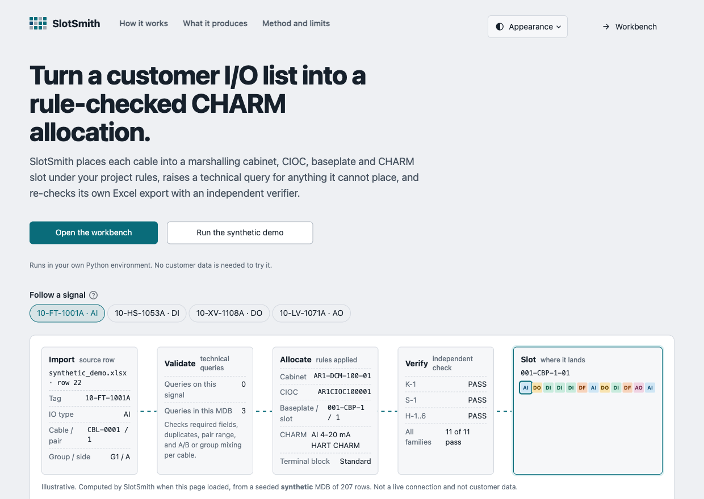
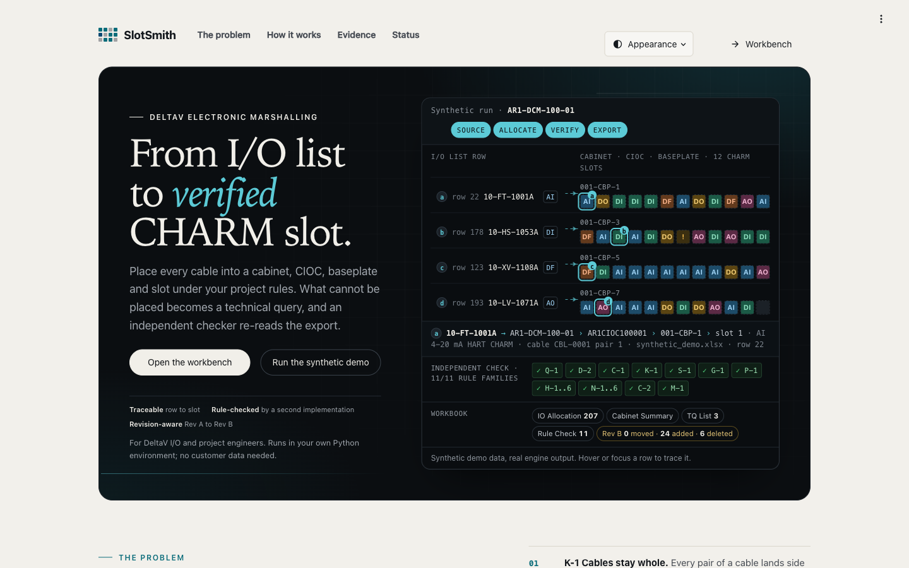
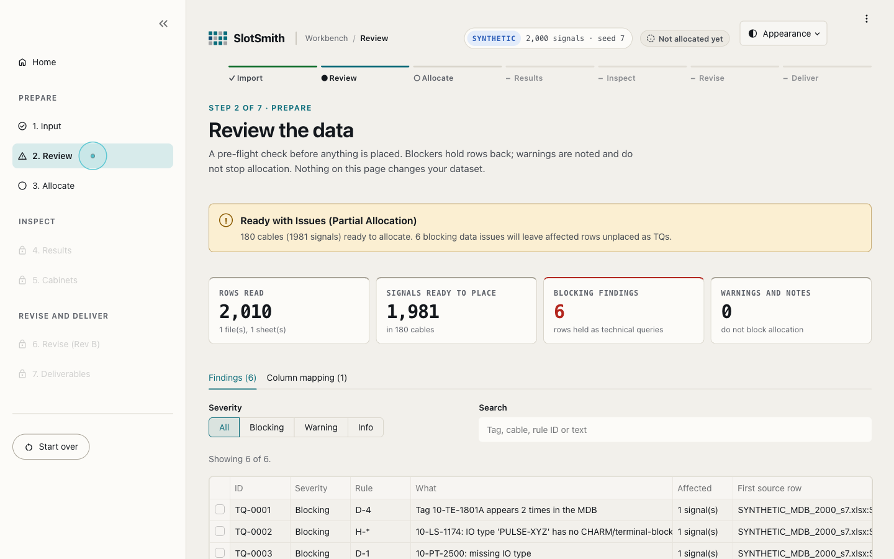
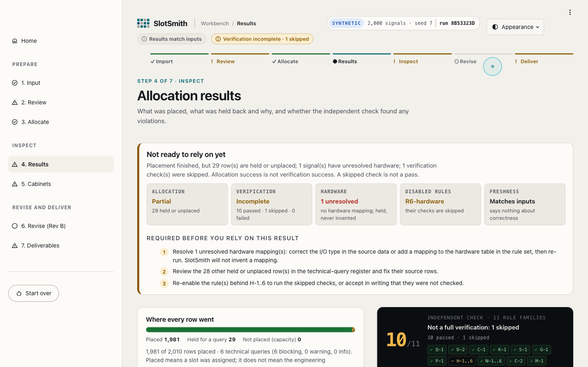
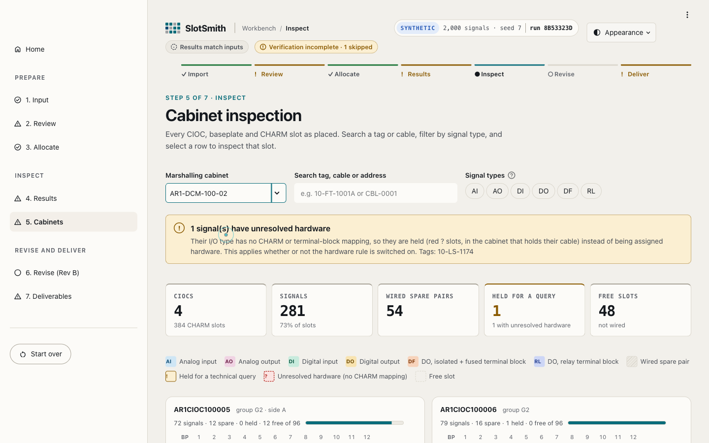
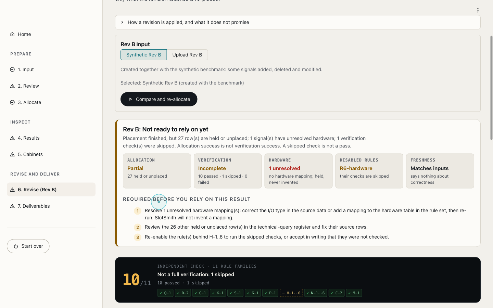
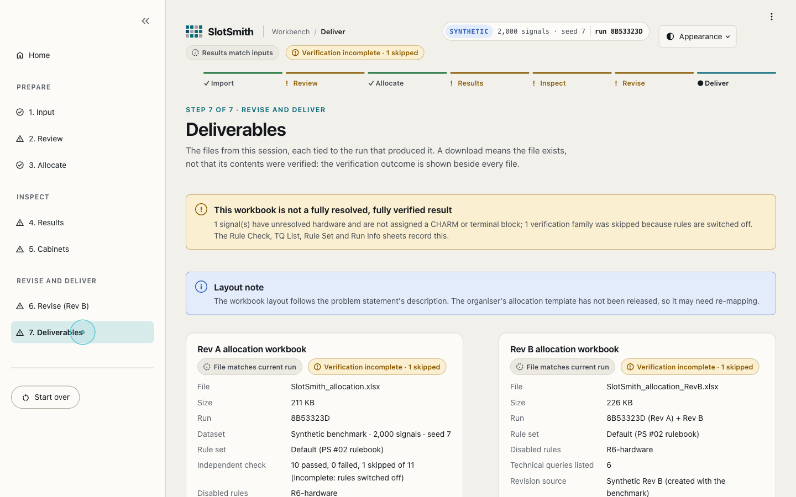
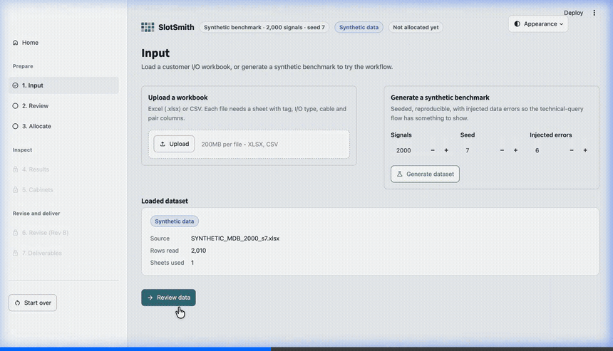
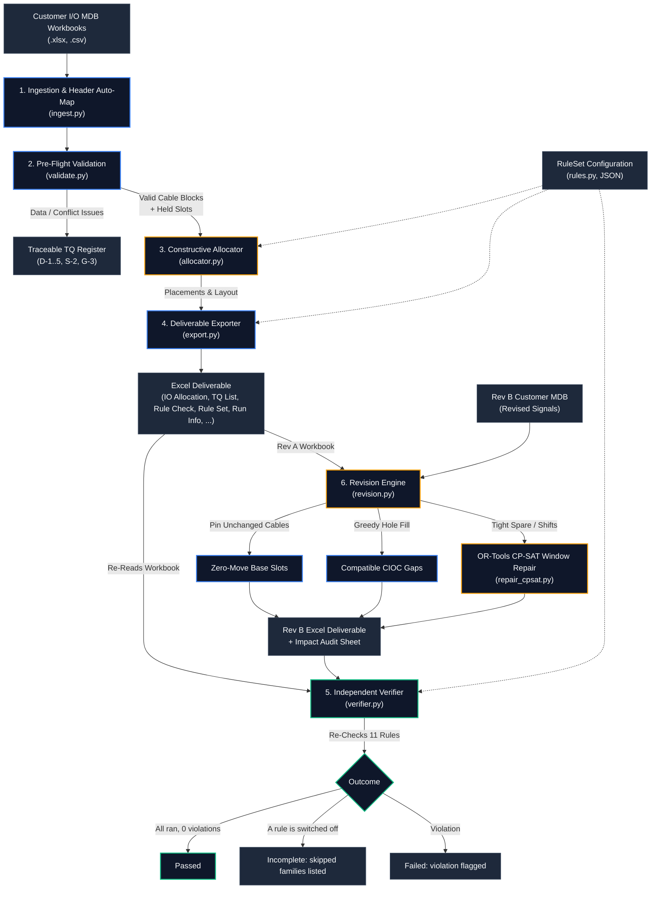
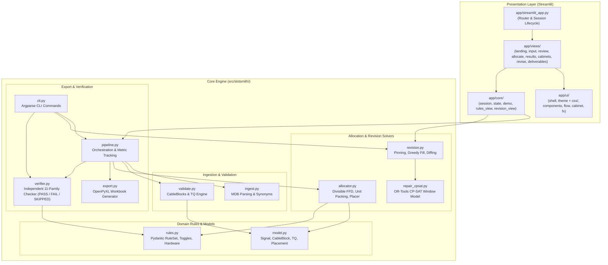

<div align="center">

# ⚡ SlotSmith

### Rule-Driven, Independently Checked, Revision-Aware DeltaV I/O Allocation

[](pyproject.toml)
[](https://developers.google.com/optimization)
[](app/streamlit_app.py)
[](tests/)
[](src/slotsmith/verifier.py)
[](deliverables/round1/SlotSmith_Round1.pdf)

**VIT Code Apex 3.0 · Track 1 (Emerson) · Problem Statement 1.2 "Project IO SIGNAL SUDOKU" · Team Mac_Enthu**

---

[At-a-Glance](#at-a-glance) •
[Product Showcase](#product-showcase) •
[Engineering Problem](#engineering-problem) •
[Features](#features) •
[Quick Start](#quick-start) •
[How It Works](#how-it-works) •
[Architecture](#architecture) •
[Allocation Algorithm](#allocation-algorithm) •
[Revision Repair](#revision-repair) •
[Verification & Testing](#verification-and-testing) •
[Benchmarks](#benchmarks) •
[Repository Map](#repository-map) •
[Developer Guide](#developer-guide) •
[Dossier & Deck](#dossier-and-deck) •
[Limitations](#limitations) •
[Roadmap](#roadmap) •
[Credits](#credits)

---

</div>

<div align="center">
  
  <p><em>SlotSmith engineering workbench: I/O ingestion, deterministic First-Fit-Decreasing allocation, independent verification, and revision repair.</em></p>
</div>

> [!NOTE]
> **Prototype Data Provenance Disclosure**  
> All benchmark results, timing profiles, and demonstrations in this repository were evaluated on **synthetic Instrument Master Databases (MDBs)** synthesized from the official competition rulebook via [`src/slotsmith/generator.py`](src/slotsmith/generator.py). The competition organizers did not publicly release sample customer MDBs or official Excel allocation templates. Consequently, passing tests and verification checks demonstrate consistency with our reading of the published rules, not compatibility with unreleased evaluation datasets. SlotSmith has not been certified, approved or validated by Emerson, the organisers or any third party.

---

## <a id="at-a-glance"></a>⚡ At-a-Glance

SlotSmith eliminates the high-friction manual spreadsheet puzzle of allocating industrial process control signals to **Emerson DeltaV™ Electronic Marshalling** hardware.

| Dimension | Manual Engineering Reality (Status Quo) | SlotSmith Solution | Verified Result |
|---|---|---|---|
| **Signal Placement** | 10,000+ signals manually mapped in Excel across multi-core cables, baseplates, and CIOCs | Deterministic First-Fit-Decreasing (FFD) packing preserving cable integrity and pair ordering | **20,033 signals allocated, exported and re-verified in 5.99 s** (median of 3 synthetic runs, Apple M5) |
| **Constraint Enforcement** | Complex, error-prone manual checking for A/B segregation, group boundaries, and 10–20% spare space | Automated constraint propagation with configurable JSON rule sets and hardware selection tables | **0 verifier violations** across the 12 recorded synthetic runs (500 to 20,000 signals) |
| **Data Integrity & TQs** | Duplicate tags, pair mismatches, and mixed-group cables discovered late | Pre-flight schema validation generating traceable Technical Queries (TQs) with `file:sheet:row` provenance | **81 of 81** injected synthetic errors flagged as TQs; every signal allocated or covered by a TQ |
| **Project Revisions (Rev B)** | Late client instrumentation changes trigger cascading manual reworks or from-scratch re-runs | Revision engine: pins unchanged cables, greedy hole fills, and solves localized OR-Tools CP-SAT window repairs | **429 moved signals vs. 49,805 from scratch** across 10 recorded synthetic revision cases |
| **Independent Re-check** | Manual visual inspection of spreadsheet columns | A verifier that shares no code with the allocator re-reads the exported workbook and re-checks 11 rule families | **11 rule families re-checked**; each is reported PASS, FAIL or SKIPPED, never silently passed |

---

## <a id="product-showcase"></a>🖥️ Product Showcase

SlotSmith pairs a Python constraint backend with a Streamlit workbench for DCS systems engineers, EPC instrumentation leads, and panel shop staff. The screenshots below were captured from the running application on **synthetic data** (the 2,000-signal demo benchmark with 6 injected data errors); they show the current seven-stage workbench: Import, Review, Allocate, Results, Inspect, Revise, Deliver.

### 1. Landing page
One page that explains the workflow, shows a small allocation computed by the real engine from a seeded synthetic MDB (labelled synthetic), and offers two entry points: open the workbench, or run the synthetic demo.
<div align="center">
  
  <p><strong>Figure 1:</strong> <em>Landing page. The preview is real engine output on synthetic data, not customer data.</em></p>
</div>

---

### 2. Pre-flight review (stage 2)
Upload `.xlsx` or `.csv` workbooks. Columns are matched by name and similarity (0.8 threshold). Findings are listed with severity, affected tags and cables, source rows, and a recommended fix; blockers hold rows back, warnings do not.
<div align="center">
  
  <p><strong>Figure 2:</strong> <em>Review: readiness, blocking findings and warnings, and the findings register.</em></p>
</div>

---

### 3. Results with an honest outcome (stage 4)
The screenshot is a synthetic run with R6 switched off. Results lead with one verdict, then show separate facts: allocation completeness, verification outcome (counts of passed, failed and skipped rule families), unresolved hardware, disabled rules and freshness, followed by the actions required before the result can be relied on. A partial allocation is never shown as complete, and a skipped check is never shown as passed.
<div align="center">
  
  <p><strong>Figure 3:</strong> <em>Results: placed, held and unplaced rows, plus the independent verification readout.</em></p>
</div>

---

### 4. Cabinet inspection (stage 5)
CIOCs, baseplates and CHARM slots as placed, with search, signal-type filter and per-slot details. Signal-type colours are SlotSmith's own palette, each with a two-letter code. Held and unresolved-hardware slots have their own marks.
<div align="center">
  
  <p><strong>Figure 4:</strong> <em>Cabinet inspection: slot grid, legend and selected-slot details.</em></p>
</div>

---

### 5. Revision repair (stage 6)
Rev B is compared with Rev A: unchanged cables stay in their slots, and the report lists moved, added, deleted and modified-in-place signals. The page states what is preserved and what needs attention.
<div align="center">
  
  <p><strong>Figure 5:</strong> <em>Revision repair: change breakdown and verification counts for Rev B.</em></p>
</div>

---

### 6. Deliverables (stage 7)
Rev A and Rev B workbooks with run identifier, dataset, rule set, verification summary, disabled rules and unresolved-hardware count. Downloads are disabled when the results are out of date.
<div align="center">
  
  <p><strong>Figure 6:</strong> <em>Deliverables: workbook cards with run identifier and verification status.</em></p>
</div>

---

### 7. Earlier workflow recording
The animation below was recorded with an earlier iteration of the interface (before the current seven-stage layout); the engine behaviour it shows is unchanged.
<div align="center">
  
  <p><strong>Figure 7:</strong> <em>End-to-end session recorded with an earlier interface iteration.</em></p>
</div>

---

### Hardware model
SlotSmith models the hardware structure given in the problem statement: 12 CHARM slots per baseplate, 8 baseplates per CIOC, 4 CIOCs per marshalling cabinet. These capacities are configurable project parameters, not statements about vendor hardware limits. The CHARM and terminal-block table is a SlotSmith reading of the problem statement and has not been checked against Emerson documentation by the vendor.

---

## <a id="engineering-problem"></a>🏭 The Engineering Problem

In modern process automation facilities (refineries, chemical plants, offshore platforms), 10,000 to 50,000 field instruments must connect to a Distributed Control System (DCS). Historically, this required cross-marshalling cabinets—massive field enclosures with thousands of individual terminal blocks requiring manual cross-wiring.

**Emerson DeltaV Electronic Marshalling** simplified physical wiring by introducing single-channel **CHARacterization Modules (CHARMs)**:
- Any signal type (AI, AO, DI, DO, RTD, TC) can land on any channel.
- Each **CHARM Baseplate** holds **12 CHARMs** and **12 Terminal Blocks**.
- Each **CHARM I/O Card (CIOC)** carrier supports up to **8 Baseplates (96 channels)**.
- Each **Marshalling Cabinet** houses up to **4 CIOCs (384 channels / 32 baseplates)** (per competition project specification).

### The "I/O Signal Sudoku" Bottleneck
While electronic marshalling eliminated physical cross-wiring ("without lifting a wire"), the combinatorial burden shifted into spreadsheet engineering. Systems engineers must allocate signals in Excel under strict industrial constraints:
1. **Cable Block Contiguity (Rule K-1):** Multi-pair field cables (2, 6, 12, or 24 pairs) must land as contiguous blocks in strict pair order ($1 \dots N$). Unused pairs become wired spares occupying slots.
2. **Redundancy & Safety Segregation (Rule S-1):** Duty/standby or risk-area signals classified as **A** and **B** must never share a CIOC (or cabinet, if configured).
3. **Logical Process Grouping (Rule G-1):** Signals belonging to the same process unit or functional area must cluster into the fewest contiguous cabinets.
4. **Spare Headroom Reservation (Rule P-1):** Marshalling cabinets must reserve space for future plant expansion (e.g., 10–20% empty baseplates reserved per cabinet).
5. **Hardware Selection (Rule H-1..6):** Correct CHARMs (e.g., Isolated DO) and Terminal Blocks (e.g., Fused Injected Power, Relay Output) must match signal electrical characteristics.
6. **Revision Churn (Rule R-1..5):** Instrument databases evolve constantly during EPC design phases. A minor revision (adding 5% instruments, deleting 3%) typically forces engineers to re-run allocations from scratch, shifting thousands of previously assigned signals and invalidating published loop diagrams and wiring schedules.

SlotSmith automates this lifecycle with deterministic placement, an independent re-check of every export, and source-row traceability. Run times for the recorded synthetic benchmarks are listed under [Benchmarks](#benchmarks).

---

## <a id="features"></a>🧩 Feature Matrix

| Functional Area | Feature | Status | Architectural Implementation & Evidence |
|---|---|:---:|---|
| **Data Ingestion** | Header row auto-detection | **Built** | Scans top 15 rows for required column combinations ([`ingest.py`](src/slotsmith/ingest.py)) |
| | Synonym & fuzzy column mapping | **Built** | Sequence matcher ($\ge 0.8$ confidence) with canonical normalization ([`ingest.py`](src/slotsmith/ingest.py)) |
| | Provenance tracking | **Built** | Every signal preserves `file:sheet:row` origin through export ([`ingest.py`](src/slotsmith/ingest.py)) |
| **Validation & TQs** | Pre-flight data validation | **Built** | Detects duplicate tags, illegal pair indices, unknown types ([`validate.py`](src/slotsmith/validate.py)) |
| | Conflict detection | **Built** | Blocks mixed A/B cables (S-2) and mixed process groups (G-3); with the controlling rule switched off the cable is placed unsided/ungrouped, every signal keeps its own value, and a warning TQ records it. That off-switch behaviour is **our interpretation, not confirmed by the organiser** ([`validate.py`](src/slotsmith/validate.py)) |
| | Traceable Technical Queries (TQs) | **Built** | Categorized (blocking, warning, info) with rule IDs & source rows ([`validate.py`](src/slotsmith/validate.py)) |
| | Slot holding for blocked signals | **Built** | Reserves slots for blocked signals so valid cable pairs keep alignment ([`validate.py`](src/slotsmith/validate.py)) |
| **Allocation Solver** | Divisible-size First-Fit-Decreasing | **Built** | Optimal baseplate counts within divisible-size packing classes (proof sketch below) ([`allocator.py`](src/slotsmith/allocator.py)) |
| | Neutral cable top-up | **Built** | Neutral cables fill spare slots of A/B baseplates before opening new ones ([`allocator.py`](src/slotsmith/allocator.py)) |
| | Group contiguity & look-ahead | **Built** | Prevents group fragmentation across non-adjacent cabinets ([`allocator.py`](src/slotsmith/allocator.py)) |
| | Spare headroom reservation | **Built** | Enforces $\lceil \text{spare\%} \times 32 \rceil$ empty baseplates per cabinet ([`allocator.py`](src/slotsmith/allocator.py)) |
| **Verification** | Independent 11-family verifier | **Built** | Does not import the allocator or exporter; re-parses positions from the workbook; reports PASS, FAIL or SKIPPED per family ([`verifier.py`](src/slotsmith/verifier.py)) |
| | Unresolved hardware (fail closed) | **Built** | A signal whose I/O type has no CHARM/terminal-block mapping is held as a blocking `H-*` TQ whether or not R6 is enabled; no hardware is invented. **Interpretation not confirmed by the organiser** ([`validate.py`](src/slotsmith/validate.py)) |
| | Format & naming regex audit | **Built** | Validates DCS cabinet, controller, CIOC, and CBP naming strings ([`verifier.py`](src/slotsmith/verifier.py)) |
| **Revision Engine** | Rev A cable pinning | **Built** | Unchanged cables locked in place; zero moves for spare-pair additions ([`revision.py`](src/slotsmith/revision.py)) |
| | Greedy hole filling | **Built** | Placed into available CIOC gaps adhering to group & spare rules ([`revision.py`](src/slotsmith/revision.py)) |
| | OR-Tools CP-SAT window repair | **Built** | Solves minimum-move window optimization with Rev A hints ([`repair_cpsat.py`](src/slotsmith/repair_cpsat.py)) |
| | Revision impact analysis | **Built** | Audits Added, Deleted, Moved, Modified in place, and Cabinets hit ([`revision.py`](src/slotsmith/revision.py)) |
| **Export & Deliverables** | Excel workbook (6 sheets for Rev A, 7 with `Revision Impact` for Rev B) | **Built** | `IO Allocation`, `Cabinet Summary`, `TQ List`, `Rule Check`, `Rule Set`, `Run Info`; the layout follows the problem statement because the organiser template was not released ([`export.py`](src/slotsmith/export.py)) |
| **User Interface** | 7-stage workbench | **Built** | Import $\to$ Review $\to$ Allocate $\to$ Results $\to$ Inspect $\to$ Revise $\to$ Deliver, with a landing page ([`streamlit_app.py`](app/streamlit_app.py), [`app/views/`](app/views/)) |
| | Cabinet inspection map | **Built** | CIOC / baseplate / slot grid with search, filters and slot details ([`app/ui/cabinet.py`](app/ui/cabinet.py), [`app/views/cabinets.py`](app/views/cabinets.py)) |
| | Stale-result detection | **Built** | SHA-256 fingerprints of rules and input mark results out of date ([`app/core/state.py`](app/core/state.py), [`app/core/session.py`](app/core/session.py)) |
| **Assumptions & Scope** | Cable straddling across baseplates | **Partial** | Allocator never straddles; `allow_cable_straddle` only relaxes verifier ([`known_limitations.md`](docs/known_limitations.md)) |
| | Open-ended rule creation | **Partial** | Existing parameters live in JSON/UI; new rule types require code ([`known_limitations.md`](docs/known_limitations.md)) |
| | AI Assistive Helpers | **Planned** | LLM column mapping suggestions & TQ wording; not implemented ([`docs/architecture.md`](docs/architecture.md)) |

---

## <a id="quick-start"></a>🚀 Quick Start

### 1. Prerequisites
- **Python:** Version `3.11` or higher (tested on Python `3.12.13`).
- **Operating System:** macOS, Linux, or Windows (WSL recommended).
- **Environment:** Clean Python virtual environment recommended.

### 2. Installation
Clone the repository and install with all development and UI dependencies:

```bash
# Clone the repository
git clone https://github.com/Sidd927/SlotSmith.git
cd SlotSmith

# Create and activate a clean virtual environment
python3 -m venv .venv
source .venv/bin/activate  # On Windows: .venv\Scripts\activate

# Install SlotSmith in editable mode with dev and UI dependencies
pip install -e ".[dev,ui]"
```

Verify installation:
```bash
slotsmith --help
pytest -q
```
*(The suite runs in well under a minute on a laptop; the exact test count changes as tests are added, so none is quoted here.)*

---

### 3. Launching the Interactive Web Workstation

Launch the Streamlit engineering interface locally:

```bash
streamlit run app/streamlit_app.py
```
Open your browser at `http://localhost:8501`.

**Guided initial workflow:**
1. On the landing page, click **Run the synthetic demo** (generates a 2,000-signal synthetic workbook and opens **Review**) or **Open the workbench** to import your own `.xlsx` or `.csv` file on the **Import** stage.
2. **Review**: inspect readiness, the column mapping and the findings (blockers hold rows back; warnings do not).
3. **Allocate**: adjust the spare percentage or the grouping and A/B separation rules, then click **Allocate**.
4. **Results**: read the outcome banner, the four separate facts (allocation, technical queries, verification counts, disabled rules) and the technical-query register.
5. **Inspect**: search the cabinet map and select a slot for its details.
6. **Revise**: apply a Rev B (synthetic or uploaded) to compare against Rev A.
7. **Deliver**: download the Rev A and Rev B workbooks and the rule set when they are current.

---

### 4. Common Setup Troubleshooting
- **Port Conflict (`Port 8501 is not available`):**  
  Run on an alternate port:
  ```bash
  streamlit run app/streamlit_app.py --server.port=8502
  ```
- **Headless / Sandbox Environments:**  
  If running on a remote server or in containerized CI environments without interactive TTY:
  ```bash
  STREAMLIT_SERVER_HEADLESS=true streamlit run app/streamlit_app.py
  ```
- **Missing Build Dependencies:**  
  Ensure `setuptools>=68` and `wheel` are installed in your virtual environment before running `pip install -e .`.

---

## <a id="how-it-works"></a>⚙️ How It Works

The SlotSmith end-to-end pipeline enforces strict data contracts at every transition:



---

## <a id="architecture"></a>🏛️ System Architecture

SlotSmith follows a layered, decoupled architecture designed for verification independence and computational determinism:



### Module Responsibilities & Verification Boundary
1. **[`src/slotsmith/ingest.py`](src/slotsmith/ingest.py):** Reads `.xlsx` and `.csv` workbooks (legacy `.xls` is not supported), scans for candidate header rows, executes deterministic fuzzy synonym matching (0.8 threshold), and attaches `file:sheet:row` provenance.
2. **[`src/slotsmith/validate.py`](src/slotsmith/validate.py):** Validates raw signals, groups signals into multi-pair `CableBlock` structures, detects conflicts (mixed A/B, mixed groups, invalid pairs), and reserves slots for blocked signals ("Held for TQ") so companion pairs keep aligned positions.
3. **[`src/slotsmith/rules.py`](src/slotsmith/rules.py):** Defines the typed, pydantic-validated `RuleSet` schema with parameter toggles for R1 (Grouping), R2 (Segregation), R3 (Capacity), R4 (Cables), R5 (Spare), R6 (Hardware), and R7 (Naming).
4. **[`src/slotsmith/allocator.py`](src/slotsmith/allocator.py):** Executes constructive First-Fit-Decreasing channel packing into 12-channel baseplates. Groups are laid out contiguously into CIOCs and cabinets via look-ahead placement.
5. **[`src/slotsmith/verifier.py`](src/slotsmith/verifier.py):** **Deliberately imports only `rules.py`, nothing from the allocator or exporter.** Re-reads the generated workbook file from disk, parses physical coordinates back out of string names using regular expressions, and re-checks 11 rule families independently. Each family is reported PASS, FAIL, or SKIPPED (its controlling rule is switched off).
6. **[`src/slotsmith/revision.py`](src/slotsmith/revision.py) & [`src/slotsmith/repair_cpsat.py`](src/slotsmith/repair_cpsat.py):** Implements minimal-perturbation revision repair for Rev B. Pins unchanged cables, attempts greedy hole fills, and invokes Google OR-Tools CP-SAT over a sliding cabinet window to minimize moved signals.
7. **[`src/slotsmith/export.py`](src/slotsmith/export.py):** Emits an OpenPyXL workbook with `IO Allocation`, `Cabinet Summary`, `TQ List`, `Rule Check`, `Rule Set` and `Run Info` (plus `Revision Impact` for Rev B). `Rule Set` lists every rule switch as ON/OFF and `Run Info` records disabled switches, verification counts and unresolved-hardware queries.

---

## <a id="allocation-algorithm"></a>📐 Allocation Algorithm & Provable Packing

### Plain-Language Summary
In electronic marshalling, multi-pair field cables (2, 6, 12, or 24 pairs) must be placed without breaking pairs across non-adjacent slots. SlotSmith treats each multi-pair cable as a rigid block of consecutive channels. It groups cables by process area and safety segregation side (A, neutral, B), sorts them largest-to-smallest, and places each cable into the first baseplate that has sufficient room. Neutral cables top up remaining slots before new baseplates are opened.

---

### Technical Explanation & Proof of Optimality

#### Bin Packing with Divisible Item Sizes
Consider a single packing class (fixed logical group and segregation side). Standard cable sizes belong to the set:
$$\mathcal{S} = \{2, 6, 12\}$$
*(A 24-pair cable spans exactly two full 12-channel baseplates in the same CIOC and is handled as a 2-baseplate atomic unit).*

Notice that $\mathcal{S}$ forms a **divisible chain**:
$$2 \mid 6 \quad \text{and} \quad 6 \mid 12$$
Furthermore, the baseplate channel capacity $C = 12$ is an exact integer multiple of every item size in $\mathcal{S}$.

**Theorem (FFD Optimality on Divisible Sizes):**  
Let item sizes belong to $\mathcal{S} = \{2, 6, 12\}$ and let bin capacity $C = 12$. First-Fit-Decreasing (FFD) uses exactly:
$$\left\lceil \frac{\sum_{i} s_i}{C} \right\rceil \text{ bins}$$
which achieves the theoretical trivial lower bound and is therefore **strictly optimal** (Coffman, Garey & Johnson 1987).

**Proof Sketch:**
1. FFD places items in non-increasing order of size ($12 \to 6 \to 2$).
2. Consider the placement of an item of size $s \in \mathcal{S}$. Every item previously placed has size $s' \ge s$, and because $\mathcal{S}$ is a divisible chain, $s \mid s'$.
3. Because $s \mid C$ and $s \mid s'$, the used space in every open bin is an integer multiple of $s$.
4. Consequently, the remaining free space in any open bin is also an integer multiple of $s$.
5. Any open bin with non-zero free space must possess at least $s$ free slots. Thus, FFD never opens a new bin while an existing bin has non-zero free space.
6. At termination, all bins except possibly the final bin are 100% full. Therefore, the number of bins equals $\lceil \sum s_i / C \rceil$. $\blacksquare$

#### Verified Scope & Audit Reconciliations
- **Mathematically Proven:** Within any single segregation class whose cable sizes belong to $\{2, 6, 12\}$ (plus 24-pair whole-baseplate units), FFD provably achieves the minimum baseplate count.
- **Empirically Verified at Group Level:** In practical plant groups, unsegregated (neutral) cables first top up remaining slots on A and B baseplates before opening neutral baseplates. Because neutral items may not divide the remaining free space left by mixed A/B items, the proof does not strictly transfer to the top-up step.  
  However, extensive solver audits verified that the group total matched the exact integer programming minimum:
  - **19,682 of 19,682 exhaustive small instances** (0–2 cables of each side and size) matched an exact CP-SAT solver with **0 excess baseplates** ([`artifacts/audit/ffd_exact.json`](artifacts/audit/ffd_exact.json)).
  - **150 of 150 random larger groups** matched exact solver lower bounds (148 proven OPTIMAL, 2 FEASIBLE at timeout, allocator never worse) ([`artifacts/audit/lb_gap.json`](artifacts/audit/lb_gap.json)).
  - **12 of 12 benchmark runs (500 to 20,000 signals)** used exactly zero baseplates above the theoretical per-group minimum ([`artifacts/benchmarks.json`](artifacts/benchmarks.json)).
- **What Is Not Claimed as Optimal:** Minimum cabinet or CIOC counts are **not** claimed to be globally minimal, as cabinet boundaries also depend on group isolation, CIOC carrier limits, and project spare budgets. Non-standard cable sizes (e.g. 4, 8, 16 pairs) are packed by the same code without the divisibility optimality proof.

---

## <a id="revision-repair"></a>🔄 Revision-Aware Repair

During plant design, revisions to the Instrument Master Database (Rev B) are frequent. A standard from-scratch re-allocation on a revised database churns thousands of previously committed signal coordinates.

### The Minimal-Perturbation Engine
SlotSmith implements a minimal-perturbation repair workflow inspired by constraint programming work (Barták et al. 2004). It reports how many signals moved; it does not claim a globally minimal result:

1. **Tag & Cable Diffing:** Signals are matched by Tag primary key and classified into `Added`, `Deleted`, `Moved`, `Modified in Place` (e.g., CHARM or terminal block swapped in the same slot), or `Unchanged`.
2. **Cable Pinning:** Any cable whose size, logical group, and segregation side match Rev A is **pinned** to its exact Rev A physical coordinates. Signals added on the cable's existing wired spare pairs land with **zero moves**. Deleted signals revert to spare pairs.
3. **Greedy Hole Filling:** New or modified cables are placed into available slots, evaluating:
   - Existing free slots in compatible CIOCs of the group's assigned cabinets.
   - Empty baseplates, provided the cabinet's reserved spare headroom is respected.
   - New CIOC positions within existing cabinets.
   - A newly opened cabinet, preserving logical group contiguity.
4. **OR-Tools CP-SAT Window Repair:** If greedy filling fails (e.g., all group cabinets have reached their spare headroom limit), SlotSmith invokes Google OR-Tools CP-SAT across a localized cabinet window:
   - **Decision Variables:** Boolean indicators $x_{c, q, b, s}$ for candidate start positions of each cable in the window. Starts are aligned to multiples of cable size.
   - **Hard Constraints:** Slot exclusivity, cabinet spare headroom, CIOC A/B segregation, CIOC group isolation, and cross-cabinet group contiguity against fixed external cabinets.
   - **Mobility Bound:** Existing cables in the window may move at most $\pm 1$ cabinet away from their Rev A location.
   - **Objective Function:**
     $$\min \quad 1000 \times (\text{moved signals}) + \sum (\text{baseplates used})$$
     Rev A positions are provided to CP-SAT as solution hints.
   - **Solver Settings:** 10-second wall-clock limit, 5% relative optimality gap, 8 worker threads.
5. **Fallback Safety Guard:** If the CP-SAT window model fails or returns infeasible, SlotSmith falls back to a full from-scratch re-allocation, raises a warning TQ, and flags the fallback in run metrics (0 fallbacks occurred across all 10 benchmark cases).

---

## <a id="verification-and-testing"></a>🔍 Verification & Testing

### The Independent Verifier Architecture
SlotSmith follows the idea of **certifying algorithms** (McConnell et al. 2011; an algorithm-theory term, not an external certification of SlotSmith). A bug in an allocation algorithm can easily be mirrored in its internal validation checks if they share data structures. To eliminate this risk:
- [`src/slotsmith/verifier.py`](src/slotsmith/verifier.py) imports **only** [`rules.py`](src/slotsmith/rules.py).
- It re-reads the output Excel file from disk and parses slot addresses back from generated names (`001-CBP-1-05` $\to$ Baseplate 1, Slot 5).
- It independently verifies 11 distinct rule families:

| Check ID | Verification Rule | Verifier Check Method |
|---|---|---|
| **Q-1** | Signal Completeness | Partitions all MDB signals into placed or blocked with a valid TQ reference |
| **D-2** | Slot Exclusivity | Verifies no physical CHARM slot holds more than one signal |
| **C-1** | Physical Capacity | Checks $\le 12$ CHARMs/baseplate, $\le 8$ baseplates/CIOC, $\le 4$ CIOCs/cabinet |
| **K-1** | Cable Integrity | Verifies all pairs of a cable land consecutively in exact pair order $1 \dots N$ |
| **S-1** | A/B Segregation | Verifies A and B segregation sides never share a CIOC (or cabinet if configured); SKIPPED when R2 is off |
| **G-1** | Group Isolation | Verifies process groups do not interleave and span contiguous cabinets; SKIPPED when R1 is off or isolation is `none` |
| **P-1** | Spare Room | Audits that every cabinet reserves $\ge \lceil \text{spare\%} \times 32 \rceil$ empty baseplates |
| **H-1..6** | Hardware Matching | Re-derives CHARM and terminal block from signal type against hardware table (SKIPPED when R6 is off) |
| **N-1..6** | Naming Compliance | Regex match against user-defined naming format strings (Area, Unit, Seq) |
| **C-2** | Controller Limits | Verifies CIOC controller assignments and respects max CIOCs per controller |
| **M-1** | Attribute Integrity | Validates that allocated row attributes exactly match input MDB columns |

#### Verification states and exit codes
- **PASS** the check ran and found nothing; **FAIL** it ran and found a violation; **SKIPPED** it was not run because its controlling rule is switched off. A skipped family is never reported as PASS.
- **Overall outcome:** `passed` (all 11 ran and passed), `failed` (any violation), or `incomplete` (nothing failed but a family was skipped). The application shows passed, failed and skipped counts separately and does not claim "all passed" for an incomplete run.
- **CLI exit codes** (`allocate`, `verify`, `revise`): `0` passed, `2` at least one violation (takes precedence), `3` incomplete. `1` is left to argparse and uncaught errors.
- **Fail closed on hardware:** a placed signal without CHARM and terminal block is a Q-1 violation regardless of switches, and a signal with no hardware mapping is held as a blocking `H-*` technical query rather than allocated.
- **Not confirmed by the organiser:** what switching R6 (hardware) off should mean, and what a mixed A/B cable or mixed-group cable should do when R2/R1 is off. The behaviour above is the project's interpretation; see [`docs/known_limitations.md`](docs/known_limitations.md).

---

### Test Suite Execution
The suite combines unit tests, Hypothesis property tests, verifier mutation tests, CLI tests and headless Streamlit (AppTest) page tests. Run it from the repository root:

```bash
pytest -q
```

The test count is not quoted here because it changes with every commit; run the command for the current result. A passing suite shows the code agrees with its own requirements reading, on synthetic data; it is not an external validation.

**Test files:**
- [`tests/test_core.py`](tests/test_core.py): FFD packing, row-level TQ generation, verifier mutation detection (double-booked slots, wrong terminal blocks, A/B mix, cable splitting), property tests across random MDBs, rule-set changes without code changes, revision pin preservation.
- [`tests/test_audit_regressions.py`](tests/test_audit_regressions.py): regression guards from the 10 Oct audit.
- [`tests/test_hardware_switch.py`](tests/test_hardware_switch.py): R6 enabled and disabled, unresolved hardware, SKIPPED versus PASS, workbook metadata read back from real files, revision with unresolved rows.
- [`tests/test_mixed_cable.py`](tests/test_mixed_cable.py): mixed A/B and mixed-group cables with the rule off (deterministic across `PYTHONHASHSEED`, per-signal values preserved, M-1 not suppressed).
- [`tests/test_cli_verification.py`](tests/test_cli_verification.py): CLI exit codes 0, 2 and 3 and the printed outcome line.
- [`tests/test_ui_core.py`](tests/test_ui_core.py), [`tests/test_ui_components.py`](tests/test_ui_components.py), [`tests/test_ui_app.py`](tests/test_ui_app.py), [`tests/test_ui_redesign.py`](tests/test_ui_redesign.py): fingerprints and stale-result state machines, design-token contrast, HTML escaping, page rendering and journeys.

Browser-level behaviour (layout, motion, keyboard use, narrow screens) is checked manually and is not covered by automated tests.

---

## <a id="benchmarks"></a>📊 Benchmarks & Empirical Evidence

All measurements below were recorded on an **Apple M5 (10-core, 16 GB RAM) running macOS 27.0 with Python 3.12.13** on synthetic Instrument Master Databases generated from the official competition rulebook.

> [!IMPORTANT]
> **Measurement Conditions:** Default rule set applied (10% spare headroom, CIOC-level A/B segregation, CIOC-level process group isolation). All scale runs were executed across 3 random seeds. Exact logs and artifacts are preserved in [`artifacts/benchmarks.json`](artifacts/benchmarks.json) and [`artifacts/audit/`](artifacts/audit/).

### 1. Scaling Performance & Correctness (Scale Benchmark)

| Nominal Signals | Actual Rows | Allocated | TQs | Coverage | Cabinets | Baseplates Used | Baseplate Bound | Verifier Violations | Ingest (s) | Alloc (s) | Export (s) | Verify (s) | Total Wall Time (s) |
|:---:|:---:|:---:|:---:|:---:|:---:|:---:|:---:|:---:|:---:|:---:|:---:|:---:|:---:|
| **500** | 502 | 502 | 0 | 100.0% | 2 | 51 | 51 | **0** | 0.016 | 0.000 | 0.046 | 0.098 | **0.17 s** |
| **500** | 508 | 508 | 0 | 100.0% | 2 | 52 | 52 | **0** | 0.015 | 0.000 | 0.049 | 0.097 | **0.17 s** |
| **500** | 517 | 517 | 0 | 100.0% | 2 | 53 | 53 | **0** | 0.015 | 0.000 | 0.049 | 0.101 | **0.17 s** |
| **2,000** | 2,002 | 2,002 | 0 | 100.0% | 8 | 203 | 203 | **0** | 0.058 | 0.001 | 0.144 | 0.392 | **0.62 s** |
| **2,000** | 2,016 | 2,016 | 0 | 100.0% | 8 | 201 | 201 | **0** | 0.044 | 0.001 | 0.142 | 0.374 | **0.58 s** |
| **2,000** | 2,011 | 2,011 | 0 | 100.0% | 9 | 203 | 203 | **0** | 0.043 | 0.001 | 0.142 | 0.372 | **0.58 s** |
| **10,000** | 10,031 | 10,031 | 0 | 100.0% | 40 | 1,000 | 1,000 | **0** | 0.227 | 0.005 | 0.748 | 1.895 | **3.00 s** |
| **10,000** | 10,027 | 10,027 | 0 | 100.0% | 39 | 996 | 996 | **0** | 0.204 | 0.006 | 0.741 | 1.836 | **2.96 s** |
| **10,000** | 10,010 | 10,010 | 0 | 100.0% | 40 | 997 | 997 | **0** | 0.255 | 0.006 | 0.730 | 1.898 | **3.01 s** |
| **20,000** | 20,033 | 20,033 | 0 | 100.0% | 79 | 1,996 | 1,996 | **0** | 0.471 | 0.012 | 1.538 | 3.703 | **5.99 s** |
| **20,000** | 20,003 | 20,003 | 0 | 100.0% | 79 | 1,991 | 1,991 | **0** | 0.466 | 0.013 | 1.620 | 3.690 | **6.06 s** |
| **20,000** | 20,003 | 20,003 | 0 | 100.0% | 78 | 1,991 | 1,991 | **0** | 0.443 | 0.012 | 1.525 | 3.723 | **5.98 s** |

- **Zero violations:** 0 verifier rule violations across all 12 recorded runs (synthetic data, default rule set).
- **Baseplate count:** In all 12 recorded runs, baseplates used equaled the per-group exact bound recorded in `exact_bp_per_group` (0 excess; maximum excess over the simple lower bound was 2).
- **Execution speed:** 20,033 signals allocated, written to Excel, and re-verified in **5.99 seconds** (median wall time of the three 20,000-signal runs; allocation itself took about 12 ms).

---

### 2. TQ Error Detection & Recall
Tested across 3 seeds with 27 injected synthetic data errors per dataset (missing tags, invalid pair numbers, duplicate tags, mixed A/B cables, mixed groups). The injected error kinds are the ones the validator was written to detect, so this measures the validator against its own error catalogue, not against real customer data:
- **Errors injected:** 81 across 3 runs.
- **Errors detected as technical queries:** **81 of 81**.
- **Signal coverage:** 100.0% (every signal allocated or covered by an explicit TQ).

---

### 3. Revision Churn Minimization (Rev B Benchmark)

Evaluated across 10 distinct revision cases (5 cases at 2,000 signals, 5 cases at 10,000 signals):

| Dataset Scale | Seed | Added | Deleted | Modified | Moved (SlotSmith Incremental) | Moved (From-Scratch Re-Run) | Churn Reduction | CP-SAT Repair Used | Fallback | Revise Time (s) |
|:---:|:---:|:---:|:---:|:---:|:---:|:---:|:---:|:---:|:---:|:---:|
| **2,000** | 1 | 100 | 60 | 26 | **53** | 1,287 | **-95.9%** | Yes (1 optimal) | No | 13.48 s |
| **2,000** | 2 | 100 | 60 | 25 | **11** | 883 | **-98.8%** | No (greedy fill) | No | 0.05 s |
| **2,000** | 3 | 116 | 60 | 30 | **4** | 1,728 | **-99.8%** | No (greedy fill) | No | 0.05 s |
| **2,000** | 4 | 117 | 60 | 32 | **50** | 1,157 | **-95.7%** | Yes (1 feasible) | No | 30.99 s |
| **2,000** | 5 | 101 | 60 | 31 | **66** | 1,095 | **-94.0%** | Yes (1 feasible) | No | 30.89 s |
| **10,000** | 1 | 507 | 300 | 142 | **50** | 9,070 | **-99.4%** | Yes (1 feasible) | No | 15.42 s |
| **10,000** | 2 | 501 | 300 | 154 | **9** | 8,535 | **-99.9%** | No (greedy fill) | No | 0.28 s |
| **10,000** | 3 | 500 | 300 | 137 | **115** | 7,252 | **-98.4%** | Yes (2 optimal, 1 feasible) | No | 53.87 s |
| **10,000** | 4 | 504 | 300 | 146 | **44** | 9,166 | **-99.5%** | Yes (3 optimal) | No | 33.77 s |
| **10,000** | 5 | 500 | 300 | 144 | **27** | 9,632 | **-99.7%** | Yes (1 optimal) | No | 2.65 s |
| **Total (10 cases)** | — | **3,046** | **1,800** | **867** | **429 moves** | **49,805 moves** | **-99.1% overall** | — | **0 / 10** | **Worst: 53.87 s** |

- **Churn reduction:** In case 10k-1, SlotSmith moved **50 signals** versus **9,070** moved by a from-scratch re-run. These are synthetic revisions generated by `generator.make_revision`; real revisions may behave differently.
- **Run-to-run variance:** OR-Tools CP-SAT runs with 8 worker threads under a 10-second wall-clock limit, so move counts can differ between runs of the same input. The table is the single run recorded in `artifacts/benchmarks.json`.
- **Local optimality of repair windows:** Across 11 accepted CP-SAT windows, **7 were proven exact** (`OPTIMAL`) and 4 were accepted as `FEASIBLE` at the time limit ([`artifacts/audit/revision_status.json`](artifacts/audit/revision_status.json)). Global minimal movement is not guaranteed.

---

## <a id="repository-map"></a>🗺️ Repository Map

```
SlotSmith/
├── app/                                # Streamlit Interactive Frontend
│   ├── core/                           # State management, session, demo, & view models
│   ├── ui/                             # Design system: shell, theme tokens, css/ files, components, cursor script
│   ├── views/                          # Modular stage views (landing, review, allocate, etc.)
│   └── streamlit_app.py                # Main UI entry point & native router
├── artifacts/                          # Reproducible benchmark evidence & test outputs
│   ├── audit/                          # Bin-packing optimality audits & CP-SAT status logs
│   │   ├── ffd_exact.json              # 19,682-instance CP-SAT comparison audit
│   │   ├── lb_gap.json                 # 150-instance larger group lower-bound audit
│   │   └── revision_status.json        # 10-case Rev B solver window status breakdown
│   ├── repro/                          # Clean virtual-environment audit logs
│   ├── screenshots/                    # UI screenshot captures
│   └── benchmarks.json                 # Canonical benchmark measurements (Apple M5)
├── assets/                             # Visual and physical assets
│   └── landing/                        # Cabinet hardware photos and plant backgrounds
├── deliverables/                       # Hackathon competition deliverables
│   ├── pitch_deck/                     # Final audited presentation deliverables
│   │   ├── SlotSmith_Final_Pitch_Deck.pdf  # Final presentation deck (PDF format)
│   │   ├── SlotSmith_Final_Pitch_Deck.pptx # Editable PowerPoint deck
│   │   └── rendered/                   # High-res renders of deck slides
│   └── round1/                         # Round 1 screening submission package
│       ├── SlotSmith_Round1.pdf        # Round 1 presentation deck (PDF format)
│       ├── SlotSmith_Round1.pptx       # Round 1 presentation deck (PPTX format)
│       ├── presentation_qa.md          # Deck claim-to-evidence audit log
│       └── renders/                    # 110 DPI raster renders of slides 1–8
├── docs/                               # Engineering dossier, research, and rule books
│   ├── SlotSmith_Technical_Dossier.md  # Comprehensive technical dossier with evidence tags
│   ├── SlotSmith_Technical_Dossier.pdf # Formatted printable technical dossier
│   ├── UI_UX_AUDIT.md                  # UI/UX audit and external design references
│   ├── UI_UX_IMPLEMENTATION_REPORT.md  # What changed, what was tested, what was not
│   ├── ux/screens/                     # Screenshots captured from the running application
│   ├── architecture.md                 # System architecture, dataflow, and FFD proof
│   ├── emerson_product_analysis.md     # Emerson DeltaV hardware & software analysis
│   ├── known_limitations.md            # Documented boundaries & unverified assumptions
│   ├── literature_review.md            # Academic references (bin packing & revision repair)
│   ├── requirements.md                 # Problem statement requirements breakdown
│   ├── rule_register.md                # Engineering rule trace register (D, C, K, S, G, P, H, N, Q, R)
│   ├── source_register.md              # Primary sources & datasheets
│   ├── technology_decisions.md         # Architecture decision records (ADRs)
│   ├── audit/final_audit.md            # 10 Oct 2026 comprehensive evidence audit
│   └── assets/readme/                  # Earlier README screenshots (one animation still used)
├── scripts/                            # Automation, benchmarking, and deck builders
│   ├── benchmark.py                    # Benchmark generation script
│   ├── build_deck.py                   # Scripted PowerPoint slide deck compiler
│   └── repro_clean.sh                  # Clean virtualenv reproduction driver script
├── src/slotsmith/                      # Core Python engineering package
│   ├── __init__.py                     # Version declaration (0.1.0)
│   ├── allocator.py                    # Constructive FFD allocator & Placer engine
│   ├── cli.py                          # Command-line interface entry points
│   ├── export.py                       # OpenPyXL Excel deliverable builder
│   ├── generator.py                    # Synthetic MDB generator with error injection
│   ├── ingest.py                       # Column auto-mapping & header detection
│   ├── model.py                        # Core domain dataclasses (Signal, CableBlock, TQ, etc.)
│   ├── pipeline.py                     # End-to-end execution pipeline
│   ├── repair_cpsat.py                 # OR-Tools CP-SAT window repair model
│   ├── revision.py                     # Minimal-perturbation revision repair engine
│   ├── rules.py                        # Typed Pydantic RuleSet & hardware table
│   ├── validate.py                     # Pre-flight data validation & TQ generator
│   └── verifier.py                     # Independent 11-family verifier (PASS / FAIL / SKIPPED)
├── tests/                              # Automated test suite
│   ├── test_core.py                    # Engine unit, property-based, & verifier tests
│   ├── test_audit_regressions.py       # Bug regression guards from 10 Oct audit
│   ├── test_hardware_switch.py         # R6 / unresolved hardware / SKIPPED verification
│   ├── test_mixed_cable.py             # Mixed A/B and mixed-group cables with a rule off
│   ├── test_cli_verification.py        # CLI exit codes and outcome line
│   └── test_ui_*.py                    # Fingerprints, design tokens, components, page journeys
├── design.md                           # Design system and interaction principles
├── CHANGELOG.md                        # Version release history
├── pyproject.toml                      # Project dependencies & package configuration
├── requirements.lock.txt               # Fully pinned reproducible environment lockfile
└── README.md                           # Project documentation homepage
```

---

## <a id="developer-guide"></a>🛠️ Developer Guide

SlotSmith provides both an interactive CLI and an automated test suite.

### 1. Command-Line Interface (CLI)

The package installs a top-level `slotsmith` binary:

```bash
# Display default rule set as formatted JSON
slotsmith rules

# Generate a synthetic customer MDB (2,000 signals, 6 injected errors) and Rev B delta
slotsmith generate --signals 2000 --errors 6 --out data/synthetic/mdb.xlsx --rev-b data/synthetic/mdb_revB.xlsx

# Allocate field signals to DeltaV hardware
slotsmith allocate data/synthetic/mdb.xlsx --out artifacts/alloc.xlsx

# Independently verify an allocation workbook against an MDB
slotsmith verify artifacts/alloc.xlsx --mdb data/synthetic/mdb.xlsx

# Execute minimal-move revision repair for Rev B
slotsmith revise --prev artifacts/alloc.xlsx --mdb data/synthetic/mdb_revB.xlsx --out artifacts/alloc_revB.xlsx
```

**Exit codes** (`allocate`, `verify`, `revise`): `0` every verification family ran and found no violation; `2` at least one violation (takes precedence); `3` no violation, but verification is *incomplete* because a family was SKIPPED (its rule is switched off); the outcome line is printed (stderr for `allocate`/`revise`, stdout for `verify`). `1` is left to argparse and uncaught errors.

---

### 2. Running Benchmarks
Reproduce the canonical benchmark suite recorded in [`artifacts/benchmarks.json`](artifacts/benchmarks.json):

```bash
python scripts/benchmark.py
```
*(Executes 12 scale runs from 500 to 20,000 signals, 3 TQ recall runs, and 10 Rev B revision runs.)*

---

### 3. Clean-Environment Reproduction
To prove environment isolation, run the reproduction driver:

```bash
zsh scripts/repro_clean.sh
```
This script creates a fresh isolated sandbox in `/tmp/slotsmith_clean_*`, instantiates a new virtual environment, installs dependencies from [`requirements.lock.txt`](requirements.lock.txt), and executes both `pytest` and duplicate benchmark passes, logging results to `artifacts/repro/`.

---

## <a id="dossier-and-deck"></a>📑 Technical Dossier & Pitch Deck

Design documentation and competition deliverables available in the repository:

- 📖 **[SlotSmith Technical Dossier (Markdown)](docs/SlotSmith_Technical_Dossier.md):** design dossier with evidence classification tags (`[Impl]`, `[Test]`, `[Meas]`, `[Proof]`, `[Ext]`).
- 📄 **[SlotSmith Technical Dossier (PDF)](docs/SlotSmith_Technical_Dossier.pdf):** Complete printable reference document.
- 🎯 **[SlotSmith Final Pitch Deck (PDF)](deliverables/pitch_deck/SlotSmith_Final_Pitch_Deck.pdf):** Audited presentation deck.
- 📊 **[SlotSmith Final Pitch Deck (PPTX)](deliverables/pitch_deck/SlotSmith_Final_Pitch_Deck.pptx):** Editable PowerPoint format.
- 📄 **[SlotSmith Round 1 Presentation Deck (PDF)](deliverables/round1/SlotSmith_Round1.pdf):** Official 8-slide presentation submitted for Round 1 screening.
- 📊 **[SlotSmith Round 1 Presentation Deck (PPTX)](deliverables/round1/SlotSmith_Round1.pptx):** Editable PowerPoint format built via [`scripts/build_deck.py`](scripts/build_deck.py).
- 📋 **[Presentation QA & Claim Register](deliverables/round1/presentation_qa.md):** Slide-by-slide verification log linking every figure to test logs.
- 📐 **[System Architecture Dossier](docs/architecture.md):** Mathematical proofs, design decisions, and data structures.
- 📑 **[Rule Register](docs/rule_register.md):** documented rules classified as Official (OFF), External (EXT) and Interpretation (INT). It does not define what switching R6 off or mixed cables with a rule off should do.
- 🔬 **[Emerson Ecosystem Analysis](docs/emerson_product_analysis.md):** Public literature study on DeltaV, CHARMs, and Hexagon SPI interfaces.
- 📝 **[Final Evidence Audit (10 Oct 2026)](docs/audit/final_audit.md):** Verification log establishing data provenance and bug regression fixes.
- 🎨 **[Design specification](design.md)**, **[UI/UX audit](docs/UI_UX_AUDIT.md)** and **[implementation report](docs/UI_UX_IMPLEMENTATION_REPORT.md):** the current interface design system, what was inspected in a browser and what was not.
- ⚠️ **[Known limitations](docs/known_limitations.md):** boundaries, unconfirmed interpretations and open questions.

---

## <a id="limitations"></a>⚠️ Limitations & Responsible Claims

In accordance with good engineering ethics and competition standards, SlotSmith explicitly declares its current operational boundaries:

1. **Synthetic Data Status:** The competition organizers have not publicly provided sample customer MDB files or official Excel allocation templates. All testing has been performed on synthetic databases synthesized from the published problem statement rulebook. **No claim is made regarding compatibility with hidden evaluation datasets.**
2. **Rule Parameters vs. New Rule Kinds:** Built-in rule parameters (spare %, isolation levels, naming conventions, CHARM/TB mapping) can be customized via JSON or UI without touching Python code. However, defining an entirely *new category* of rule (e.g., physical separation between AC and low-voltage DC signals) currently requires adding Python logic.
3. **Local Window CP-SAT Optimality:** The CP-SAT revision repair solver operates over a sliding cabinet window (the target group's cabinets $\pm 1$ neighbor), and existing cables are constrained to move at most 1 cabinet away. While 7 of 11 benchmark windows were proven mathematically exact, solutions stopping at the 10-second wall-clock limit are accepted with status `FEASIBLE`. Therefore, **global minimal-movement across the entire plant is not mathematically guaranteed**.
4. **Solver Non-Determinism:** Multi-threaded OR-Tools CP-SAT (8 parallel workers) under a wall-clock time limit exhibits minor run-to-run variation in move counts (e.g., 429 to 470 moves across runs on identical revision inputs).
5. **Cable Straddling:** The parameter `allow_cable_straddle=true` is accepted by the verifier schema, but the constructive allocator never splits a cable across baseplates (it always leaves trailing slots free).
6. **No AI in Placement:** Placement, packing and verification are deterministic algorithms; revision repair uses a time-limited multi-threaded solver whose results can vary between runs (item 4). No large language models (LLMs) are used at runtime. Planned LLM features are strictly limited to assistive offline tasks (suggesting column mappings for unrecognized headers and phrasing customer-facing TQ explanations) requiring engineer sign-off.
7. **Unconfirmed interpretations:** (a) With R6 (hardware) switched off, a signal with no hardware mapping is still held as a blocking `H-*` TQ; the problem statement does not say what switching R6 off means. (b) With R2 or R1 off, a cable mixing A/B sides or IO groups is placed unsided/ungrouped, keeps each signal's own value and raises a warning TQ; the requirements do not define this case. Both are the project's interpretation and have **not** been confirmed by the organisers.
8. **Prototype scope:** SlotSmith is a single-user local application. Work lives in the Streamlit session and is lost on refresh; there is no authentication, persistence, audit log or multi-user support, and uploaded files are handled in temporary directories. It has not been security-reviewed or validated for production use.
9. **No external certification:** Nothing in this repository has been certified, approved or validated by Emerson, the organisers or any standards body. "Independent verifier" means independent of the allocator's code, not independently audited.
10. **Interface verification:** The interface was inspected in a browser on synthetic data at several widths, but keyboard-only use, screen readers and browsers other than Chromium have not been tested.
11. **No Claims of Superiority:** SlotSmith makes no claim to replace proprietary Emerson software (DeltaV I/O Studio, Bulk Edit, or DeltaV Books Online) or commercial third-party engineering tools (Hexagon Smart Instrumentation).

---

## <a id="roadmap"></a>🗺️ Roadmap & Contributions

### Planned Enhancements (Round 2+)
- [ ] **Relational Database Storage:** Migrate from in-memory DataFrames to an embedded SQLite datastore for long-term project version history and revision lineage.
- [ ] **Physical Voltage Separation:** Implement explicit baseplate-level isolation rules separating 120/230 VAC field circuits from 24 VDC instrument loops per Emerson PDS recommendations.
- [ ] **LLM Header Suggestion Hook:** Introduce optional, local LLM assistance (e.g., via ONNX or Ollama) to suggest mappings for unrecognized customer column headers, with human confirmation.
- [ ] **Containerized Deployment:** Dockerfile and Docker Compose configurations for one-click deployment in on-premises plant IT environments.
- [ ] **Bidirectional DeltaV Bulk Edit Format:** Direct export to Emerson TAB-delimited Unicode format files (`.FMT`) for native DeltaV database synchronization.

### Contributing
This repository represents the hackathon submission and prototype for **VIT Code Apex 3.0**. Issues and technical queries regarding implementation details, reproducibility, or rule interpretations are welcome via GitHub Issues.

---

## <a id="credits"></a>👥 Credits & Acknowledgments

- **Team Name:** Mac_Enthu
- **Team Leader:** Aayush Aade
- **Competition:** VIT Code Apex 3.0 · Track 1 (Emerson)
- **Problem Statement:** PS 1.2 "Project IO SIGNAL SUDOKU"
- **Open-Source Tools:** Developed using Python, Pandas, OpenPyXL, Pydantic, Google OR-Tools CP-SAT (Apache-2.0), Streamlit, Pytest, Hypothesis, and Python-PPTX.
