<!-- Canonical source of the SlotSmith technical dossier. Edit this Markdown file; the PDF is generated from it
     (scripts/build_dossier_pdf.py). Source links with #L anchors are checked by scripts/check_dossier.py. -->

# SlotSmith Technical Dossier

**Rule-driven, independently checked, revision-aware allocation of DeltaV field signals**

| | |
|---|---|
| Project | SlotSmith (Team **Mac_Enthu**: Aayush Aade (lead), Siddhant Patil, Gaurang Bagwe) |
| Event | VIT Code Apex 3.0 · Track 1 (Emerson) · problem statement PS 1.2, "Project IO SIGNAL SUDOKU" (PS #02 in the organiser's PDF) |
| Repository | <https://github.com/Sidd927/SlotSmith> (the repository was **private** on 11 Oct 2026; see [§21](#21-failure-modes-and-limitations)) |
| Document version | 1.0, 12 Oct 2026 |
| Documented revision | commit `47a26b6` on branch `claude/slotsmith-vit-apex-presentation-e9e650` (`src/`, `app/`, `tests/`, `pyproject.toml`, `requirements.lock.txt` are identical to that commit; the dossier, its assets, `scripts/dossier_*.py` and the re-run logs in `artifacts/dossier_repro/` were added afterwards and are not yet committed) |
| Environment used for every measurement quoted here | Apple M5 (10 cores, 16 GB), macOS 27.0, Python 3.12.13, pandas 3.0.6, openpyxl 3.1.5, pydantic 2.14.0, OR-Tools 9.15.6755, Streamlit 1.65.0, pytest 9.1.1, Hypothesis 6.168.5 |
| Status | Hackathon **prototype**, tested on **synthetic** data only. Not validated on customer or organiser data. Not a certified or production engineering tool. |

> **How to read this document.** Every important statement carries an evidence tag. A tag says *what kind* of evidence exists; the kinds are not interchangeable (a passing test is not a proof, a zero-violation report is not correctness, a feasible solver result is not an optimum).
>
> | Tag | Meaning |
> |---|---|
> | **[Impl]** | Confirmed in the current source code (file and symbol given). |
> | **[Test]** | Exercised by a named automated test. |
> | **[Meas]** | Produced by an identifiable experiment or benchmark (command and output file given). |
> | **[Ref]** | Compared with a named authoritative source or expected result. |
> | **[Proof]** | Mathematical argument under stated assumptions. |
> | **[Ext]** | Supported by an external source (citation in [§17](#17-related-work-and-literature-review) or [§26](#26-glossary-references-and-evidence-index)). |
> | **[Plan]** | Described as future work; not implemented. |
> | **[Unv]** | Not enough evidence to decide. |
> | **[NS]** | Not supported: repository evidence contradicts the claim. |

## Contents

1. [Executive summary](#1-executive-summary)
2. [Problem statement and engineering context](#2-problem-statement-and-engineering-context)
3. [Domain glossary](#3-domain-glossary)
4. [Existing workflow and problem analysis](#4-existing-workflow-and-problem-analysis)
5. [Requirements and traceability](#5-requirements-and-traceability)
6. [Complete system architecture](#6-complete-system-architecture)
7. [Technology stack](#7-technology-stack)
8. [Data model and input specification](#8-data-model-and-input-specification)
9. [Rule system and constraint catalogue](#9-rule-system-and-constraint-catalogue)
10. [Allocation algorithm](#10-allocation-algorithm)
11. [Independent verifier](#11-independent-verifier)
12. [Revision-aware allocation and local repair](#12-revision-aware-allocation-and-local-repair)
13. [End-to-end workflow](#13-end-to-end-workflow)
14. [Prototype and interface guide](#14-prototype-and-interface-guide)
15. [Outputs and workbook contract](#15-outputs-and-workbook-contract)
16. [Novelty and technical contribution](#16-novelty-and-technical-contribution)
17. [Related work and literature review](#17-related-work-and-literature-review)
18. [Fair comparison with existing approaches](#18-fair-comparison-with-existing-approaches)
19. [Evaluation methodology and benchmark results](#19-evaluation-methodology-and-benchmark-results)
20. [Testing and quality assurance](#20-testing-and-quality-assurance)
21. [Failure modes and limitations](#21-failure-modes-and-limitations)
22. [Security, safety and responsible-use boundaries](#22-security-safety-and-responsible-use-boundaries)
23. [Reproducible setup and execution](#23-reproducible-setup-and-execution)
24. [Research questions and future work](#24-research-questions-and-future-work)
25. [Conclusion](#25-conclusion)
26. [Glossary, references and evidence index](#26-glossary-references-and-evidence-index)

---

## 1. Executive summary

**The problem.** In a DeltaV Electronic Marshalling project every field signal must be given an exact home: a marshalling cabinet, a CHARM I/O Card (CIOC), a baseplate and a slot that holds a CHARM. The organiser's problem statement describes this as hand work in Excel for 10,000+ signals, repeated, with impact tracing, for every customer revision, under rules such as "keep IO groups together", "A and B never share a CIOC", capacity limits, spare room and CHARM/terminal-block selection **[Ext]** (PS #02, pp. 4–6, organiser document, not redistributed here).

**The solution.** SlotSmith is a Python engine plus a Streamlit workbench. It reads an I/O list (Excel or CSV), validates it, raises a *technical query* (TQ) for every problem, packs whole cables into baseplates, CIOCs and cabinets under a parameterised rule set, exports an Excel workbook, and **re-reads that workbook with a separate verifier module** that re-checks 11 rule families. For a revised list (Rev B) it keeps unchanged cables where they were, places only the new or changed ones, and, when that fails, runs a local CP-SAT repair over a window of cabinets **[Impl]**.

**Primary workflow.** Input → Review (pre-flight findings) → Allocate (edit rules, run) → Results (verifier banner, TQs) → Cabinets (slot map) → Revise (Rev B) → Deliverables (workbooks, rule set JSON) ([§13](#13-end-to-end-workflow), [§14](#14-prototype-and-interface-guide)).

**Core technical design.**

- *Baseline allocation is constructive, not solver-based.* Whole cables are the unit of placement. Within one group and one A/B side class, first-fit-decreasing (FFD) packs cable blocks into 12-slot baseplates; baseplates are then laid into CIOCs and cabinets sequentially, with look-ahead only at the start of a group ([§10](#10-allocation-algorithm)).
- *Independent verification:* `verifier.py` imports only `rules.py`, reads the **exported workbook**, re-derives positions from the names in it and re-looks-up hardware from the rule table ([§11](#11-independent-verifier)).
- *CP-SAT is used only for revision repair*, inside a window of cabinets, with a 10 s limit per solve and a 5 % relative gap limit. It is **not** used for the baseline allocation ([§12](#12-revision-aware-allocation-and-local-repair)).

**Most important verified results (all synthetic; Apple M5).**

- 122 automated tests pass on the documented revision, including in a fresh clone **[Test]** ([§20](#20-testing-and-quality-assurance), [§23](#23-reproducible-setup-and-execution)).
- 48 allocation runs (4 benchmark batches × 12 runs, 500 to 20,033 signals): 0 verifier violations, 100 % of rows allocated or covered by a TQ, baseplate count equal to the exact per-group minimum in every run **[Meas]**.
- Exhaustive check against an exact solver: the allocator's per-group baseplate count equalled the CP-SAT optimum in all 19,682 small generated groups and in 148 of 150 random larger groups (the other two were not proven by the solver; none was worse) **[Meas]** (re-run 11 Oct, identical results).
- Revision: across 10 synthetic Rev B cases, the revision-aware engine moved **429 to 575 signals in total over six runs**, against **49,805** when Rev B is allocated from scratch with the same engine; verifier violations were 0 in every case **[Meas]**. The spread between runs is real (CP-SAT, 8 workers, wall-clock limit) and is reported, not hidden ([§19](#19-evaluation-methodology-and-benchmark-results)).

**Maturity.** Working prototype with a tested engine and UI. Not validated against the organiser's sample data or allocation template, because neither had been released when this was written **[Unv]**.

**Most important limitation.** All evidence is synthetic and generated from the same published rulebook the engine implements. Passing it shows internal consistency, not that the rules are interpreted as an engineer would, and not that the exported layout matches the organiser's template ([§21](#21-failure-modes-and-limitations)).

### Project fact sheet

| Item | Value |
|---|---|
| Primary language / framework | Python ≥ 3.11 (3.12.13 used); Streamlit 1.65 for the UI |
| Entry points | CLI `slotsmith` ([`main`](../src/slotsmith/cli.py#L22)); UI `streamlit run app/streamlit_app.py` |
| Backend module location | `src/slotsmith/` (12 modules, 2,232 lines) |
| UI location | `app/` (router `app/streamlit_app.py`, 8 pages under `app/views/`) |
| Test command | `python -m pytest -q` → 122 tests (31 engine, 91 UI) |
| Input formats actually supported | `.xlsx` and `.csv` (the UI uploader offers only these; `.xls` is not supported because the `xlrd` package is not installed) |
| Output formats actually supported | `.xlsx` workbooks (Rev A, Rev B), rule set `.json`; CLI prints JSON metrics |
| Data provenance | Synthetic only, from [`generate`](../src/slotsmith/generator.py#L37) (seeded). No customer or organiser data was available |
| Implementation status | Ingest, validate, allocate, verify, export, revision, CP-SAT repair, CLI and 7-stage UI: implemented and tested. LLM helper, Docker bundle, organiser-template export: planned, not built |

---

## 2. Problem statement and engineering context

### 2.1 What the organiser asks for (explicit requirements)

The problem statement (PS #02, "Project IO SIGNAL SUDOKU", pp. 4–6) **[Ext]** says, in substance:

1. Input: a customer I/O list ("IO MDB", one row per signal: Tag, IO type, Cable, Pair, group "Grp", segregation "Seg"), one or many Excel files.
2. Cables arrive as 24-, 12-, 6- or 2-pair cables; one pair is one signal and one CHARM; unused pairs are spares.
3. Output: an Excel IO allocation (organiser's template) giving every signal its cabinet, CIOC, baseplate and CHARM slot, the right CHARM and terminal block, names generated from user-defined patterns, cabinets needed with fill % and spares, a rule-check report with zero violations, and a TQ for every issue the tool cannot resolve.
4. Six example rules (the user may add, edit or remove rules; "nothing is hard-coded"): (1) keep logical groups together, in sequence; (2) never put A and B in the same CIOC; (3) capacity of 12 CHARMs per baseplate, 8 baseplates per CIOC, 4 CIOCs per cabinet; (4) keep each cable together, side by side, in pair order (a 24-pair cable takes two full baseplates); (5) leave spare room, e.g. about 10 % of baseplates per cabinet; (6) pick the right CHARM and terminal block (a table of signal types).
5. Revisions: load Rev B, compare with Rev A, keep unchanged signals in place ("fewest moves"), and report added, deleted, moved signals and cabinets hit.
6. "Definition of done": 100 % of signals allocated or covered by a TQ; zero violations of the user's rules; right hardware and names; revision-friendly; flexible ("a new rule or new IO MDB needs no code change"); no hand-editing; a hidden test with an unseen MDB and a revision. Expected deliverables: working tool with a simple UI, rule panel, allocation in the organiser's template, TQ list and rule-check report, revision impact report, live demo, source code and a 5-minute pitch.

The statement gives **no evaluation rubric** for the hidden test; this dossier does not assume one. The organiser's sample MDB and allocation template were not among the published attachments when checked on 10 Oct 2026 (`artifacts/audit/unstop_competition_20261010_1224.json`) and were not re-checked afterwards **[Unv]**.

### 2.2 What this project assumes beyond the statement

| Item | Where it comes from | Status |
|---|---|---|
| 4 CIOCs per cabinet | PS rule 3 (a project rule; Emerson documents no cabinet limit) | **[Ext]** PS; **[Impl]** as parameter `ciocs_per_cabinet` |
| 12 CHARMs per baseplate; 8 baseplates (96 channels) per CIOC | Emerson product data sheet | **[Ext]** (§3) |
| 24-pair cable occupies two baseplates in the same CIOC, starting at slot 1 | Inference from the PS diagram | Interpretation; **[Impl]** ([`build_units`](../src/slotsmith/allocator.py#L101)) |
| Cables of ≤ 12 pairs never straddle two baseplates | Inference (PS diagram shows none) | Interpretation; **[Impl]**; the parameter `allow_cable_straddle` is accepted but the allocator ignores it (only the verifier honours it) |
| Spare reserve = ⌈spare % × 32⌉ empty baseplates per cabinet | One reading of "about 10 % per cabinet" | Interpretation; **[Impl]** ([`reserved_baseplates_per_cabinet`](../src/slotsmith/rules.py#L95)) |
| One IO group per CIOC | Reading of the PS diagram (CIOC 1 = G1·A, CIOC 2 = G1·B, CIOC 3 = G2) | Interpretation; parameter `group_isolation_level` (`cioc`, `cabinet`, `none`) |
| Controller per CIOC: ⌊(n−1)/16⌋+1; 4 controllers per system cabinet | Naming needs a controller; PS does not define the mapping | Assumption; **[Impl]** ([`controller_map`](../src/slotsmith/export.py#L28)) |
| Names | PS naming table gives patterns and examples; CHARM slot pattern is not given | Slot name `<baseplate>-<slot:02>` is our choice |

Every interpretation above is a *parameter* in the [`RuleSet`](../src/slotsmith/rules.py#L44), so a clarification from the organiser changes a JSON file, not code, with the exceptions listed in [§9.4](#94-rules-that-are-switches-but-do-nothing) **[Impl]**.

### 2.3 Why manual allocation is hard: interacting constraints

A rule looks easy alone; the difficulty is that all of them apply at once and again on every revision. Two concrete interactions, both reproduced with the real engine on synthetic data ([`scripts/dossier_examples.py`](../scripts/dossier_examples.py)):

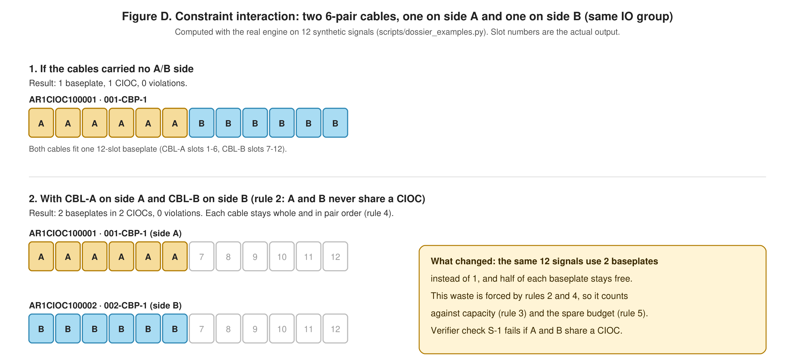

*Figure D. Two 6-pair cables, one on side A and one on side B, in the same IO group. Without sides both cables share one baseplate (slots 1–6 and 7–12). With sides, rule 2 forces two CIOCs, rule 4 keeps each cable whole, and each baseplate is half empty. That waste then competes with the capacity limit and the spare reserve. Source: `docs/assets/slotsmith/data/examples_fast.json`.* **[Meas]**

1. **Cable integrity versus segregation.** A cable carrying both A and B signals can satisfy neither "keep the cable together" nor "A and B apart". SlotSmith blocks it with TQ rule `S-2` and holds its signals instead of splitting it ([`validate`](../src/slotsmith/validate.py#L54); **[Test]** [`test_cable_with_a_and_b_is_blocked`](../tests/test_core.py#L115)).
2. **Spare room versus group contiguity.** Keeping about 10 % of baseplates empty in every cabinet shrinks usable capacity from 32 to 28 baseplates. A group that is already spread over contiguous cabinets can then have no room for one new cable, and the only compliant fix may move other cables. That is exactly the case that triggers the CP-SAT repair in [§12](#12-revision-aware-allocation-and-local-repair) **[Impl]**.

Revisions add a second difficulty: a layout that satisfies every rule is not unique, so re-running the allocation on Rev B can move most signals even when only a few rows changed. In the 10 synthetic cases of [§19](#19-evaluation-methodology-and-benchmark-results), a from-scratch re-run moved 883 to 9,632 signals per case where the revision-aware engine moved 4 to 218 **[Meas]**.

### 2.4 The hardware hierarchy

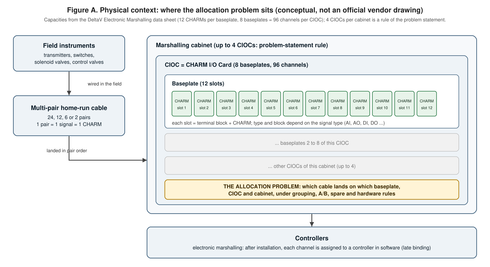

*Figure A. Where the allocation problem sits. Conceptual diagram drawn for this dossier from the Emerson data sheet and the PS; it is not an official vendor drawing.*

In DeltaV Electronic Marshalling, field cables land on terminal blocks mounted on a **baseplate**; each baseplate position takes one **CHARM** (CHARacterization Module), a single-channel I/O component that is chosen for the signal type. Baseplates are wired to a **CHARM I/O Card (CIOC)**, which Emerson's data sheet says supports up to 96 channels (8 baseplates × 12 CHARMs) and can serve I/O to any of four controllers; the channel-to-controller assignment is done in software afterwards, which is the "late binding" that makes late changes cheap ("without lifting a wire") **[Ext]** ([DeltaV Electronic Marshalling product data sheet, Aug 2026](https://www.emerson.com/is/content/emerson/en/systems-and-software/deltav-distributed-control-system-dcs/product-data-sheets/documents/deltav-electronic-marshalling.pdf); [Emerson product page](https://www.emerson.com/en/automation-systems/distributed-control-systems-dcs/deltav-distributed-control-system/deltav-controllers-io/deltav-electronic-marshalling), accessed 11 Oct 2026).

The consequence for this project: *which controller* a signal ends up on is decided in software later, but *which cable lands on which baseplate and slot* is physical wiring. That physical placement is what must be planned early and what changes with every revision. The organiser adds the project rules that make the placement non-trivial.

---

## 3. Domain glossary

The full alphabetical glossary is in [§26.1](#261-glossary). The terms below are defined at first use, with their provenance: **Emerson** = used in Emerson documentation **[Ext]**; **PS** = term of the organiser's problem statement **[Ext]**; **project** = term defined or chosen inside SlotSmith **[Impl]**.

| Term | Meaning in this dossier | Provenance |
|---|---|---|
| DCS | Distributed Control System: the plant-wide control platform | general |
| DeltaV | Emerson's DCS family | Emerson |
| Electronic marshalling | Landing field cables on generic terminal blocks and assigning signal type and controller in software, instead of wiring each signal to a dedicated, type-specific card | Emerson |
| Late binding | Assigning a channel's identity (tag, type, controller) after the hardware is wired and installed | Emerson |
| CHARM | One-channel I/O module; plugs into a baseplate slot | Emerson |
| Baseplate | Carrier with 12 slots (terminal block + CHARM each) | Emerson |
| CIOC | CHARM I/O Card: connects up to 8 baseplates (96 channels) to controllers | Emerson |
| Marshalling cabinet | Cabinet that houses CIOCs and baseplates; "up to 4 CIOCs" is a PS project rule | PS |
| I/O signal, I/O type | One field signal (AI, AO, DI, DO, ...) and its type; one row of the MDB | PS |
| Cable, pair | Multi-pair field cable of 24, 12, 6 or 2 pairs; one pair carries one signal | PS |
| Terminal block | Field wiring terminal of a slot; type depends on signal (standard, fused/injected power, relay) | PS table |
| IO group ("Grp"), segregation ("Seg", sides A and B) | Logical grouping of related signals; duty/standby or risk separation | PS |
| Redundancy | Duplicate (A/B) equipment whose signals must not share a failure point; modelled as A/B segregation per CIOC | PS, **[Impl]** |
| Spare capacity | Deliberately empty baseplates kept per cabinet for growth; also "wired spare pairs" inside a cable | PS |
| MDB | The customer's signal list ("IO MDB"); here a workbook or CSV, never a Microsoft Access database | PS |
| TQ (technical query) | A traceable question about data that cannot be placed: ID, severity, rule reference, source rows, suggested action | PS, **[Impl]** ([`TQ`](../src/slotsmith/model.py#L41)) |
| Constraint satisfaction, feasible allocation | A set of placements where every hard rule holds | general |
| Independent verification | Re-checking a result with code that does not reuse the producer's logic | project |
| Revision-aware allocation | Producing Rev B from Rev A while keeping unchanged assignments | project |
| FFD | First-fit-decreasing bin packing heuristic | literature |
| CP-SAT | Google OR-Tools' constraint-programming solver on a SAT core | OR-Tools docs |
| Cable block | Whole cable treated as one unit of `size` consecutive slots (spares included) | project ([`CableBlock`](../src/slotsmith/model.py#L21)) |

"Technical query", the exact rule IDs (`S-2`, `K-1`, ...) and "cable block" are SlotSmith vocabulary built on the PS; they are **not** official Emerson terminology.

---

## 4. Existing workflow and problem analysis

### 4.1 The expected workflow, as far as sources show

Emerson's documents describe tools that surround the allocation step, not the planning of it **[Ext]**:

- *Auto-sense and drag-and-drop*: controllers recognise installed CHARMs and the engineer assigns channels to controllers (product data sheet).
- *Late binding*: field devices are bound to I/O by instrument tag after installation; for HART devices binding happens automatically once the device is discovered, for other signal types a DST is assigned manually, by drag-and-drop or bulk edit (Smart Commissioning white paper, 2021).
- *Bulk Edit*: user-defined import/export in tab-delimited files and an Excel template (Bulk Edit white paper, 2022).
- *CHARM Configuration Tool* for SIS cabinets selects baseplate and CSLS quantities, which is hardware selection, not signal-to-channel planning (seen in a search-result summary of an Emerson SIS data sheet on 11 Oct 2026; the data sheet was not read in full).

The PS describes the planning step itself as manual Excel work. A patent from another DCS vendor describes the same context from the tool side: a wiring index drives hardware engineering and cabinet population (US 10,354,343 B2, see [§17](#17-related-work-and-literature-review)). The organiser's statement is the only source in this dossier that characterises the manual burden; no independent measurement exists **[Unv]**.

### 4.2 Pain points the project targets

1. Checking a hand allocation against several interacting rules is slow and error-prone (statement of the PS; not measured here).
2. Data defects in the customer list (missing type, duplicate tags, a pair number beyond the cable size, A and B on one cable) must be reported back as specific questions.
3. A revision should disturb as few already-engineered signals as possible; tracing the impact is part of the job.

### 4.3 Why simple strategies fall short

- *Sequential first-fit in list order* ignores cable integrity (a cable's pairs would scatter), and gives different results depending on row order.
- *Packing individual signals* breaks the rule that a cable stays whole and in pair order.
- *Re-running the whole allocation on Rev B* is deterministic but unstable: in 10 synthetic cases it moved 883 to 9,632 signals each, where only about 3 % of rows were deleted and 5 % added **[Meas]** ([§19](#19-evaluation-methodology-and-benchmark-results)).
- *A general solver on the whole project* is possible in principle but was not built or evaluated here **[Unv]**; the baseline in SlotSmith is deliberately constructive so that results are reproducible and fast (about 6 s for 20,033 signals including verification).

### 4.4 What SlotSmith demonstrates, and what it does not

SlotSmith demonstrates, on synthetic data, a working pipeline for the PS rulebook with independent checking and revision-aware repair. It does **not** demonstrate performance on a real customer project, agreement with an engineer's reading of every rule, compatibility with Emerson or third-party engineering tools, time savings, or readiness for any production use. It is positioned as complementary planning support, not a replacement for DeltaV engineering software.

---

## 5. Requirements and traceability

Statuses: **Implemented**, **Partial**, **Not implemented**, **Not verified**. "Test" gives the strongest automated evidence; "Gap" states what remains.

### 5.1 Functional requirements (organiser's statement)

| ID | Requirement | Importance | Implementation | Verification | Status | Gap |
|---|---|---|---|---|---|---|
| F1 | Upload one or many customer IO MDB Excel files | Must | [`read_mdb`](../src/slotsmith/ingest.py#L79) (multi-file, multi-sheet); UI uploader ([`input.py`](../app/views/input.py)) | [`test_read_mdb_with_title_row`](../tests/test_core.py#L63); UI upload verified in a browser | Implemented | `.xlsx`/`.csv` only; real customer files untested |
| F2 | Fill the organiser's allocation template | Must | [`write_workbook`](../src/slotsmith/export.py#L151) with own layout | [`test_workbook_has_required_sheets`](../tests/test_core.py#L290) | **Partial** | Template not released; layout not validated against it |
| F3 | Auto-map columns (tag, IO, cable, pair, group, segregation) | Must | [`auto_map`](../src/slotsmith/ingest.py#L42) synonyms + fuzzy match ≥ 0.8 | [`test_auto_map_ps_headers`](../tests/test_core.py#L52), [`test_auto_map_variant_headers`](../tests/test_core.py#L57) | Implemented | No manual override in the pipeline or UI; LLM suggestion is [Plan] |
| F4 | Rule panel: user adds/edits/switches rules; save and reuse rule sets | Must | [`RuleSet`](../src/slotsmith/rules.py#L44) JSON; UI [Allocate](../app/views/allocate.py) page | [`test_rule_change_without_code_change`](../tests/test_core.py#L226); UI tests | **Partial** | Parameters and four rule switches only; three listed switches have no effect ([§9.4](#94-rules-that-are-switches-but-do-nothing)); new rule *types* need code; hardware table and most naming patterns are not editable in the UI (editable in the JSON file) |
| F5 | One click: every signal → cabinet, CIOC, baseplate, CHARM | Must | [`allocate`](../src/slotsmith/allocator.py#L267), [`run`](../src/slotsmith/pipeline.py#L63) | [`test_ps_example_rows_allocate_clean`](../tests/test_core.py#L74); property test [`test_property_random_mdbs_zero_violations`](../tests/test_core.py#L211) | Implemented | Synthetic data only |
| F6 | TQ for anything the tool cannot place | Must | [`validate`](../src/slotsmith/validate.py#L54), [`capacity_tqs`](../src/slotsmith/pipeline.py#L34) | [`test_row_level_tqs`](../tests/test_core.py#L107), [`test_injected_errors_all_detected`](../tests/test_core.py#L128); 81/81 injected errors in the benchmark **[Meas]** | Implemented | Recall measured only on our nine injected error kinds; false positives not measured |
| F7 | Report cabinets, CIOCs, fill %, spares | Must | [`summary`](../src/slotsmith/export.py#L108) (Cabinet Summary sheet) | `test_workbook_has_required_sheets` | Implemented | "Fill %" has two bases (signals or occupied ÷ cabinet slots); the PS does not define it |
| F8 | Rule-check report with zero violations | Must | [`verify`](../src/slotsmith/verifier.py#L58) (Rule Check sheet) | Mutation tests ([§11](#11-independent-verifier)) | Implemented | Zero means "no violation of the implemented checks"; see [§11.5](#115-what-the-verifier-does-not-establish) |
| F9 | TQ list: missing data, rule conflicts, capacity | Must | TQ List sheet | as F6 | Implemented | |
| F10 | Load Rev B, compare, keep unchanged signals ("fewest moves") | Must | [`revise`](../src/slotsmith/revision.py#L89) | [`test_revision_keeps_unchanged_signals_in_place`](../tests/test_core.py#L254), [`test_signal_added_on_spare_pair_lands_without_moves`](../tests/test_core.py#L267) | **Partial** | "Fewest" is not guaranteed: window-local repair; some windows are best-found ([§12](#12-revision-aware-allocation-and-local-repair)) |
| F11 | Impact report: added, deleted, moved, cabinets hit | Must | [`impact_report`](../src/slotsmith/revision.py#L289) | `test_signal_added_on_spare_pair_lands_without_moves` (counts) | Implemented | Matching is by tag: a renamed tag appears as delete + add |
| F12 | Working tool with a simple UI | Must | Streamlit app, 7 stages | 21 UI journey tests ([`tests/test_ui_app.py`](../tests/test_ui_app.py)); browser walkthrough 11 Oct | Implemented | No browser matrix; no persistence across a refresh |
| F13 | Live demo, source, 5-min pitch | Event | Synthetic demo button; this repository | – | Not verified here | Outside this dossier |

### 5.2 Non-functional and boundary requirements

| ID | Requirement (source) | Implementation / evidence | Status | Gap |
|---|---|---|---|---|
| N1 | "No hand-editing" end to end (PS) | Pipeline writes the workbook without manual steps **[Impl]** | Implemented | – |
| N2 | New rule or new MDB needs no code change (PS) | Rule parameters and header synonyms are data **[Test]**; schema variants tested only through `test_auto_map_variant_headers` | **Partial** | New rule types and unseen schemas are not covered ([§21](#21-failure-modes-and-limitations)) |
| N3 | Works on an unseen MDB and revision (PS hidden test) | Synthetic variation only | **Not verified** | Needs the organiser's sample |
| N4 | Declare tools and AI models (PS) | README and [§7](#7-technology-stack): no LLM runs at runtime | Implemented | – |
| N5 | Deterministic, reproducible baseline | Allocation results (counts, violations) were identical across four benchmark batches **[Meas]**; no test asserts determinism directly | Implemented | Revision repair is **not** deterministic |
| N6 | Run offline on a laptop | The engine imports no network library **[Impl]**; the UI's network use was not audited under an isolated network **[Unv]** (the 11 Oct browser session served fonts from the local Streamlit server; an earlier review recorded one external request, see `docs/ux_review_log.md` R13) | Partly verified | – |
| N7 | Safety boundary: planning aid only | See [§22](#22-security-safety-and-responsible-use-boundaries) | Stated | Not certified |

### 5.3 Input assumptions and output expectations

- Input: one signal per row; required columns tag, I/O type, cable, pair; optional group, segregation, cable size ([§8](#8-data-model-and-input-specification)).
- Output: the workbook contract of [§15](#15-outputs-and-workbook-contract); the organiser's template compliance is **not** claimed.

---

## 6. Complete system architecture

### 6.1 Overview diagram

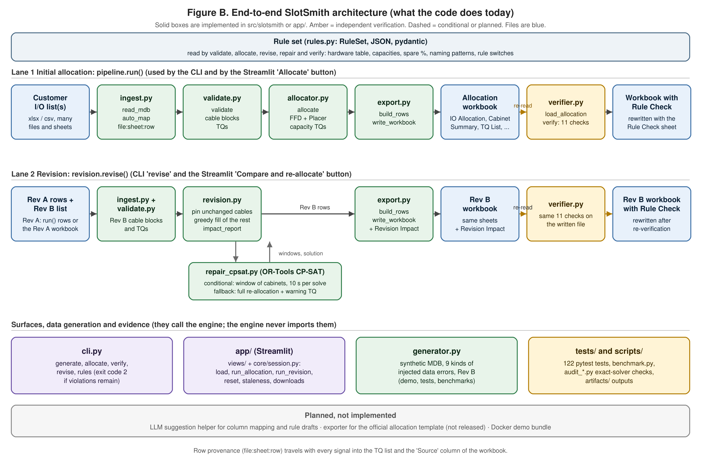

*Figure B. Module-level architecture as implemented. Lane 1 is `pipeline.run()`; lane 2 is `revision.revise()`; both end in a workbook that the verifier re-reads. Dashed = conditional or planned. The diagram is generated by `scripts/dossier_diagrams.py`; an equivalent editable Mermaid description of the logical flow is kept in [`figB_architecture_mermaid.mmd`](assets/slotsmith/diagrams/figB_architecture_mermaid.mmd).* **[Impl]**

The engine in `src/slotsmith/` has no dependency on Streamlit; the CLI and the UI are two independent callers of it. The UI adds session handling, staleness detection and presentation (`app/core/`, `app/views/`, `app/ui/`), and calls only public engine entry points (`generate`, `make_revision`, `read_mdb`, `run`, `revise`, `write_workbook`, `verify`) **[Impl]** (module docstring of [`session.py`](../app/core/session.py)).

### 6.2 What each part does

| Part | Role and relationships |
|---|---|
| **Input files** | One or many `.xlsx`/`.csv` workbooks. Each row is one signal. `file:sheet:row` is kept on every signal and reappears in TQs and in the workbook's `Source` column. |
| **Ingestion** ([`ingest.py`](../src/slotsmith/ingest.py)) | [`read_mdb`](../src/slotsmith/ingest.py#L79) reads every sheet as text, finds the header row among the first 15 rows, maps columns with [`auto_map`](../src/slotsmith/ingest.py#L42), skips sheets that lack the four required columns, and normalises blanks. |
| **Validation** ([`validate.py`](../src/slotsmith/validate.py)) | [`validate`](../src/slotsmith/validate.py#L54) turns rows into [`CableBlock`](../src/slotsmith/model.py#L21)s and emits TQs for every defect. Blocked rows are *held*: their pair keeps its slot so the cable's other signals are still placed. |
| **Rule configuration** ([`rules.py`](../src/slotsmith/rules.py)) | A pydantic [`RuleSet`](../src/slotsmith/rules.py#L44) holds capacities, isolation levels, spare %, hardware table, aliases, naming patterns and rule switches. Loaded and saved as JSON. Read by validation, allocation, revision, repair and verification. |
| **Allocation** ([`allocator.py`](../src/slotsmith/allocator.py)) | [`allocate`](../src/slotsmith/allocator.py#L267): per-group, per-side FFD packing ([`build_units`](../src/slotsmith/allocator.py#L101)) then sequential layout into CIOCs and cabinets ([`Placer`](../src/slotsmith/allocator.py#L139)). Cables that cannot fit even an empty cabinet become capacity TQs. |
| **Export** ([`export.py`](../src/slotsmith/export.py)) | [`build_rows`](../src/slotsmith/export.py#L42) expands blocks into one row per slot (signal, spare pair, held pair), assigns hardware from the rule table and generates names from patterns; [`write_workbook`](../src/slotsmith/export.py#L151) writes the sheets. |
| **Independent verification** ([`verifier.py`](../src/slotsmith/verifier.py)) | [`verify`](../src/slotsmith/verifier.py#L58) re-reads the exported file ([`load_allocation`](../src/slotsmith/verifier.py#L53)) and re-checks 11 rule families ([§11](#11-independent-verifier)). The report is written back into the workbook as the Rule Check sheet. |
| **Revision** ([`revision.py`](../src/slotsmith/revision.py)) | [`revise`](../src/slotsmith/revision.py#L89) rebuilds the Rev A geometry from rows, pins unchanged cables, greedily places the rest, and falls back to CP-SAT repair, then to full re-allocation ([§12](#12-revision-aware-allocation-and-local-repair)). |
| **Local repair** ([`repair_cpsat.py`](../src/slotsmith/repair_cpsat.py)) | [`repair_window`](../src/slotsmith/repair_cpsat.py#L23) builds and solves a CP-SAT model for a window of cabinets. Conditional: only when greedy placement fails. |
| **Synthetic data** ([`generator.py`](../src/slotsmith/generator.py)) | [`generate`](../src/slotsmith/generator.py#L37) (seeded I/O lists with optional injected errors) and [`make_revision`](../src/slotsmith/generator.py#L137) (Rev B). Used by the demo, tests and benchmarks. |
| **UI and session state** ([`app/`](../app/)) | Router [`streamlit_app.py`](../app/streamlit_app.py); pages in `app/views/`; [`session.py`](../app/core/session.py) wraps engine calls ([`run_allocation`](../app/core/session.py#L122), [`run_revision`](../app/core/session.py#L169)); [`state.py`](../app/core/state.py) derives staleness from SHA-256 fingerprints of the rules and inputs. Failures never overwrite a previous good result. |
| **Tests and benchmark harness** | `tests/` (pytest + Hypothesis), `scripts/benchmark.py`, `scripts/audit_*.py`, `artifacts/`. |
| **Planned (not built)** | LLM suggestion helper; Docker demo bundle; exporter for the organiser's template. |

### 6.3 Source-code mapping

| Module (lines) | Responsibility | Important symbols | Inputs → outputs | Depends on | Tests |
|---|---|---|---|---|---|
| [`model.py`](../src/slotsmith/model.py) (67) | Shared data classes | `Signal`, `CableBlock`, `TQ`, `Placement` | – | – | used everywhere |
| [`rules.py`](../src/slotsmith/rules.py) (164) | Typed rule set | `RuleSet`, `HardwareRule`, `NamingRules`, [`default_ruleset`](../src/slotsmith/rules.py#L129) | JSON ↔ object | pydantic | [`test_rule_change_without_code_change`](../tests/test_core.py#L226) |
| [`ingest.py`](../src/slotsmith/ingest.py) (110) | Read and map | `read_mdb`, `auto_map`, `CANONICAL`, `SYNONYMS` | files → `MDB` (DataFrame + mappings) | pandas, difflib | `test_auto_map_*`, `test_read_mdb_with_title_row` |
| [`validate.py`](../src/slotsmith/validate.py) (206) | Row/cable checks, TQs | `validate`, `ValidationResult` | DataFrame, rules → blocks, TQs | model, rules | `test_row_level_tqs`, `test_duplicate_tag_and_pair`, `test_injected_errors_all_detected` |
| [`allocator.py`](../src/slotsmith/allocator.py) (295) | Packing and layout | `ffd_pack`, `build_units`, `Placer`, `allocate`, `lower_bounds`, `exact_group_baseplates` | blocks, rules → placements, layout, unplaced | model, rules | `test_ffd_divisible_sizes_is_optimal`, audit tests |
| [`export.py`](../src/slotsmith/export.py) (170) | Rows, summary, workbook | `build_rows`, `controller_map`, `summary`, `write_workbook` | validation + allocation → rows, `.xlsx` | openpyxl, pandas, allocator, validate | `test_workbook_has_required_sheets` |
| [`verifier.py`](../src/slotsmith/verifier.py) (244) | Independent re-check | `CHECKS`, `load_allocation`, `verify`, `total_violations` | exported rows, MDB, rules → report | pandas, **rules only** | five mutation tests ([§11](#11-independent-verifier)) |
| [`pipeline.py`](../src/slotsmith/pipeline.py) (98) | One allocation run | `run`, `capacity_tqs`, `RunResult` | paths, rules → `RunResult`, workbook | all above | `test_ps_example_rows_allocate_clean` |
| [`revision.py`](../src/slotsmith/revision.py) (395) | Rev B | `revise`, `impact_report`, `_cpsat_repair` | Rev A rows, Rev B DataFrame → `RevisionResult` | allocator, export, validate, verifier | revision tests |
| [`repair_cpsat.py`](../src/slotsmith/repair_cpsat.py) (207) | CP-SAT model | `repair_window` | window, cables, old positions → solution + status | OR-Tools | indirectly via revision tests and benchmarks |
| [`generator.py`](../src/slotsmith/generator.py) (185) | Synthetic data | `generate`, `make_revision`, `_inject` | seed, size → DataFrame | pandas | used by property and benchmark tests |
| [`cli.py`](../src/slotsmith/cli.py) (89) | Command line | `main` | args → files, JSON, exit code | engine | exercised in the fresh-clone run ([§23](#23-reproducible-setup-and-execution)); no dedicated test **[Unv]** |

### 6.4 Source-code map

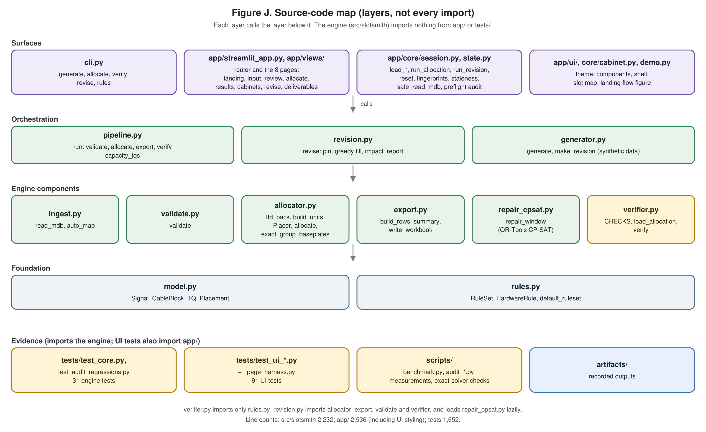

*Figure J. Layers of the repository (not every import). The engine imports nothing from `app/` or `tests/`.*

---

## 7. Technology stack

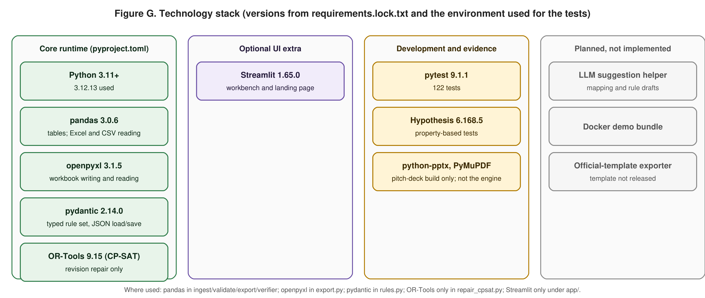

*Figure G. Versions are those in `requirements.lock.txt` and in the environment used for the tests.*

| Technology | Role in SlotSmith | Where it is used | Category |
|---|---|---|---|
| Python ≥ 3.11 (3.12.13 used) | Language of engine, UI, tests | everywhere; `requires-python` in [`pyproject.toml`](../pyproject.toml) | core |
| pandas 3.0.6 | Table handling, Excel/CSV reading | `ingest.py`, `validate.py`, `export.py`, `verifier.py`, `generator.py` | core |
| openpyxl 3.1.5 | Excel engine for pandas; workbook writing and formatting | `export.py` (and implicitly `pd.read_excel`) | core |
| pydantic 2.14.0 | Validated rule set and JSON persistence | `rules.py` | core |
| OR-Tools 9.15 (CP-SAT) | Constraint solver for revision repair only | `repair_cpsat.py` (imported lazily from `revision.py`) | core |
| Streamlit 1.65.0 | Workbench UI (`st.navigation`, `st.dialog`, `st.fragment`, native light/dark theme) | `app/`; extra `ui = ["streamlit>=1.65"]` | optional |
| pytest 9.1.1, Hypothesis 6.168.5 | Tests, property-based tests | `tests/` | development |
| python-pptx, PyMuPDF, LibreOffice | Pitch-deck build and rendering | `scripts/build_deck.py`, `scripts/build_final_deck.py` | development, not part of the engine |
| Chromium (Playwright), Mermaid 11 | Rendering this dossier's diagrams and PDF | `scripts/dossier_*.py` (build time only) | development |
| LLM helper, Docker, official-template exporter | – | – | **[Plan]**, not implemented |

Notes. `numpy` and `protobuf` are transitive dependencies of pandas and OR-Tools. The lock file pins 63 packages. No database is used: storage is files only (`.xlsx`, `.csv`, rule-set `.json`). No LLM is called anywhere in `src/` or `app/` (README statement; `grep` of the imports above shows no AI library) **[Impl]**. Installed-but-unused packages (for example `xlsxwriter`) are not listed.

---

## 8. Data model and input specification

### 8.1 What is accepted

- **Extensions.** `.csv` is read with `pd.read_csv(header=None, dtype=str)`; every other extension is passed to `pd.read_excel`, so `.xlsx` works. `.xls` fails with an `xlrd` message because `xlrd` is not installed; the UI uploader therefore offers only `.xlsx` and `.csv` ([`input.py`](../app/views/input.py)) **[Impl]**. Streamlit's default upload limit of 200 MB per file applies in the UI.
- **Sheets.** Every sheet of a workbook is examined. A sheet whose header row does not map all four required columns is **silently skipped**. If no sheet in any file qualifies, [`read_mdb`](../src/slotsmith/ingest.py#L79) raises `ValueError("No sheet with the required columns ...")` **[Impl]**; the UI turns it into the message "No sheet with required IO columns found..." ([`safe_read_mdb`](../app/core/state.py#L249)) **[Test]** (`test_safe_read_mdb_missing_required_columns_returns_actionable_error`).
- **Header row.** Fully empty rows are dropped; [`_find_header_row`](../src/slotsmith/ingest.py#L70) picks the first of the first 15 rows that maps all required columns (title rows are tolerated; **[Test]** `test_read_mdb_with_title_row`). If none does, row 1 is used.
- **Column mapping.** Header text is lower-cased and stripped of punctuation ([`_norm`](../src/slotsmith/ingest.py#L30)); each canonical field takes the best synonym match by `difflib` ratio, accepted at **≥ 0.80**; a header is used for at most one field. Mapping is deterministic. `read_mdb` has a `mapping_override` argument, but neither `pipeline.run` nor the UI exposes it, so users cannot override a mapping **[Impl]** (the Review page says so).
- **Values.** All cells are read as text. Blank, `-`, `–`, `nan`, `None` become missing. Pair and cable-size values use the *first run of digits* (`"P12"` → 12, `"1.5"` → 1); I/O type is upper-cased with spaces and underscores turned into hyphens and then looked up in the alias table; segregation is upper-cased; tags, cables and groups are trimmed and **case-sensitive** (`G1` ≠ `g1`) **[Impl]** ([`validate`](../src/slotsmith/validate.py#L54), [`normalise_io_type`](../src/slotsmith/rules.py#L116)).
- **Provenance.** `src_file`, `src_sheet` and `src_row` (the 1-based row of the sheet) are added to every row.

### 8.2 Field-level table

| Canonical field | Meaning | Type | Required | Accepted aliases (implemented) | Validation behaviour | Code |
|---|---|---|---|---|---|---|
| `tag` | Instrument tag, unique key of a signal | text | **yes** | tag, tag no, tag number, tagname, instrument tag, signal tag, dst, loop tag, device tag | Missing → TQ `D-1`. Duplicate → TQ `D-4`, **all** rows of that tag are blocked | [`SYNONYMS`](../src/slotsmith/ingest.py#L19), `validate` |
| `io_type` | Signal type (AI, AO, DI, DO, DO-SOV, ...) | text | **yes** | io, io type, i/o, i/o type, signal type, type, io_type, channel type | Missing → `D-1`. No hardware rule for the normalised key → `H-*` (when switch `R6-hardware` is on) | `validate`, [`hardware_for`](../src/slotsmith/rules.py#L110) |
| `cable` | Cable the signal arrives on | text | **yes** | cable, cable no, cable number, cable tag, multicore, multi core, cable id, mc cable | Missing → `D-1` | `validate` |
| `pair` | Pair number within the cable (1-based) | int (first digits) | **yes** | pair, pair no, pair number, core, core no, pair# | Missing or < 1 → `D-1`. Larger than the cable size → `D-3`. Two tags on one pair → `D-5` | `validate` |
| `group` | IO group for "keep together" | text | no | grp, group, io grouping, io group, logical group, grouping | Several groups on one cable → `G-3` (when `R1-grouping` is on) | `validate` |
| `seg` | Side for A/B separation | text | no | seg, segregation, a/b, redundancy, duty/standby, side | Value not in `segregation_values` (default A, B) → `S-3`. Both A and B on one cable → `S-2` (when `R2-segregation` is on) | `validate` |
| `cable_size` | Pairs in the cable (24, 12, 6, 2) | int | no | cable size, pairs, no of pairs, cable pairs, size, cable type, cores | Conflicting sizes for a cable → `D-3` (cable blocked). Non-standard size → warning `D-3` (still placed). Absent → inferred as the smallest standard size ≥ the highest pair, with one info TQ | `validate` |

### 8.3 Behaviour on bad input

| Situation | Behaviour | Evidence |
|---|---|---|
| Corrupt or non-zip `.xlsx` | UI: "That file could not be read" banner with technical detail; the previous dataset is kept. CLI: uncaught exception | **[Test]** `test_safe_read_mdb_corrupted_file_returns_error_without_crash`, `test_failed_upload_preserves_previous_allocation_state`; browser run 12 Oct |
| Missing file | Readable error in the UI | **[Test]** `test_safe_read_mdb_nonexistent_file_returns_error` |
| A row lacks its I/O type or cable, or has an unusable pair or an unknown I/O type or segregation value | Each such row becomes a blocking TQ and a `TQ raised` row in the workbook | **[Test]** `test_row_level_tqs` (five parametrised cases; a missing *tag* or *pair* is not covered by it) |
| Empty workbook / no rows | Pre-flight audit reports "Allocation blocked: No rows found" | **[Test]** `test_preflight_audit_empty_data` |
| Merged cells, hidden sheets, formulas, very large sheets, `.xls`, password-protected files | Not tested | **[Unv]** |
| Real customer MDB with extra columns or different language headers | Unmapped headers are listed and ignored; no real MDB was available | **[Unv]** |

### 8.4 Illustrative accepted and rejected records

The ten rows below are **fabricated** (tags `ILL-*`) to show the validator's behaviour. They were run through the real engine ([`scripts/dossier_examples.py`](../scripts/dossier_examples.py), output `docs/assets/slotsmith/data/examples_fast.json`); the TQ text is the engine's output **[Meas]**.

| Tag | IO | Cable | Size | Pair | Grp | Seg | Outcome |
|---|---|---|---|---|---|---|---|
| ILL-001 | AI | CBL-X1 | 12 | 1 | G1 | A | Allocated |
| ILL-002 | DI | CBL-X1 | 12 | 2 | G1 | A | Allocated (same cable, next slot) |
| ILL-003 | *(blank)* | CBL-X2 | 6 | 1 | G2 | | TQ-0002 `D-1`: missing IO type |
| ILL-004 | PULSE-XYZ | CBL-X3 | 6 | 1 | | | TQ-0003 `H-*`: IO type has no CHARM/terminal-block rule |
| ILL-005 | AI | CBL-X4 | 6 | **7** | | | TQ-0005 `D-3`: pair 7 exceeds the 6-pair size |
| ILL-006 | AI | CBL-X5 | 6 | 1 | G3 | **C** | TQ-0004 `S-3`: segregation value 'C' is not one of ['A', 'B'] |
| ILL-007 | AI | CBL-X6 | 6 | 1 | | | TQ-0001 `D-4`: tag appears 2 times (both rows blocked) |
| ILL-007 | DI | CBL-X6 | 6 | 2 | | | (second row of the duplicated tag) |
| ILL-008 | AI | CBL-X7 | 2 | 1 | G1 | A | TQ-0006 `S-2`: cable carries both A and B signals |
| ILL-009 | DI | CBL-X7 | 2 | 2 | G1 | B | (same TQ-0006) |

Result: 2 signals allocated, 8 rows held under 6 TQs, 0 verifier violations: every row is either allocated or covered by a TQ (Q-1).

### 8.5 Dataset provenance and limits

All data in this dossier is **synthetic**, produced by [`generate`](../src/slotsmith/generator.py#L37): cables of 24/12/6/2 pairs drawn with weights 35/30/20/15 %, 1–22 pairs used per cable, a type mix (AI 36 %, DI 26 %, AO 13 %, DO 8 %, DO-SOV 9 %, DO-HORN 2 %, DO-RELAY 3 %, AI-RTD 3 %), `max(1, n // 450)` groups, 15 % ungrouped cables, 25 % of grouped cables as an A cable with a B twin on its own cable, rows shuffled. Nine error kinds can be injected (duplicate tag, missing I/O type, unknown I/O type, pair beyond size, duplicate pair, mixed A/B cable, mixed-group cable, bad segregation value, missing cable). Rev B ([`make_revision`](../src/slotsmith/generator.py#L137)): about 3 % of rows deleted, 2 % have their I/O type changed (for example DI↔DO), 5 % added (half on spare pairs of existing cables, the rest on new cables in existing groups), and one cable regrouped.

The generator is built from the same published rulebook the engine implements, so it can show consistency with that reading, not correctness of the reading. It is **not** a customer MDB and **not** the organiser's sample.

---

## 9. Rule system and constraint catalogue

### 9.1 The rule model

A [`RuleSet`](../src/slotsmith/rules.py#L44) holds: capacities (`charms_per_baseplate=12`, `baseplates_per_cioc=8`, `ciocs_per_cabinet=4`); cable sizes; isolation levels (`group_isolation_level` ∈ {`cioc`, `cabinet`, `none`}, `segregation_level` ∈ {`cioc`, `cabinet`}); `spare_percent=10` with rounding; the hardware table (7 default rows) and I/O-type aliases; naming patterns; and seven named switches (`R1-grouping` ... `R7-naming`). The PS lists six rules; the verifier checks 11 families. They are two levels of one model: **six PS rules → six verifier families (G-1, S-1, C-1, K-1, P-1, H-1..6), plus five families on data and output integrity (Q-1, D-2, N-1..6, C-2, M-1)** **[Impl]** ([`CHECKS`](../src/slotsmith/verifier.py#L19)).

Notation for the formal statements below. Cable block *b* has size *s_b* (pairs = slots), side σ_b ∈ {A, B, ∅}, group γ_b. A placement *p(b)* = (cabinet, CIOC, baseplate, start slot). Let *U* = 32 − ⌈ρ·32⌉ (ρ = `spare_percent`/100; 28 by default) be the usable baseplates per cabinet ([`usable_baseplates_per_cabinet`](../src/slotsmith/rules.py#L101)).

### 9.2 Catalogue of implemented rules

All rules below are **hard** constraints: SlotSmith has no soft preferences. Heuristic choices (order of cables, next-fit layout, look-ahead) are in [§10](#10-allocation-algorithm). "Pre" = pre-allocation validation (TQ); "Alloc" = enforced by construction in the allocator; "Verify" = independent post-check on the exported file; "Rev" = revision greedy fill and CP-SAT.

| Rule | Rationale | Pre | Alloc | Verify | Rev / CP-SAT | Violation reporting | Tests | Known limits |
|---|---|---|---|---|---|---|---|---|
| **D-1** required fields | Cannot place an unidentified signal | yes | – | Q-1 (row must be allocated or have a TQ) | validate on Rev B | blocking TQ + `TQ raised` row | `test_row_level_tqs` | – |
| **D-3** cable size and pair range | Pair must exist in the cable | yes | – | K-1 uses the exported size | validate on Rev B | blocking TQ (`D-3`), warning for non-standard size | `test_row_level_tqs` | Declared size is not cross-checked against the MDB by the verifier (M-1 omits it) |
| **D-4/D-5** unique tag; unique (cable, pair) | One signal per tag and per pair | yes | – | Q-1 | validate on Rev B | blocking TQs | `test_duplicate_tag_and_pair` | – |
| **S-2/S-3** A+B on one cable; invalid side | Cable integrity and A/B separation cannot both hold | yes (needs `R2-segregation` for S-2) | – | S-1 | validate | blocking TQ | `test_cable_with_a_and_b_is_blocked` | – |
| **G-3** several groups on one cable | Cable stays whole, groups apart | yes (needs `R1-grouping`, isolation ≠ none) | – | G-1 | validate | blocking TQ | – (no dedicated test; covered by injected-error test) | – |
| **H-\*** unknown I/O type | No rule for the CHARM/terminal block | yes (needs `R6-hardware`) | – | H-1..6 | validate | blocking TQ | `test_row_level_tqs` | – |
| **K-1/K-2** cable whole, side by side, in pair order; 24-pair = two baseplates from slot 1 in one CIOC | PS rule 4 | – | block placement ([`ffd_pack`](../src/slotsmith/allocator.py#L81), [`build_units`](../src/slotsmith/allocator.py#L101)) | **K-1** | exactly-one start position per cable, aligned starts | verifier FAIL with example | [`test_24_pair_cable_takes_two_full_baseplates`](../tests/test_core.py#L88), `test_verifier_catches_spare_budget_and_cable_split` | `R4-cable` switch has no effect; straddling cannot be enabled in the allocator |
| **D-2** one signal per slot | Physical | – | by construction (contiguous blocks) | **D-2** | `AddAtMostOne` per slot | FAIL | `test_verifier_catches_double_booked_slot` | – |
| **C-1** capacity 12 · 8 · 4 | PS rule 3; Emerson data sheet | – | `_cioc_ok`, `_cab_ok` ([`Placer`](../src/slotsmith/allocator.py#L139)) | **C-1** | slot/baseplate ranges, ≤ 4 CIOCs | FAIL; oversize cable → capacity TQ | `test_oversized_cable_does_not_unplace_its_group` | `R3-capacity` switch has no effect; capacities are parameters |
| **S-1** A and B never share a CIOC | Duty/standby independence | – | `_cioc_ok` | **S-1** | `AddAtMostOne` over side flags per CIOC (or per cabinet) | FAIL | `test_verifier_catches_ab_mix_and_missing_signal`, `test_segregation_toggle_off_is_caught_by_strict_verifier` | Level is CIOC or cabinet only |
| **G-1** groups together, in sequence | PS rule 1 | – | one group per CIOC; groups placed in natural order; look-ahead | **G-1** (isolation and contiguity of cabinets) | per-CIOC isolation, contiguity over cabinets | FAIL | indirectly via property test | "In sequence" ordering and minimal cabinet span are **not** checked by the verifier |
| **P-1** spare room | PS rule 5 | – | `U` baseplates usable per cabinet | **P-1** | sum of used baseplates ≤ *U* | FAIL | `test_verifier_catches_spare_budget_and_cable_split` | Reading of "~10 %" as ⌈10 % × 32⌉ is an interpretation |
| **H-1..6** CHARM and terminal block | PS rule 6 | – | [`hardware_for`](../src/slotsmith/rules.py#L110) in `build_rows` | **H-1..6** (re-lookup from the rule table) | unchanged (CHARM swap in place is "modified") | FAIL with expected pair | `test_verifier_catches_wrong_terminal_block` | Table is a SlotSmith reading of a coarse PS table; thermocouple blocks not special-cased |
| **N-1..6** names | PS naming table | – | pattern formatting in `build_rows` | **N-1..6** (regex from the same patterns) | – | FAIL | `test_rule_change_without_code_change` (names) | Slot-name pattern is our choice; area/unit are parameters |
| **C-2** controller per CIOC; ≤ 16 CIOCs per controller | Naming needs a controller | – | [`controller_map`](../src/slotsmith/export.py#L28) | **C-2** | stable controller numbers on revision | FAIL | – (no dedicated mutation test) | Mapping rule is an assumption |
| **M-1** rows match the MDB (type, cable, pair, group, side) | Output faithful to input | – | – | **M-1** | – | FAIL | – (no dedicated mutation test) | Cable size and tags' presence only via Q-1 |
| **Q-1** every signal allocated or has a TQ | PS "100 % allocated or TQ" | – | held rows and capacity TQs | **Q-1** | – | FAIL | [`test_verifier_flags_tag_both_allocated_and_not_allocated`](../tests/test_audit_regressions.py#L33) | – |
| **R-2** revision fallback notice | A silent full re-allocation would hide moves | – | – | – | warning TQ when fallback occurs | warning TQ | [`test_revision_fallback_raises_warning_tq`](../tests/test_audit_regressions.py#L41) | – |

### 9.3 Formal statements of the main rules

With *c(b)* the CIOC of *b*, *a(b)* its cabinet and `slots(b)` the set of slots it occupies:

- **K (cable integrity).** `slots(b)` = { (c(b), pos₀ + k) : k = 0 … s_b − 1 } where positions are counted as (baseplate − 1)·12 + (slot − 1); for s_b ≤ 12 all positions lie in one baseplate; for s_b > 12 pos₀ is a multiple of 12 (the cable starts at slot 1) and it spans ⌈s_b/12⌉ baseplates of one CIOC. Pair *k*+1 sits at pos₀ + *k*.
- **D (no double booking).** `slots(b) ∩ slots(b′) = ∅` for b ≠ b′.
- **S (segregation).** σ_b, σ_b′ ∈ {A, B}, σ_b ≠ σ_b′ ⇒ c(b) ≠ c(b′) (or a(b) ≠ a(b′) if `segregation_level = cabinet`). Cables without a side (σ = ∅) may share a CIOC with either side.
- **G (grouping).** With `group_isolation_level = cioc`: γ_b ≠ γ_b′ ⇒ c(b) ≠ c(b′) (an ungrouped cable shares a group's CIOC only if `ungrouped_may_share_group_cioc`); and for every group γ the set of cabinets containing it is an interval {m, …, M}.
- **C/P (capacity and spare).** Per CIOC ≤ 8 baseplates; per cabinet ≤ 4 CIOCs and ≤ *U* baseplates holding any slot of any block.

### 9.4 Rules that are switches but do nothing

`default_ruleset()` lists seven switches. A code search for `enabled(` shows that only **R1-grouping, R2-segregation, R5-spare and R6-hardware** are ever read. **R3-capacity, R4-cable and R7-naming are listed in the UI and in the rule-set file but switching them off changes nothing** **[Impl]** (`grep "enabled(" src/slotsmith`; [`default_ruleset`](../src/slotsmith/rules.py#L129)). The PS says users can switch rules on and off; the statement "toggles R1–R7" in `docs/architecture.md` is therefore only partly true. This is recorded as a confirmed limitation in [§21](#21-failure-modes-and-limitations).

### 9.5 Default hardware table

| Row | I/O type keys | CHARM (SlotSmith default name) | Terminal block |
|---|---|---|---|
| H-1 | AI | AI 4-20 mA HART CHARM | Standard |
| H-1b | AI-RTD | RTD CHARM | Standard |
| H-2 | AO | AO 4-20 mA HART CHARM | Standard |
| H-3 | DI | DI 24 V DC low-side CHARM | Standard |
| H-4 | DO-SOV, DO-HORN, DO-BEACON, DO-SOUNDER, DO-ISO | DO 24 V DC Isolated CHARM | Fused-injected-power |
| H-5 | DO | DO 24 V DC High-side CHARM | Standard |
| H-6 | DO-RELAY | DO 24 V DC High-side CHARM | Relay output |

The PS table names CHARM families ("AI CHARM (HART / RTD)", "Isolated DO CHARM"); the exact CHARM model names above and the split of AI into HART and RTD rows are SlotSmith's reading and need confirmation against the project's CHARM list **[Unv]**. The relay rule has no trigger in the PS; it is reached only through the explicit I/O type `DO-RELAY`.

---

## 10. Allocation algorithm

### 10.1 In plain terms

1. Every cable becomes one **block** whose size is the cable's pair count; wired spare pairs are part of the block, so a 24-pair cable with 22 signals occupies 24 slots.
2. Blocks are grouped by IO group. Inside a group they are split into three classes by side: A, none ("neutral") and B.
3. Within each class, blocks of 12 pairs or fewer are packed into 12-slot baseplates with **first-fit-decreasing**: largest cable first, each placed in the first baseplate that still has room. Neutral cables first top up the free space of A and B baseplates, then open their own. Cables above 12 pairs take ⌈size/12⌉ whole baseplates.
4. The resulting baseplate units are laid into CIOCs and cabinets in order (groups in natural-sort order, ungrouped cables last). A new CIOC is opened at the start of each group; A and B never share a CIOC; each cabinet offers only the usable baseplates (28 of 32 by default); a unit that cannot fit even an empty cabinet becomes a capacity TQ.
5. Names, controllers, CHARM types and terminal blocks are then derived from the layout and the rule table ([`build_rows`](../src/slotsmith/export.py#L42)).

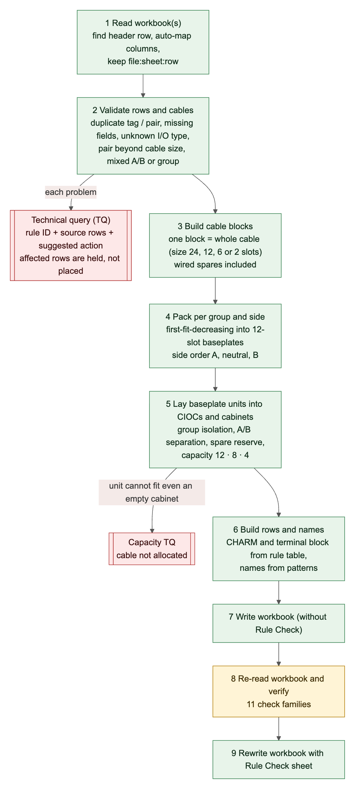

*Figure C. The steps of `pipeline.run()`: validation, cable blocks, per-class packing, layout, rows, workbook, independent verification. Rows held under a TQ never block the rest. Mermaid source: [`figC_allocation_workflow.mmd`](assets/slotsmith/diagrams/figC_allocation_workflow.mmd).*

### 10.2 Pseudocode (derived from the code)

```text
allocate(blocks, rules):                                  # allocator.py:allocate
    groups ← blocks grouped by block.group
    placer ← Placer(rules)                                # empty layout
    for g in groups sorted by natural_key (None last):
        units ← build_units(groups[g], rules, g)
        ok ← []
        for u in units:
            if placer.fits_empty(u): ok.append(u)
            else: unplaced[cable of u] ← "needs n baseplates; an empty cabinet offers m ..."
        placer.place_group(ok)
    placements ← position of every block in placer.layout
    return AllocationResult(placements, layout, unplaced, lower_bounds(...), stats)

build_units(blocks, rules, g):                            # allocator.py:build_units
    A ← first segregation value; sides ← [A, None, others...]
    for side in sides:
        for b in blocks of side with size > 12 (natural order): big[side] += Unit(ceil(size/12), start slot 1)
        if side is not None: bins[side] ← ffd_pack(blocks of side with size ≤ 12, 12)
    shared ← all bins of A, then bins of B
    combined ← ffd_pack(neutral blocks with size ≤ 12, 12, bins = shared)   # first-fit into A/B bins, then new bins
    bins[None] ← combined[len(shared):]
    return for side in [A, None, B]: big[side] then Unit(1, bin) for bin in bins[side]

ffd_pack(blocks, cap, bins):                              # allocator.py:ffd_pack
    for b in blocks sorted by (-size, natural_key(cable)):
        for bin in bins:
            used ← sum(size of blocks in bin)
            if used + b.size ≤ cap: bin.append((b, start = used + 1)); break
        else: bins.append([(b, start = 1)])

Placer.place(unit):                                       # allocator.py:Placer.place
    cab ← last cabinet
    if cab has a CIOC and cab_ok(unit) and cioc_ok(last CIOC, unit): put unit in last CIOC
    elif cab has < 4 CIOCs and cab_ok(unit): open a new CIOC (if the last one is non-empty); put unit there if cioc_ok
    else: open a new cabinet with one CIOC; put unit there
    cab_ok  : used_bp + unit.n_bp ≤ usable_baseplates_per_cabinet   (and side compatibility at cabinet level)
    cioc_ok : used_bp + unit.n_bp ≤ 8, no A/B clash, and group isolation at CIOC level

Placer.place_group(units):
    start the first unit in a fresh CIOC (isolation level cioc)
    if starting a fresh cabinet would touch fewer cabinets than continuing (capacity-only simulation): do so
    place the units in order
```

### 10.3 Capacity accounting

A baseplate counts as *used* as soon as a unit opens it, even if only some slots are filled; free slots inside a used baseplate are not reused by later groups, because the layout never goes back to earlier CIOCs. The cabinet budget is `used_bp ≤ usable_baseplates_per_cabinet` where usable = 32 − ⌈ρ · 32⌉ (28 for ρ = 10 %). The reported "lower bounds" (`lower_bounds`) are valid bounds on baseplates and cabinets given group isolation; the *cabinet* bound ignores CIOC and A/B structure and is weak (benchmark runs show it is at most 2 baseplates under the actual count; the exact per-group formula removes that gap for baseplates, [§10.5](#105-what-is-proved-what-is-tested-what-is-not-claimed)) **[Meas]**.

### 10.4 What the algorithm guarantees and does not

**Guarantees [Impl][Test].**

- Every placed cable satisfies the hard rules of [§9](#9-rule-system-and-constraint-catalogue) for the given rule set (checked independently on every benchmark run, [§19](#19-evaluation-methodology-and-benchmark-results)).
- Determinism: the same input and rule set give the same layout (counts and violations were identical across four benchmark batches **[Meas]**).
- A signal is never silently dropped: it is allocated, held under a TQ (blocked data, held pair) or reported as unplaced with a capacity TQ (property test `test_property_random_mdbs_zero_violations`; Q-1 in every run).

**Does not guarantee.**

- *Minimum number of CIOCs or cabinets.* The layout is next-fit at CIOC and cabinet level: only the last CIOC of the last cabinet is tried, a group always starts in a fresh CIOC, and free baseplate space at the end of one group's last CIOC is not reused by later groups. FFD optimality applies *inside* a class ([§10.5](#105-what-is-proved-what-is-tested-what-is-not-claimed)), not to the layout.
- *Optimal handling of non-standard cable sizes* (e.g. 4, 8, 16, 36 pairs). They are packed by the same code without the proof; a 16-pair cable takes two whole baseplates and wastes 8 slots.
- *"In sequence" ordering of groups* and *minimal cabinet span of a group* are produced by construction but not checked by the verifier.
- *Interpretation correctness*: the rules are parameters; a different reading by the project engineer needs a different rule set.

Held and unplaced signals: rows blocked by validation keep their pair slot as a "Held (TQ)" row so the rest of their cable still lands in order; cables too large for an empty cabinet are not allocated and each of their signals gets a `Not allocated` row that cites a capacity TQ [`capacity_tqs`](../src/slotsmith/pipeline.py#L34) **[Test]** (`test_oversized_cable_does_not_unplace_its_group`: a regression for a defect found in the 10 Oct audit).

### 10.5 What is proved, what is tested, what is not claimed

**Proved [Proof].** Let item sizes come from {2, 6, 12}, each dividing the next, and let the bin capacity be 12. Then FFD uses exactly ⌈Σsizes / 12⌉ bins, which is the trivial lower bound and therefore optimal. *Argument* (`docs/architecture.md` §4): items are placed in non-increasing size order; when an item of size *s* is placed, every item already in any bin has a size that is a multiple of *s* and 12 is a multiple of *s*, so every bin's free space is a multiple of *s*; a bin with non-zero free space therefore has at least *s* free and accepts the item, so FFD opens a new bin only if all bins are full; hence at the end all bins but the last are full. A 24-pair cable is two whole baseplates and does not alter the argument. The divisible-size structure is a known setting in the literature (Coffman, Garey & Johnson 1987; the full text was not read for this dossier, so the proof is relied upon in its own right, not as a citation) **[Ext]**. Scope: *one packing class* (one group, one side), *baseplates only*.

**Tested [Test][Meas].**

- Hypothesis property: for random lists of sizes from {2, 6, 12}, `len(ffd_pack(...)) == ceil(sum/12)` (200 examples) ([`test_ffd_divisible_sizes_is_optimal`](../tests/test_core.py#L203)).
- Whole-group equality, including the neutral top-up step that the proof does **not** cover: [`test_allocator_matches_exact_group_minimum_small_exhaustive`](../tests/test_audit_regressions.py#L75) (all 0/1 counts per (side, size)) and the exhaustive solver comparison `scripts/audit_ffd_exact.py`: **19,682 groups** with 0–2 cables of each (side, size), the allocator's baseplate count equalled the CP-SAT bin-packing optimum in all, every solve proven OPTIMAL; `scripts/audit_lb_gap.py`: **150 random larger groups**, 148 proven OPTIMAL and 2 FEASIBLE (not proven), allocator never worse. Reproduced identically on 11 Oct 2026 (`artifacts/dossier_repro/`, `artifacts/pitch_deck_repro/ffd_exact_rerun.json`, `lb_gap_rerun.json`).
- On all 48 benchmark allocation runs the baseplate count equalled the closed-form exact per-group minimum [`exact_group_baseplates`](../src/slotsmith/allocator.py#L243) (a subset-sum formula that places neutral cables optimally between the sides; valid for sizes {2, 6, 12} and multiples of 12).

**Not claimed.** Minimum CIOCs or cabinets; optimality for non-standard sizes; any optimality statement about the layout; any statement about organiser data.

### 10.6 A worked miniature

Figure D ([§2.3](#23-why-manual-allocation-is-hard-interacting-constraints)) shows the algorithm on two 6-pair cables. With sides A and B, `build_units` produces two units (one baseplate each); `Placer.place` puts the first in CIOC 1; the second is rejected by `_cioc_ok` (side clash) and opens CIOC 2. Result: 2 baseplates, 2 CIOCs, 0 violations, as computed by the real engine **[Meas]**.

---

## 11. Independent verifier

### 11.1 Why it exists

A producer of an allocation can contain a bug that the producer itself cannot see. The PS requires a "rule-check report: zero violations". SlotSmith therefore ends every run with a second implementation of the rules that sees only the *output*. The design follows the idea of certifying algorithms: a result is accompanied by something a simple, separate checker can validate (McConnell, Mehlhorn, Näher, Schweitzer 2011) **[Ext]**.

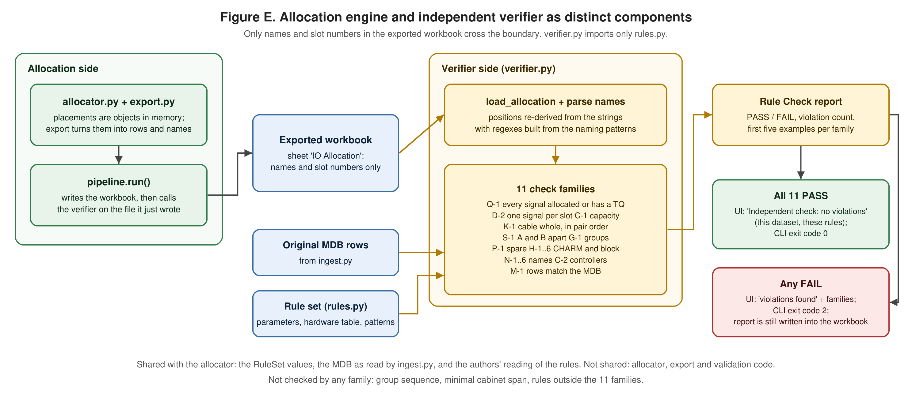

*Figure E. The allocator and verifier as distinct logical components. Positions cross the boundary only as names and slot numbers in the workbook. Generated by `scripts/dossier_diagrams.py`.*

### 11.2 What it reads, and when it runs

- **Input representation [Impl].** [`load_allocation`](../src/slotsmith/verifier.py#L53) reads the sheet `IO Allocation` of the **exported workbook** as text; [`verify`](../src/slotsmith/verifier.py#L58) takes those rows, the original MDB DataFrame and the rule set.
- **Allocation run** ([`run`](../src/slotsmith/pipeline.py#L63)): when an output path is given, the workbook is written, **re-read from disk and verified**, and rewritten with the Rule Check sheet. Without an output path (tests and some benchmarks) the in-memory rows are verified instead ([`pipeline.py` line 92–96](../src/slotsmith/pipeline.py#L92)).
- **Revision**: `revise()` verifies in-memory Rev B rows for its metrics; the CLI and the UI then write the workbook, re-read it, verify it again and rewrite it with the report ([`run_revision`](../app/core/session.py#L169), CLI `revise`). Benchmark revision cases use the in-memory result only **[Impl]**.
- **CLI** `slotsmith verify <workbook> --mdb <files>` verifies any workbook in this format and exits with code 2 if violations remain.

### 11.3 The 11 check families

| ID | What is re-derived | How a violation is found |
|---|---|---|
| Q-1 | Each MDB tag: allocated exactly once, or every row of it has a TQ reference; untagged rows have a TQ | tag in rows → statuses; more than one `Allocated`, or `Allocated` plus another status, or neither → violation |
| D-2 | One signal per slot | key (CIOC, baseplate, slot) seen twice |
| C-1 | Slot 1–12, baseplate 1–8, ≤ 4 CIOCs per cabinet, a CIOC in one cabinet | counters over parsed positions |
| K-1 | Per cable: pairs 1..size exactly once, one CIOC, consecutive linear positions in pair order, single baseplate if ≤ 12 pairs, start at slot 1 if > 12 | linear index = (baseplate − 1)·12 + (slot − 1) |
| S-1 | A and B in one CIOC (or cabinet) | set of sides per unit has two members |
| G-1 | Several named groups in a unit, group sharing with ungrouped, cabinets of a group not contiguous | sets per CIOC/cabinet; max − min + 1 ≠ count |
| P-1 | Empty baseplates per cabinet ≥ required | 32 − distinct (CIOC, baseplate) used < `reserved_baseplates_per_cabinet` |
| H-1..6 | CHARM and terminal block equal the rule table's entry for the MDB's I/O type | own alias normalisation and table lookup |
| N-1..6 | Cabinet, CIOC, baseplate, controller, system cabinet and CHARM address match the naming patterns; baseplate belongs to its CIOC | regexes built from the patterns ([`_pattern_regex`](../src/slotsmith/verifier.py#L34)) |
| C-2 | One controller per CIOC; ≤ 16 CIOCs per controller | sets |
| M-1 | Allocated row equals the MDB row for I/O type, cable, group, side and pair | field comparison (blank MDB group or side is allowed: it may be inherited from the cable) |

The report ([`verify`](../src/slotsmith/verifier.py#L58)) has one entry per family: PASS or FAIL, a violation count and the first five examples ([`total_violations`](../src/slotsmith/verifier.py#L243) sums the counts). The UI shows "Independent check: no violations" only when all 11 entries pass ([`is_verifier_certified`](../app/core/state.py#L467); the function name is historical, the on-screen wording avoids "certified").

### 11.4 What independence the code structure actually provides

**Separate [Impl].**

- `verifier.py` imports only `rules.py` (plus pandas and the standard library); it imports nothing from `allocator.py`, `export.py` or `validate.py`. (The reverse dependency exists: `revision.py` imports the verifier's `_pattern_regex` helper.)
- Positions are not passed from the allocator: they are re-parsed from strings in the workbook, so the check is about what a reader of the file sees.
- Hardware is re-looked-up from the rule table with its own normalisation code; groups, sides and contiguity are recomputed from rows.

**Shared (so *not* independent) [Impl].**

- The **rule set object**, including derived properties such as `reserved_baseplates_per_cabinet` and the naming patterns: an error in how a rule value is defined is mirrored.
- The **MDB DataFrame** produced by `ingest.py`: a mis-read column is the "truth" for both sides.
- The **reading of the rules**: both modules were written by the same team from the same PS pages. Common-mode misunderstandings are not detected.
- The `Cable Size` and `IO Group`/`Segregation` values in the exported rows (the verifier trusts the exported cable size for K-1; M-1 does not compare size with the MDB).

### 11.5 What the verifier does not establish

- It does **not** show the allocation is *optimal* or *complete* in an engineering sense, only that the 11 implemented families report no violation.
- It does not check "groups in sequence" (only isolation and contiguity of cabinets), minimal cabinet span, or any rule that is not in `CHECKS`.
- It cannot detect mistakes that are consistent between the exported names and the rule set (for example a wrong naming pattern).
- Passing it says nothing about hardware compatibility, electrical limits, area classification or safety.

### 11.6 Tests, and a concrete defect and response

**Mutation tests [Test].** Each takes a clean 2,000-signal allocation, corrupts the exported rows, and asserts that the intended family fails: [`test_verifier_catches_double_booked_slot`](../tests/test_core.py#L163), [`test_verifier_catches_wrong_terminal_block`](../tests/test_core.py#L171), [`test_verifier_catches_ab_mix_and_missing_signal`](../tests/test_core.py#L178), [`test_verifier_catches_spare_budget_and_cable_split`](../tests/test_core.py#L189), [`test_segregation_toggle_off_is_caught_by_strict_verifier`](../tests/test_core.py#L239), and the regression [`test_verifier_flags_tag_both_allocated_and_not_allocated`](../tests/test_audit_regressions.py#L33) (a blind spot found in the 10 Oct audit and fixed). The tests establish that these seven corruption types are detected; they do not establish detection of corruptions nobody thought of, and there is no mutation test for C-2 or M-1.

**Worked defect, recorded with the real code.** `scripts/dossier_examples.py` takes a clean 600-signal synthetic allocation (0 violations in all 11 families), applies one corruption at a time to the *exported rows*, and records the verifier's response ([`examples_fast.json`](assets/slotsmith/data/examples_fast.json)) **[Meas]**:

| Corruption applied to the exported rows | Families that FAIL (violations) | First example text |
|---|---|---|
| Second signal copied onto the first signal's slot | D-2 (1), K-1 (1) | "AR1CIOC100001 BP1 slot 1: 10-XV-1059A and 10-TT-1060A"; and "CBL-0013: pairs are not side by side in pair order" |
| Terminal block of a fused DO changed to Standard | H-1..6 (1) | "10-XV-1059A: DO 24 V DC Isolated CHARM / Standard (expected ('DO 24 V DC Isolated CHARM', 'Fused-injected-power'))" |
| A B-side signal given an A-side CIOC and baseplate name | S-1 (1), D-2 (1), C-1 (2), K-1 (1) | "AR1CIOC100001: holds A and B signals"; also "AR1CIOC100001 appears in two cabinets" and "CBL-0014: spread over several CIOCs" |
| One allocated signal row deleted | Q-1 (1), K-1 (1) | "10-XV-1059A: missing from the allocation"; and the cable's pairs no longer cover 1..24 |
| Pair 2 of a cable moved five slots | D-2 (1), K-1 (1) | "AR1CIOC100001 BP1 slot 7: 10-TT-1060A and 10-PS-1065A"; "CBL-0013: pairs are not side by side in pair order" |
| Rule set asks for 60 % empty baseplates; workbook was built with 10 % | P-1 (2) | "cabinet #1: 4 empty baseplates, 20 required" |
| Cabinet name replaced by `WRONG-NAME` | N-1..6 (1), K-1 (1) | "CBL-0013/1: unparseable location names WRONG-NAME/AR1CIOC100001/001-CBP-1" |

Several corruptions trigger more than one family; that is a property of the checks (a double-booked slot also breaks cable integrity), not noise.

---

## 12. Revision-aware allocation and local repair

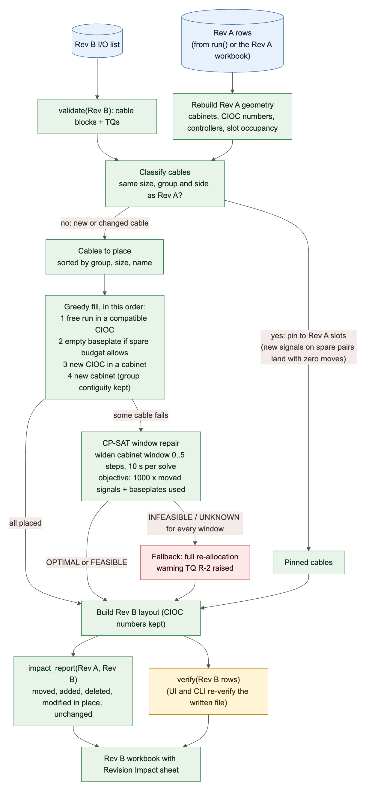

*Figure F. The revision flow as implemented in [`revise`](../src/slotsmith/revision.py#L89). Mermaid source: [`figF_revision_repair.mmd`](assets/slotsmith/diagrams/figF_revision_repair.mmd).*

### 12.1 Comparing Rev A and Rev B

- **Rev A geometry** is rebuilt from the Rev A *rows* ([`_prev_layout`](../src/slotsmith/revision.py#L53)): cabinet, CIOC number, controller, baseplate and slot of every cable, parsed from the names. It works for in-memory rows or a re-read workbook; CIOC numbers and controllers are kept stable so existing names do not change.
- **Rev B** is validated like any input (new TQs may appear).
- **Matching** for the impact report is by **tag**, over rows with status `Allocated` ([`impact_report`](../src/slotsmith/revision.py#L289)). A signal is *Moved* if its (cabinet, CIOC, baseplate, slot) differs; *Modified in place* if the slot is the same but I/O type, CHARM or terminal block differs; *Added* / *Deleted* if present in only one revision; otherwise *Unchanged*. "Cabinets hit" are cabinets that contain any changed signal. A renamed tag therefore appears as a delete plus an add.

### 12.2 What is preserved (pinned)

A Rev B cable is **pinned** to its Rev A slots if a Rev A cable of the same name has the same size, the same group and the same side. Signals added on the cable's wired spare pairs then land with zero moves, and a deleted signal turns into a spare pair of the same cable. A cable that changes size, group or side is *not* pinned and is re-placed ([`revise`](../src/slotsmith/revision.py#L89), steps 1–3; **[Test]** `test_signal_added_on_spare_pair_lands_without_moves`).

### 12.3 Greedy placement of the rest

Unpinned cables are sorted by (group, −size, cable). For each cable the engine tries, in order: a free run in a compatible CIOC of the group's cabinets; then (if the cabinet's spare budget allows) an empty baseplate; then a new CIOC in an existing cabinet; then a new cabinet, keeping the group's cabinets contiguous. Cables whose size cannot fit one CIOC under the current rules get a capacity TQ without disturbing anything else (**[Test]** `test_revision_oversized_new_cable_gets_capacity_tq_without_fallback`).

### 12.4 When CP-SAT repair is attempted, and how the window is chosen

Only if some cable cannot be placed by the greedy steps ([`_cpsat_repair`](../src/slotsmith/revision.py#L322)). For the failed cables of one group *g*, the engine builds a **window** of cabinets: the cabinets that already hold *g*, widened by `ext` = 0 … 5 steps (the lower end by `ext // 2`, the upper end by `ext`), plus one new cabinet when the window reaches the last existing cabinet. For each window it solves one model with *all pinned cables in those cabinets* plus the failed cables of *g*. If the status is INFEASIBLE or UNKNOWN, the next, wider window is tried. If no window is accepted, the revision **falls back to a full re-allocation** and raises a warning TQ `R-2` ([`test_revision_fallback_raises_warning_tq`](../tests/test_audit_regressions.py#L41)).

### 12.5 The CP-SAT model

[`repair_window`](../src/slotsmith/repair_cpsat.py#L23) (OR-Tools CP-SAT, Boolean variables):

- **Variables.** One literal per *candidate start position* of each cable: (cabinet, CIOC position 1–4, baseplate, slot). Starts are aligned to multiples of the cable size when the size divides 12 (otherwise every slot); cables above 12 pairs start at slot 1. An existing cable may move at most one cabinet away from where it was; new or unplaced cables may go anywhere in the window.
- **Hard constraints.** Exactly one start per cable; at most one cable per slot; the number of baseplates used per cabinet ≤ *U* (if `R5-spare`); at most one side per CIOC (or per cabinet if configured); at most one group per CIOC (or cabinet) under `R1-grouping`; group contiguity across *all* cabinets, with the presence of groups in cabinets outside the window fixed.
- **Not encoded.** Controller limits (C-2) and naming (they do not depend on placement inside the window); hardware selection is unaffected by position.
- **Objective.** Minimise `1000 · moved + baseplates_used`, where *moved* counts **signals** of existing cables that leave their old position (weight = number of signals of the cable, at least 1). Moves dominate; baseplates used break ties.
- **Solver settings.** `max_time_in_seconds = 10`, `relative_gap_limit = 0.05`, `num_workers = 8`, Rev A positions supplied as hints.

### 12.6 What "best-found" and "proven exact" mean here

CP-SAT's documentation defines the statuses: OPTIMAL (optimal feasible solution found), FEASIBLE (feasible solution found, optimality unknown), INFEASIBLE (proved no solution), UNKNOWN (no solution and no proof before a limit) **[Ext]** ([OR-Tools CP-SAT guide](https://developers.google.com/optimization/cp/cp_solver), accessed 11 Oct 2026). Two further facts matter:

1. The parameter `relative_gap_limit` stops the search when |objective − bound| / max(1, |objective|) reaches the limit, and that reaching it is reported with an OPTIMAL status **[Ext]** (OR-Tools `sat_parameters.proto`, accessed 11 Oct 2026). With the 0.05 used here, a window can be reported **OPTIMAL while its objective is within 5 % (relative to the objective) of the proven lower bound rather than equal to it**. In the worked example below the window [1, 4] has status OPTIMAL, objective 36,106 and bound 35,364 (36 moved signals against a proven lower bound of 35).
2. SlotSmith therefore also records `proven_exact = (|objective − bound| < 1e-6)` ([`repair_window`](../src/slotsmith/repair_cpsat.py#L23)). The UI's solver summary ([`solver_summary`](../app/core/revision_view.py#L7)) uses this strict flag. **The benchmark summary instead counts windows with status OPTIMAL** (`rev_cpsat_windows_accepted_optimal`).

"Best-found" in this project means: an accepted window whose `proven_exact` flag is false, i.e. status FEASIBLE at the time limit, or OPTIMAL only within the 5 % gap.

**Evidence on windows (10 synthetic cases; 11 accepted windows in every run)** **[Meas]**:

| Run | Accepted windows | Status OPTIMAL | Status FEASIBLE | Strictly proven exact (`proven_exact`) |
|---|---|---|---|---|
| Status audit, 10 Oct (`artifacts/audit/revision_status.json`) | 11 | – | – | **7** |
| Status audit, 12 Oct (`artifacts/dossier_repro/revision_status_run2.json`) | 11 | – | – | **6** |
| Benchmark batches 1–3 | 11 | 7, 7, 7 | 4, 4, 4 | not recorded |
| Benchmark batch 4 (11 Oct) | 11 | 6 | 5 | not recorded |

So "7 of 11 windows proven exact" (used in earlier Round 1 material) was one run's value; the strict count was 6 in another. No window can be called proven minimal across runs. Windows that were INFEASIBLE or UNKNOWN (many per run) were rejected and widened.

### 12.7 Worked synthetic example (computed with the real code)

`scripts/dossier_examples.py --revision`: a 2,000-signal synthetic Rev A (`generate(seed=201)`), Rev B from `make_revision(seed=301)` (the case "2k · #1" of the benchmark). Output: [`example_revision.json`](assets/slotsmith/data/example_revision.json) **[Meas]**.

| | Full re-allocation of Rev B | Revision-aware engine |
|---|---|---|
| Rev A | 2,007 signals allocated; 8 cabinets, 29 CIOCs, 201 baseplates | same |
| Rev B rows | 2,047 | 2,047 |
| Moved | **1,287** | **53** |
| Added / Deleted | 100 / 60 | 100 / 60 |
| Modified in place (CHARM or block change) | 10 | 26 |
| Unchanged | 650 | 1,868 |
| Verifier violations | 0 | 0 |
| CP-SAT | not used | windows [1,2] INFEASIBLE (2.0 s), [1,3] INFEASIBLE (5.4 s), [1,4] OPTIMAL (5.0 s; moved 36, lower bound 35; objective 36,106, bound 35,364; `proven_exact` false). No fallback |
| Time | not timed in this example | 13.1 s |

- *Full reallocation* produces a valid layout but treats Rev B as a new problem, so 1,287 signals change slot.
- *Revision-aware allocation* pins everything unchanged and places the changed cables; this alone leaves one group without room.
- *Local repair* then found, in the third window, a layout that moves 36 signals of existing cables (the other 17 of the 53 moves come from cables that were not pinned; the exact attribution was not traced) **[Unv]**. In the two status audits (10 and 12 Oct) the same window ended with `proven_exact = True` (36 moved signals, lower bound 36); in this example run it ended OPTIMAL within the 5 % gap instead. The total of 53 moves was identical in all six runs; the strict-exactness flag of the window was not.

Sample moved rows (from the impact list): tag `10-FT-1574`, cable `CBL-0062`, from `AR1-DCM-100-03 / AR1CIOC100011 / 011-CBP-8 / slot 10` to `AR1-DCM-100-04 / AR1CIOC100015 / 015-CBP-3 / slot 10`.

### 12.8 Trade-offs

Wider windows give the solver more freedom (fewer forced moves, more feasible repairs) but more variables and longer solves; four of the 11 accepted windows ended FEASIBLE at the 10 s limit, and several other windows ended UNKNOWN and were rejected. Restricting existing cables to move at most one cabinet and aligning start positions shrinks the model but excludes some repairs; both are *assumptions* of the design, not proven lossless (the alignment argument is stated in the module docstring for the divisible sizes only). The weight 1000 makes minimising moves lexicographically dominant over baseplates, which is a modelling choice. Repair time on 10,000-signal revisions reached about 56 s in the benchmark; the page blocks while it runs.

---

## 13. End-to-end workflow

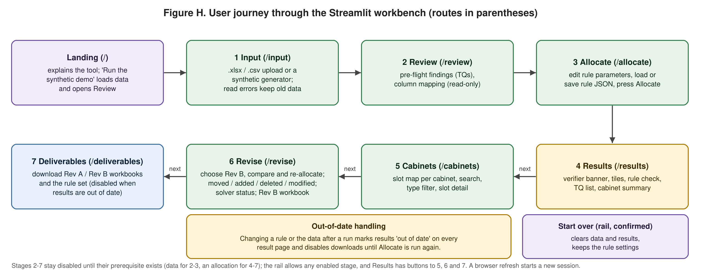

*Figure H. The seven workbench stages and the landing page, with their routes. Stages 2–7 stay disabled until their prerequisite exists.*

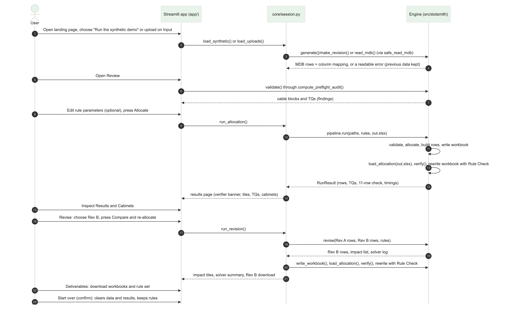

*Figure K. Sequence of calls for one complete session (user, Streamlit app, `app/core/session.py`, engine). Mermaid source: [`figK_sequence.mmd`](assets/slotsmith/diagrams/figK_sequence.mmd).*

### 13.1 Stage by stage

| # | User action | Internal operation | Data created or changed | Success state | Error state | Next |
|---|---|---|---|---|---|---|
| 1 | Open the app (`streamlit run app/streamlit_app.py`) | [`streamlit_app.py`](../app/streamlit_app.py) registers 8 pages with `st.navigation` (default navigation hidden; own header and rail); session defaults created | `st.session_state`: default rule set, empty dataset/results | Landing page; a synthetic demo preview is computed once per server process | If the demo preview fails, a notice replaces it; the workbench still works | Landing buttons |
| 2 | **Input**: upload `.xlsx`/`.csv`, or generate a synthetic benchmark (signals, seed, injected errors) | [`load_uploads`](../app/core/session.py#L85) → `safe_read_mdb` → `read_mdb`; or [`load_synthetic`](../app/core/session.py#L64) → `generate` + `make_revision` | Dataset record, cached MDB with fingerprint; synthetic Rev B kept for later; previous results are *not* deleted but become stale if the data differs | "Loaded dataset" panel (source, rows read, sheets used) | Banner "That file could not be read" with technical detail; previous dataset kept | Review |
| 3 | **Review**: read the readiness banner, tiles, findings table and the column-mapping table | [`get_audit`](../app/core/session.py#L252) → `compute_preflight_audit` → `validate` (cached by input and rule fingerprints) | Nothing changes ("Nothing on this page changes your dataset") | "Ready", "Ready with issues (partial allocation)" or "Allocation blocked" | Blocked when no valid cable can be formed | Allocate |
| 4 | **Allocate**: adjust the rule panel (isolation levels, seven switches, spare %, area/unit); optionally load a rule-set JSON | Widgets write into the session's `RuleSet`; fingerprint of the rules changes | Rule set; results become "out of date" if they exist | A computed summary of the rules in plain language | Invalid JSON: "That rule set could not be loaded"; the current rules stay | Run |
| 5 | Press **Allocate** | [`run_allocation`](../app/core/session.py#L122) → `pipeline.run(paths, rules, out.xlsx)`: validate, allocate, build rows, write, **re-read and verify**, rewrite with Rule Check | `res` (rows, TQs, 11-row check, timings), workbook path, fingerprints; any older revision is cleared | Redirect to Results | "The allocation did not finish …"; previous results unchanged | Results |
| 6 | **Results**: read the verifier banner, tiles and tabs (Rule check, Technical queries, Cabinets) | Pure display of `res`; [`compute_kpi_metrics`](../app/core/state.py#L404), [`is_verifier_certified`](../app/core/state.py#L467) | – | "Independent check: no violations" | "Independent check: violations found" listing the families | Cabinets / Revise / Deliverables |
| 7 | **Cabinets**: choose a cabinet, search a tag, cable or address, filter by type, select a table row | [`build_cabinet`](../app/core/cabinet.py#L111) from the rows; [`find_slots`](../app/core/cabinet.py#L146) | – | Matching slots ringed or highlighted, others dimmed; slot detail panel | "No slots match" | Revise |
| 8 | **Revise**: choose "Synthetic Rev B" or upload Rev B; press **Compare and re-allocate** | [`run_revision`](../app/core/session.py#L169): `revise` (pin, greedy, CP-SAT repair), write Rev B workbook, re-read, verify, rewrite | Revision result, Rev B workbook, fingerprints | Solver banner, six tiles, impact table with filters, download button | "Rev B could not be read"; "The revision did not finish …"; blocked while Rev A results are out of date | Deliverables |
| 9 | **Deliverables**: download Rev A workbook, Rev B workbook, rule-set JSON | Reads the files already written | – | Cards list every sheet and its row count; downloads enabled | Disabled with a reason when results are out of date | – |
| 10 | **Start over** (rail) → confirm | [`reset_session`](../app/core/session.py#L208) | Clears dataset, results, workbooks and fingerprints; **keeps the rule settings** | Returns to the landing page | Cancel keeps everything | – |

### 13.2 Operational sequence for a first-time user

1. Run `streamlit run app/streamlit_app.py` and open the printed address.
2. Click **Run the synthetic demo** (2,000 signals, seed 7, 6 injected errors). The Review page opens.
3. Read the six blocking findings; press **Set up allocation**; leave the rules at their defaults; press **Allocate**.
4. On Results check the green banner ("no violations"), the 29 held rows and the six technical queries.
5. Open **Cabinets**, search `10-TT-1005A` and select its row.
6. Open **Revise (Rev B)**, keep "Synthetic Rev B", press **Compare and re-allocate** and wait up to a minute.
7. Open **Deliverables** and download the two workbooks and the rule-set file.

The numbers quoted in steps 2–4 and in the screenshots below are those produced by the documented revision on 11 Oct 2026.

---

## 14. Prototype and interface guide

All screenshots were captured from the running application (`streamlit run app/streamlit_app.py`, Chromium via Playwright, 1440 × 900 viewport, light theme) on 12 Oct 2026 at commit `47a26b6`, using the **synthetic** demo dataset (2,000 signals, seed 7, 6 injected errors; Rev B from `make_revision(seed=8)`). They are crops of the real pages; the raw captures are in `docs/assets/slotsmith/screens/raw/`. A screenshot shows one state; it is not evidence that a feature works for every input.

### 14.1 Landing page (`/`)


*Figure U1. Landing page. **Purpose:** explain the tool and offer two actions. **Elements:** header with Appearance popover and a secondary "Workbench" link; hero; "Open the workbench" (primary) and "Run the synthetic demo"; a figure that follows one signal through Import, Validate, Allocate, Verify and Slot. Notice the caption: the figure is computed by SlotSmith from a seeded synthetic file (cached per server process), "not a live connection and not customer data". **Code:** [`landing.py`](../app/views/landing.py), [`flow.py`](../app/ui/flow.py), [`demo.py`](../app/core/demo.py). **Limits:** the preview is cached per server process; if it cannot be computed the page shows a notice.*

### 14.2 Input (`/input`)

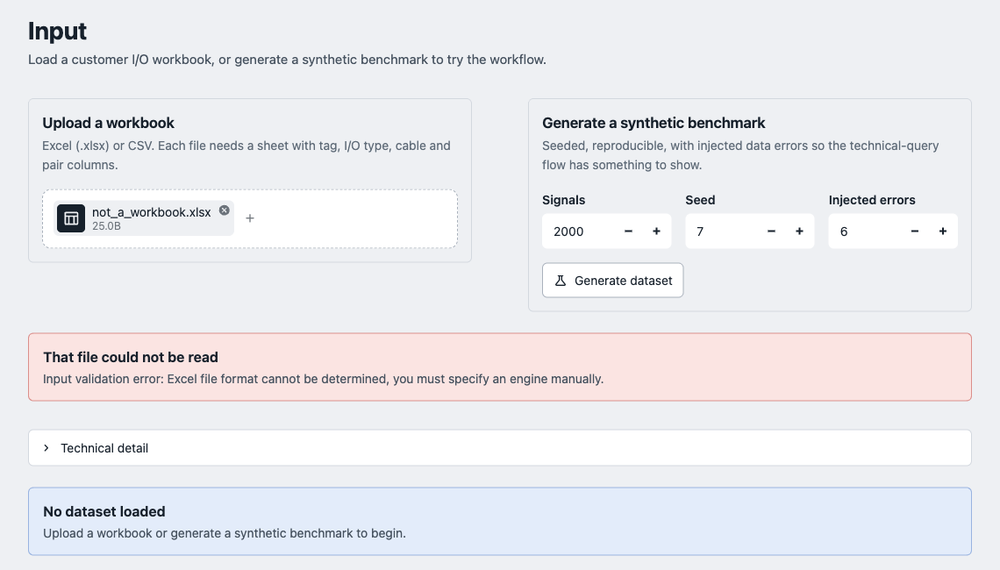

*Figure U2. Input page after uploading a file that is not a workbook (25 bytes of text named `.xlsx`). **Purpose:** load data. **Elements:** uploader (`.xlsx`, `.csv`, many files), synthetic generator (signals 100–30,000, seed, injected errors), "Generate dataset". **Error state shown:** a red banner "That file could not be read" with the reason, a collapsible technical detail, and the empty-state banner "No dataset loaded"; a previously loaded dataset would stay in place. **Code:** [`input.py`](../app/views/input.py), `load_uploads`, `safe_read_mdb`.*

### 14.3 Review (`/review`): findings and mapping

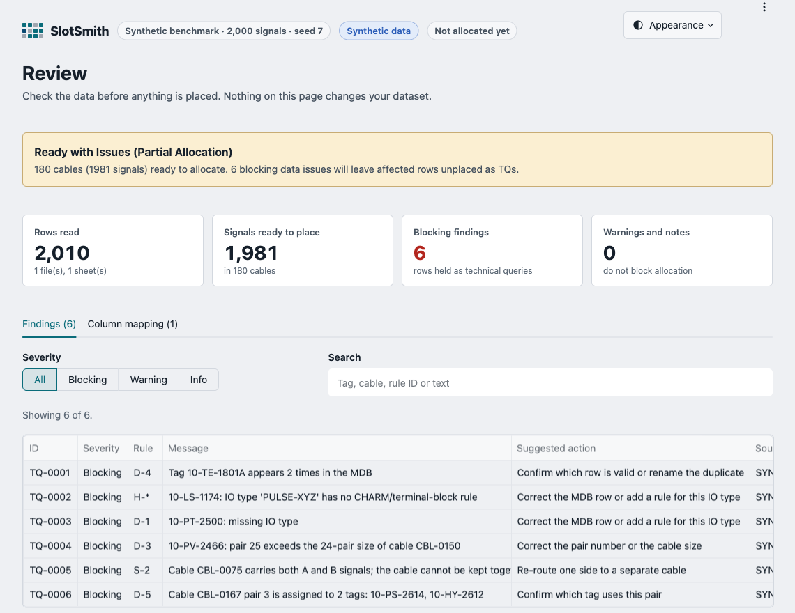

*Figure U3. Review page after generating the synthetic dataset. **Purpose:** show data problems before anything is placed. **Elements:** readiness banner ("Ready with issues (partial allocation): 180 cables (1981 signals) ready … 6 blocking data issues"), four tiles, a Findings tab with severity pills and search, and the table of six TQs (duplicate tag, unknown I/O type, missing I/O type, pair beyond cable size, A and B on one cable, duplicate pair). **Code:** [`review.py`](../app/views/review.py), `compute_preflight_audit`. **Limits:** capacity TQs appear only after allocation.*

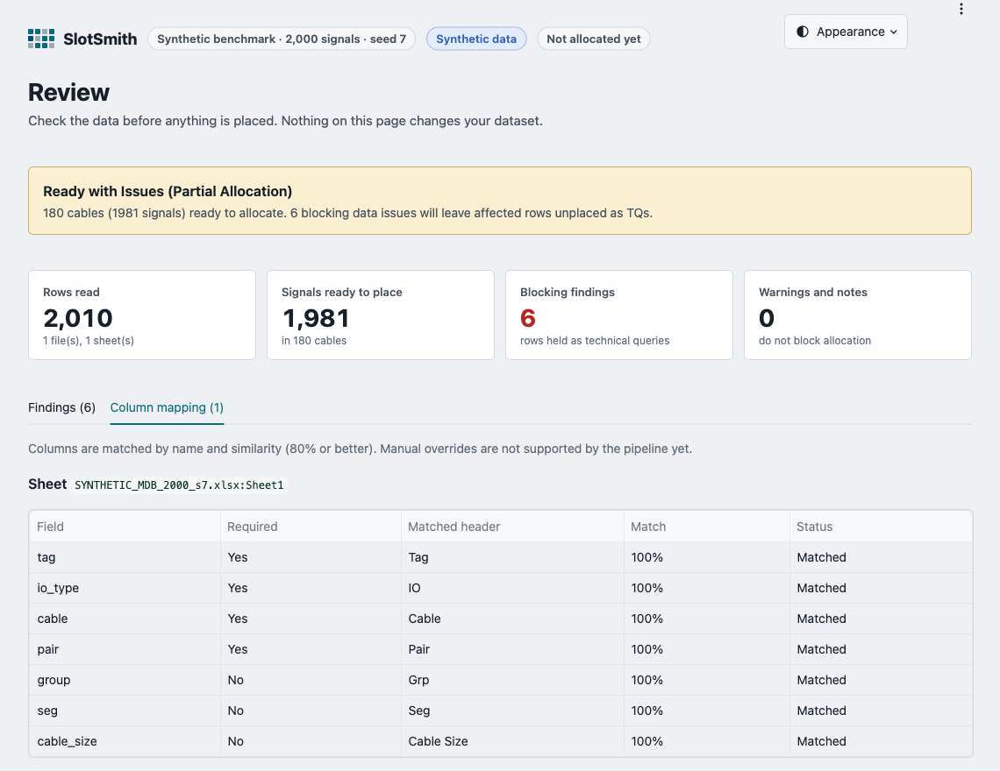

*Figure U4. The Column mapping tab: per sheet, the matched header, the similarity and a status for each canonical field. Mappings are read-only; the page says that manual overrides are not supported by the pipeline yet.*

### 14.4 Allocate (`/allocate`)

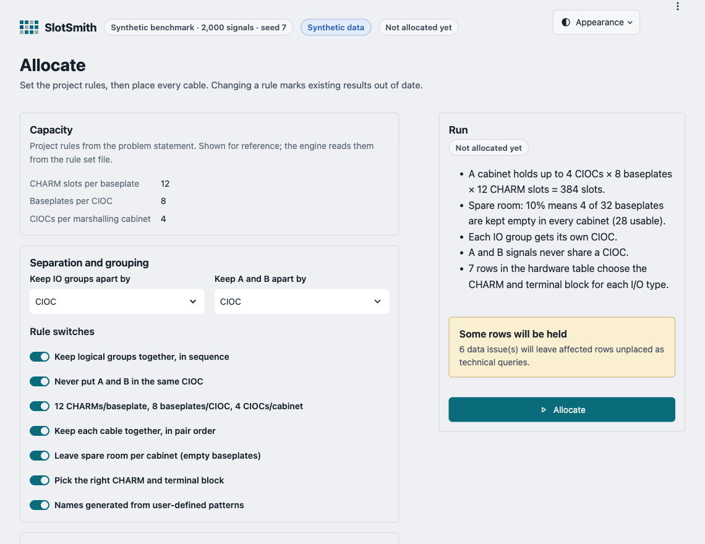

*Figure U5. Allocate page. **Purpose:** set rules and run. **Elements (left):** capacity values (display only), isolation levels for groups and for A/B, seven rule switches, spare % slider (0–40 %), area and unit for names, the hardware table, rule-set download and upload. **Right:** a plain-language summary generated from the current rule values (so it cannot disagree with them), a warning that six rows will be held, and the primary Allocate button. **Notice:** the switches for capacity, cable integrity and naming appear here but have no effect ([§9.4](#94-rules-that-are-switches-but-do-nothing)). **Code:** [`allocate.py`](../app/views/allocate.py), [`rules_view.py`](../app/core/rules_view.py).*

### 14.5 Results (`/results`)

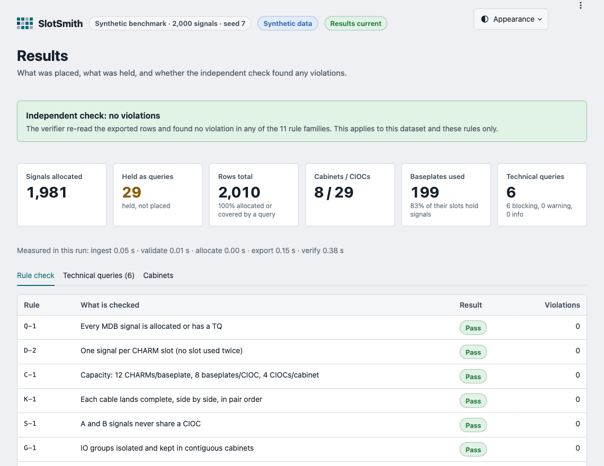

*Figure U6. Results page. **Purpose:** what was placed, what was held, and what the independent check found. **Elements:** verifier banner ("The verifier re-read the exported rows and found no violation in any of the 11 rule families. This applies to this dataset and these rules only."), six tiles (1,981 signals allocated; 29 held as queries; 2,010 rows; 8 cabinets / 29 CIOCs; 199 baseplates; 6 TQs), per-stage timings, and the Rule check tab with one row per family. **Code:** [`results.py`](../app/views/results.py). **Limits:** "100 % allocated or covered by a query" counts held rows as covered; 29 rows are *not* placed.*

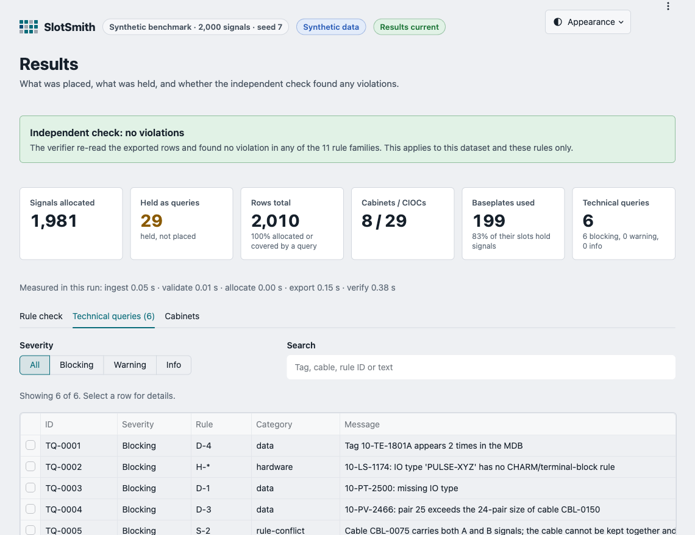

*Figure U7. The Technical queries tab: severity filter, search and a selectable table; selecting a row opens a detail panel (rule, category, tags, cables, source rows, suggested action).*

### 14.6 Cabinets (`/cabinets`)

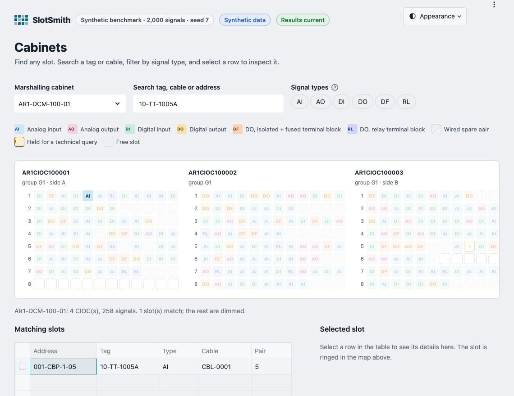

*Figure U8. Cabinet inspector after searching `10-TT-1005A`. **Purpose:** find any slot. **Elements:** cabinet selector, search box, type pills (AI, AO, DI, DO, DF = DO with fused isolated block, RL = relay block), legend, the map (each CIOC column has 8 baseplate rows of 12 slots with two-letter type codes; hatched = wired spare; "!" = held for a TQ; dashed = free), and the Matching slots table. The single matching slot (001-CBP-1-05) is highlighted and everything else dimmed. **Code:** [`cabinets.py`](../app/views/cabinets.py), [`cabinet.py`](../app/ui/cabinet.py). **Limits:** slots are not individually focusable; keyboard users select through the table.*

### 14.7 Revise (`/revise`)

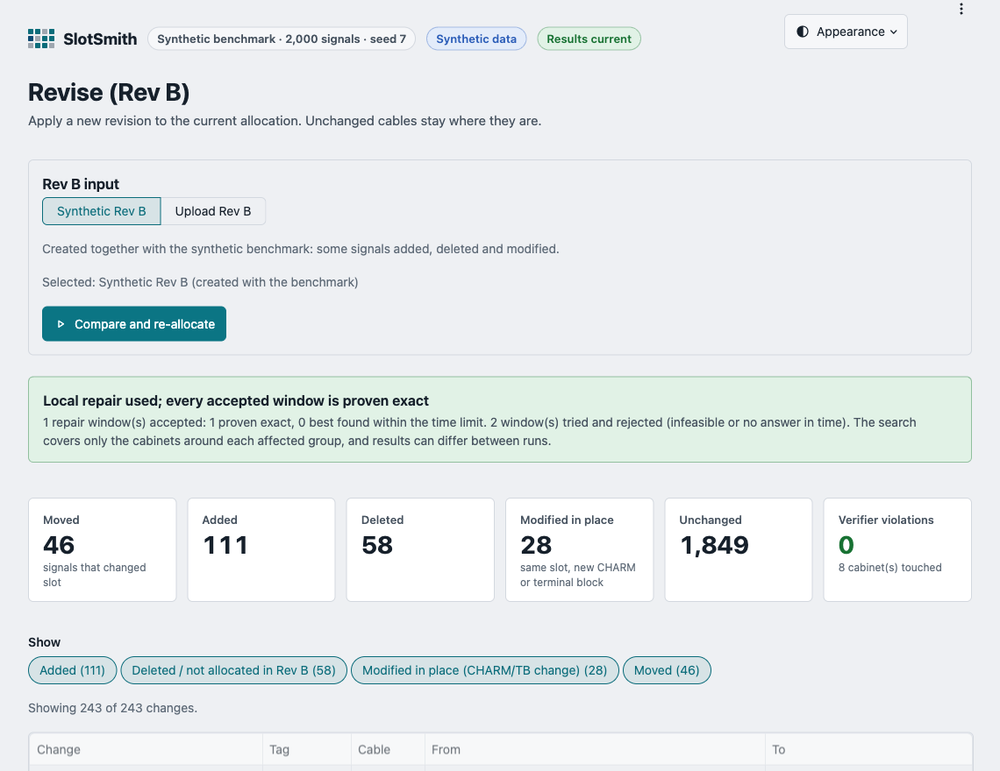

*Figure U9. Revise page after "Compare and re-allocate" on the synthetic Rev B. **Elements:** Rev B source selector (synthetic or upload), solver banner ("Local repair used; every accepted window is proven exact … 1 repair window accepted, 2 tried and rejected … results can differ between runs"), tiles (46 moved, 111 added, 58 deleted, 28 modified in place, 1,849 unchanged, 0 verifier violations, 8 cabinets touched), a filterable impact table and the Rev B download. **Code:** [`revise.py`](../app/views/revise.py), [`revision_view.py`](../app/core/revision_view.py). **Limits:** the page blocks while the solver runs (up to about a minute); the repair status and the move count can differ between runs.*

### 14.8 Deliverables (`/deliverables`) and Start over

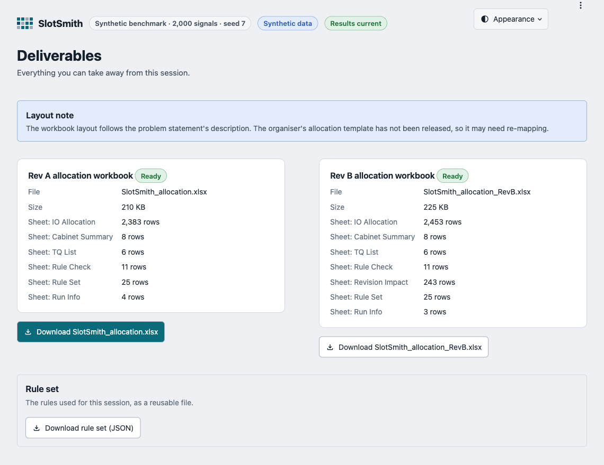

*Figure U10. Deliverables page: a layout note (the organiser's template has not been released), cards listing every sheet of the Rev A and Rev B workbooks with row counts, and downloads. Downloads are disabled, with a reason, when results are out of date. **Code:** [`deliverables.py`](../app/views/deliverables.py).*

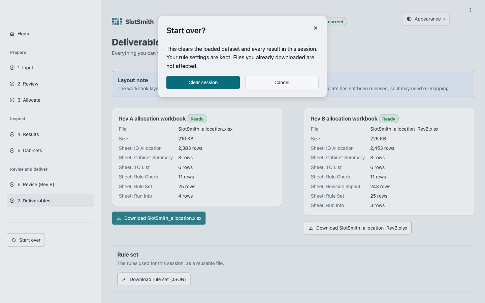

*Figure U11. "Start over?" confirmation: clears the dataset and every result, keeps the rule settings, does not affect downloaded files.*

**Empty states.** Every workbench page without its prerequisite shows "No dataset loaded" or "No allocation yet" with a button to the missing stage (**[Test]** `test_every_workbench_page_has_an_empty_state_without_data`). Theme: light and dark follow the system or Streamlit's own settings menu; switching causes no rerun (checked in the 11 Oct UI review, `docs/ux_review_log.md`).

---

## 15. Outputs and workbook contract

### 15.1 Artefacts

| Artefact | Created by | Purpose |
|---|---|---|
| Allocation workbook `.xlsx` (UI name `SlotSmith_allocation.xlsx`) | [`write_workbook`](../src/slotsmith/export.py#L151) via `run` | The allocation, TQs, rule check and run information |
| Rev B workbook `.xlsx` (`SlotSmith_allocation_RevB.xlsx`) | `write_workbook(..., impact=...)` via `revise` | Same sheets plus **Revision Impact** |
| Rule set `.json` | `RuleSet.model_dump_json` | Reusable project rules |
| CLI JSON metrics on stdout | `slotsmith allocate` / `revise` | Counts, timings, violations, solver log; exit code 2 if violations |
| `<name>.injected.json` | `slotsmith generate --errors N` | Ground truth of injected synthetic errors |

### 15.2 Worksheets

| Sheet | Content (columns) | Row semantics |
|---|---|---|
| **IO Allocation** | `Tag, IO Type, Cable, Cable Size, Pair, IO Group, Segregation, Row Kind, Controller, System Cabinet, Marshalling Cabinet, CIOC, Baseplate, Slot, CHARM Address, CHARM Type, Terminal Block, Status, TQ Ref, Source` ([`COLUMNS`](../src/slotsmith/export.py#L21)) | One row **per slot of every placed cable**, plus one row per unplaced or blocked signal. `Row Kind`: `Signal`, `Spare pair` (wired, empty), `Held (TQ)` (slot kept for a blocked signal). `Status`: `Allocated`, `Spare`, `Reserved`, `Not allocated` (capacity), `TQ raised` (data problem). `TQ Ref` links a held or unplaced row to its TQ. `Source` is `file:sheet:row`. Sorted by cabinet, CIOC, baseplate, slot; unplaced rows last |
| **Cabinet Summary** | `Marshalling Cabinet, CIOCs, Baseplates used, Empty baseplates (cabinet spare), Signals, Wired spare pairs, Held for TQ, Free slots on used baseplates, Fill % (signals / cabinet slots), Fill % (occupied / cabinet slots)` | One row per cabinet. "Empty baseplates" counts every unopened baseplate of the cabinet (32 − used); fill is relative to 384 slots per cabinet |
| **TQ List** | `TQ, Severity, Category, Rule, Message, Tags, Cables, Source rows, Suggested action` (lists cut to 20 entries) | One row per TQ; severity `blocking`, `warning`, `info` |
| **Rule Check** | `Rule, Check, Result, Violations, Examples` | The 11 verifier entries; examples limited to five |
| **Revision Impact** (Rev B only) | `Change, Tag, Cable, From, To, IO Type (A→B)` | One row per changed tag: Moved, Added, Deleted / not allocated in Rev B, Modified in place (CHARM/TB change). Unchanged signals are not listed |
| **Rule Set** | `Parameter, Value` | Scalar parameters and the hardware rows. **Rule switches and I/O-type aliases are not exported**, so this sheet alone does not reproduce a run |
| **Run Info** | `Key, Value` | Tool and version, rule-set name, **input file paths**, a note. For Rev B: tool, previous workbook path, Rev B path |

Naming: names come from the rule set's patterns (defaults reproduce the PS examples: `AR1-DCM-100-01`, `AR1CIOC100001`, `001-CBP-1`, CHARM address `001-CBP-1-01`). A recorded run (fresh clone, 614-row synthetic list) produced workbooks whose sheets match this table, with `Run Info` showing the absolute path of the input file **[Meas]** (`artifacts/dossier_repro/fresh_clone_setup.log`).

### 15.3 What to check before relying on an export

1. Read the **TQ List** and every `TQ raised`, `Not allocated` and `Held (TQ)` row: those signals are *not* placed.
2. Confirm **Rule Check** shows PASS for all 11 rules *and* that the Rule Set sheet matches the project's intended rules (switches are not listed there).
3. Compare names, CHARM types and terminal blocks with the project's hardware list and naming standard; the defaults are SlotSmith's reading of the PS.
4. Treat `Fill %` as one of two possible definitions.
5. Remove or accept the absolute paths in `Run Info` before sharing the file.

### 15.4 Limitations of the format

The layout follows the PS description and `COLUMNS` can be re-mapped, but **template compliance is not claimed and was not tested**; no official template or sample workbook was available **[Unv]**. There is no import-ready format for DeltaV Bulk Edit or any other engineering tool. Workbook contents are synthetic in this dossier; no private or organiser workbook is published with it.

---

## 16. Novelty and technical contribution

This section is deliberately conservative. SlotSmith uses established techniques (bin packing, constraint programming, minimal-perturbation re-solving, independent checking, property-based testing). **None of them is a contribution of this team.** What can be examined is how they are combined, specialised and evidenced for one concrete engineering workflow.

### 16.1 Search for counterexamples (what was looked for, what was found)

Searches on 11–12 Oct 2026 (web search, Google Patents, Emerson, AVEVA and ISA pages) and the review of 10 Oct (`docs/literature_review.md`, `docs/emerson_product_analysis.md`) looked for: (a) published algorithms for assigning field signals to electronic-marshalling slots; (b) vendor tools that allocate I/O from rules; (c) minimal-move revision of such allocations.

- **(a)** No peer-reviewed paper on rule-based assignment of field signals to DCS electronic-marshalling slots was found. The nearest academic items optimise DCS *hardware architecture* with metaheuristics (Zakirzyanov, 2026 preprints), which is a different problem **[Ext]**.
- **(b), found and important:** US 10,354,343 B2, *Automated process control hardware engineering using schema-represented requirements* (assignee Schneider Electric Systems USA, formerly Invensys; filed 14 Nov 2016, granted 16 Jul 2019). Its claims cover receiving a wiring index of tags and signal types, associating a "wiring typical schema" with each tag, populating a cabinet with hardware components and mapping connections; dependent claims include **project-specific I/O allocation rules** and engineering reports including cabinet loading; one independent claim covers **modifying the design in real time when an edited wiring index is received** **[Ext]** ([Google Patents page](https://patents.google.com/patent/US10354343B2/en), read 12 Oct 2026; the page does not mention CHARMs). This shows that rule-driven, index-based hardware engineering with automatic update on revised input is an existing idea in the industry. It does not describe a DeltaV CHARM allocation with an independent verifier or a minimal-move objective, as far as the page text read here shows. Its patent claims were not analysed legally and nothing in this dossier is a freedom-to-operate statement.
- **(b), other:** Emerson's own documentation covers late binding, auto-sense, CHARM templates and Bulk Edit around the allocation, not the planning of it. AVEVA's page for *Unified Engineering* does not mention I/O allocation or marshalling; an AVEVA Instrumentation brochure summary found by search mentions "design rules and catalogues" and auto-generated cable schedules and termination diagrams without describing I/O assignment rules; Hexagon Smart Instrumentation help (seen only through search snippets on 10 Oct, medium confidence) describes drag-and-drop I/O assignment and wiring-only auto-wiring **[Ext]**. Adjacent commercial tools exist (for example I/O list generation from P&IDs, vendor marketing, not verified).
- **(c)** Minimal-perturbation solving is a known formal problem (Barták, Müller, Rudová 2004) and "limited repacking" and "reoptimization" are studied for bin packing and scheduling ([§17](#17-related-work-and-literature-review)). No prior application to electronic-marshalling revision was found.

**Statement that the evidence supports.** *Within the sources reviewed, we did not find a publicly documented implementation that combines rule-parameterised DeltaV CHARM allocation, an independent output verifier and a minimal-move revision objective.* Limits of that statement: the search was a few hours of web and patent-page reading, not a systematic review; commercial and in-house tools are rarely documented publicly; the patent above shows adjacent prior art; and absence of evidence is not evidence of absence. It must not be shortened to "no similar tool exists".

### 16.2 Contributions, one by one

| # | Contribution | What is implemented | What is technically meaningful | Prior work and tools | What SlotSmith adds | Evidence | Unproven |
|---|---|---|---|---|---|---|---|
| 1 | Domain-specific workflow integration | Ingest → validate → allocate → verify → export → revise in one tool, CLI and UI | End-to-end traceability from source row to slot, with TQs as first-class outputs | Emerson tools around the step; patent US 10,354,343; manual Excel (PS) | A runnable, open, rule-parameterised pipeline for the PS workflow | **[Impl][Test]** | Usefulness to engineers; no user study |
| 2 | Engineering constraints represented | PS rules 1–6 plus data-integrity families, as a typed `RuleSet`; 11 verifier families | Explicit separation of hard rules, interpretations (parameters) and open questions (rule register) | PS rule list; bin packing with conflicts and class constraints (Gendreau et al.; Shachnai & Tamir) | A concrete model of whole-cable blocks with A/B and group isolation at CIOC level | **[Impl][Ref]** to the PS | Fidelity to real projects; three switches are inert ([§9.4](#94-rules-that-are-switches-but-do-nothing)) |
| 3 | Baseline allocation approach | Per-class FFD + next-fit layout | A proof that FFD is baseplate-optimal for one class with sizes 2/6/12, and exact agreement with an exact solver on 19,682 + 150 groups | FFD (Johnson et al. 1974); divisible sizes (Coffman, Garey & Johnson 1987) | Applying the divisible-size structure of cable sizes and a closed-form exact group minimum | **[Proof][Meas]** | Layout optimality (CIOCs, cabinets); other cable sizes |
| 4 | Independent checking | `verifier.py` over the exported workbook | A second implementation with a minimal import surface that sees only the output | Certifying algorithms (McConnell et al. 2011); independent verification in general | A verifier shaped to this workbook contract, with mutation tests | **[Impl][Test]** | Absence of shared misreadings; coverage beyond 11 families |
| 5 | Revision-aware preservation | Pin unchanged cables; greedy fill; stable CIOC numbering | Zero-move landing of new signals on spare pairs | Minimal perturbation (Barták et al. 2004); limited repacking (Gupta et al., arXiv) | Application to cable-block layouts with stable names | **[Impl][Test][Meas]**: 4–218 vs 883–9,632 moved per case | Comparison with other revision strategies; real revisions |
| 6 | Local optimisation for repair | CP-SAT over a window of cabinets, moves-first objective, hints | Windowed (large-neighbourhood-style) exact repair with reported status | CP-SAT; minimal-perturbation CSPs (Zivan et al. 2011) | A concrete model and an empirical study on 10 synthetic cases | **[Impl][Meas]** | Proven minimality (only 6–7 of 11 windows strictly exact); determinism; scalability |
| 7 | Reproducible testing and traceability | 122 tests, seeded generator with ground-truth injection, benchmark and audit scripts, recorded artifacts | Evidence that can be re-run (done on 11–12 Oct) | Property-based testing (QuickCheck; Hypothesis) | A synthetic benchmark for this problem (no public one found) | **[Meas][Test]** | External comparability; real data |
| 8 | UI and deliverable workflow | 7-stage workbench, staleness detection, downloads | Results marked out of date when rules or data change; failures never overwrite results | – | A usable front end for the engine | **[Impl][Test]** | Usability testing; accessibility audit |
| 9 | Potential research contributions | – | See [§24](#24-research-questions-and-future-work) | – | – | **[Plan]** | All |

### 16.3 What is, and is not, new

| Kind | Assessment |
|---|---|
| New algorithm | **No.** FFD, CP-SAT and the greedy pin-and-fill are standard. The closed-form exact group minimum is a small, specific derivation built on a known divisible-size property. |
| New formulation | **Modest.** The CP-SAT window model (start-position literals, moves-first objective, group-contiguity constraints) is specific to this layout; it is a modelling contribution, not a new technique. |
| New engineering integration | **Yes, in the sources reviewed**, with the qualification of [§16.1](#161-search-for-counterexamples-what-was-looked-for-what-was-found). |
| New experimental evidence | **Small.** A synthetic benchmark and an exhaustive small-case comparison; revision evidence on 10 cases with run-to-run variance. |
| New software artefact | **Yes:** an open, tested prototype that others can run. |
| Application of established methods to a domain | **Yes**, this is the strongest accurate description. |

**Strongest defensible contribution.** A reproducible, tested prototype that applies established packing and constraint-programming techniques to the PS's DeltaV allocation rules, with an independently implemented output checker, explicit accounting for held and unplaced signals, and a measured comparison of revision-aware repair with from-scratch re-allocation on synthetic data. The evidence for each element is in §10–§12 and §19; the limits are in §21.

---

## 17. Related work and literature review

Bibliographic data of the items marked "verified" were checked on 11–12 Oct 2026 against Crossref (DOI records) or the arXiv API; web pages were read on 11–12 Oct 2026. Several items were also read at abstract level on 10 Oct (`docs/literature_review.md`); **full texts were not read** for the papers below unless stated, so "relation" and "difference" are the author's interpretation of the problem each addresses, not claims about the papers' detailed results. The review is a focused survey, not exhaustive.

### 17.1 Bin packing and its variants

| Source | Purpose | Method | Relation to SlotSmith | Difference | Does not establish |
|---|---|---|---|---|---|
| D. S. Johnson, A. Demers, J. D. Ullman, M. R. Garey, R. L. Graham. *Worst-Case Performance Bounds for Simple One-Dimensional Packing Algorithms.* SIAM J. Computing 3(4), 1974. DOI 10.1137/0203025 (verified) | Analyse simple bin-packing heuristics | Worst-case analysis | Origin of the first-fit / first-fit-decreasing heuristics used as the baseline | General item sizes; SlotSmith's sizes are divisible | Anything about cable allocation |
| E. G. Coffman Jr., M. R. Garey, D. S. Johnson. *Bin packing with divisible item sizes.* J. Complexity 3(4), 1987. DOI 10.1016/0885-064X(87)90009-4 (verified) | Study bin packing when item sizes divide each other | Analysis of simple algorithms | Cable sizes 2, 6, 12, 24 and capacity 12 form such a chain; SlotSmith's own proof ([§10.5](#105-what-is-proved-what-is-tested-what-is-not-claimed)) covers the case used | Not read in full; the dossier relies on its own proof | The group-level or layout-level optimum |
| E. G. Coffman, J. Csirik, G. Galambos, S. Martello, D. Vigo. *Bin Packing Approximation Algorithms: Survey and Classification.* In *Handbook of Combinatorial Optimization*, 2013. DOI 10.1007/978-1-4419-7997-1_35 (verified) | Survey of approximation algorithms | Survey | Context for choosing FFD as a baseline | General | Domain evidence |
| V. Delorme, M. Iori, S. Martello. *Bin packing and cutting stock problems: Mathematical models and exact algorithms.* European J. Operational Research 255(1), 2016. DOI 10.1016/j.ejor.2016.04.030 (verified) | Exact models for bin packing | Review | Context for exact checks used in the audit (CP-SAT bin-packing model) | Plain bin packing without side constraints | – |
| M. Gendreau, G. Laporte, F. Semet. *Heuristics and lower bounds for the bin packing problem with conflicts.* Computers & Operations Research 31(3), 2004. DOI 10.1016/S0305-0548(02)00195-8 (verified) | Items in conflict may not share a bin | Heuristics and bounds | A/B segregation is a conflict constraint at CIOC level | Item-level conflicts; SlotSmith's are class-level | Anything about optimality in SlotSmith |
| K. Jansen. *An Approximation Scheme for Bin Packing with Conflicts.* J. Combinatorial Optimization 3, 1999. DOI 10.1023/A:1009871302966 (verified); H. Shachnai, T. Tamir. *Polynomial time approximation schemes for class-constrained packing problems.* J. Scheduling 4(6), 2001. DOI 10.1002/jos.86 (verified) | Theory for conflict and class-constrained packing | Approximation schemes | "One group per CIOC" resembles class-constrained packing | Theory; no layout or revision | – |

### 17.2 Revisions, stability and re-optimisation

| Source | Purpose | Relation | Difference | Does not establish |
|---|---|---|---|---|
| R. Barták, T. Müller, H. Rudová. *A New Approach to Modeling and Solving Minimal Perturbation Problems.* CSCLP 2003, LNCS 3010 (2004). DOI 10.1007/978-3-540-24662-6_13 (verified) | Formal model: given a solution and a changed problem, find a solution with fewest changed assignments | Exact formal match for "keep unchanged signals in place, fewest moves" | Course timetabling setting | That SlotSmith's repair is minimal |
| T. Müller, H. Rudová, R. Barták. *Minimal Perturbation Problem in Course Timetabling.* PATAT 2004, LNCS 3616 (2005). DOI 10.1007/11593577_8 (verified) | Large real instances | Evidence that incremental repair is practical | Timetabling | – |
| R. Zivan, A. Grubshtein, A. Meisels. *Hybrid search for minimal perturbation in Dynamic CSPs.* Constraints 16, 2011. DOI 10.1007/s10601-011-9108-5 (verified) | Combine systematic and local search | Supports pin-then-search with CP | Dynamic CSP | – |
| G. Verfaillie, N. Jussien. *Constraint Solving in Uncertain and Dynamic Environments: A Survey.* Constraints 10, 2005. DOI 10.1007/s10601-005-2239-9 (verified) | Survey of re-solving and solution stability | Motivation for stability as an objective | General | – |
| A. Gupta, G. Guruganesh, A. Kumar, D. Wajc. *Fully-Dynamic Bin Packing with Limited Repacking.* arXiv:1711.02078, 2017 (verified on arXiv; venue not checked) | Dynamic bin packing with bounded rearrangement | Related notion of limiting moves when items change | Online insert/delete model; SlotSmith is batch revision | Results for SlotSmith |
| Y. Mordechai. *Optimization and Reoptimization in Scheduling Problems.* arXiv:1509.01630, 2015 (verified on arXiv) | Reoptimisation after instance changes | Related framing | Scheduling | – |
| M. A. Bender, M. Farach-Colton, S. P. Fekete, J. T. Fineman, S. Gilbert. *Cost-oblivious storage reallocation.* arXiv:1404.2019, 2014 (verified on arXiv) | Reallocation cost in storage | Related notion of move cost | Storage allocation | – |

### 17.3 Solvers, checking and testing

| Source | Purpose | Relation | Does not establish |
|---|---|---|---|
| Google OR-Tools, *CP-SAT solver* guide, <https://developers.google.com/optimization/cp/cp_solver> and `sat_parameters.proto` (read 11 Oct 2026) | Defines solver statuses and parameters such as `relative_gap_limit`, `max_time_in_seconds`, `num_workers` | Basis for §12.6 | Quality of SlotSmith's model |
| Google OR-Tools bin-packing guide, <https://developers.google.com/optimization/pack/bin_packing> (read 11 Oct 2026) | Bin packing as a MIP solved with SCIP through MPSolver | Shows a standard exact formulation; SlotSmith's audit uses its own CP-SAT bin-packing model | – |
| R. M. McConnell, K. Mehlhorn, S. Näher, P. Schweitzer. *Certifying algorithms.* Computer Science Review 5(2), 2011. DOI 10.1016/j.cosrev.2010.09.009 (verified) | Algorithms that output a certificate checkable by a simple independent checker | Design inspiration for `verifier.py` | That SlotSmith's verifier is a certifying-algorithm checker in the formal sense |
| U. Junker. *QuickXplain.* AAAI 2004 (URL live on 11 Oct); M. Liffiton, K. Sakallah. *Algorithms for Computing Minimal Unsatisfiable Subsets of Constraints.* J. Automated Reasoning 40, 2008, DOI 10.1007/s10817-007-9084-z (verified); M. Gamba, B. Bogaerts, T. Guns. *Efficiently Explaining CSPs with Unsatisfiable Subset Optimization.* IJCAI 2021 DOI 10.24963/ijcai.2021/191, JAIR 2023 DOI 10.1613/jair.1.14260 (verified) | Explaining infeasibility | Future work: turn INFEASIBLE windows into explanations | Not implemented |
| K. Claessen, J. Hughes. *QuickCheck.* ICFP 2000, DOI 10.1145/351240.351266 (verified); D. R. MacIver, Z. Hatfield-Dodds et al. *Hypothesis: A new approach to property-based testing.* JOSS 4(43), 2019, DOI 10.21105/joss.01891 (verified) | Property-based testing | Used in `tests/test_core.py` | That tests prove correctness |

### 17.4 Industrial context

| Source | Relevance | Does not establish |
|---|---|---|
| Emerson, *DeltaV Electronic Marshalling* product data sheet (Aug 2026) and product page (read 11 Oct 2026) | Hierarchy, capacities, late binding | Anything about planning tools |
| Emerson white papers: *Smart Commissioning for DeltaV v14* (2021), *DeltaV Bulk Edit* (2022), *DeltaV CHARMs Commissioning* (2016) (read 10 Oct) | Workflow around allocation | A claim about absent features |
| US 10,354,343 B2 (Schneider Electric Systems USA) and US 7,684,875 B2 (Fisher-Rosemount, tag-based binding; recorded 10 Oct in `docs/source_register.md`) | Adjacent prior art | Legal scope; comparison of claims |
| B. Vogel-Heuser, A. Fay, I. Schaefer, M. Tichy. *Evolution of software in automated production systems: Challenges and research directions.* J. Systems and Software 110, 2015. DOI 10.1016/j.jss.2015.08.026 (verified) | Revision and variant management are known pain points in automation engineering | That SlotSmith addresses them in practice |
| R. Zakirzyanov. arXiv:2603.16617 (17 Mar 2026) and arXiv:2605.14788 (14 May 2026) (verified on arXiv; preprints) | Optimisation of DCS hardware architecture | Nearest academic neighbours; different objective; not peer reviewed |
| D. Tsouros et al. *Holy Grail 2.0.* arXiv:2308.01589 (2023); M. Parciak et al. *Schema Matching with Large Language Models.* arXiv:2407.11852 (2024) (verified on arXiv) | Context for the *planned* LLM suggestion helper only | Nothing about implemented features |

---

## 18. Fair comparison with existing approaches

Only dimensions with evidence are compared; empty or uncertain cells are labelled instead of scored. **No ranking is implied.** SlotSmith was not benchmarked against any other tool.

Labels: **D** = demonstrated in SlotSmith (this dossier); **X** = documented by an external source; **N** = not evaluated; **P** = not publicly verified; **Pl** = planned; **O** = outside current scope.

| Dimension | Manual spreadsheet (PS description) | Simple greedy (list-order first-fit) | General constraint optimiser on the whole project | DeltaV engineering tools (Emerson docs) | SlotSmith |
|---|---|---|---|---|---|
| Input validation with row-level queries | N | N | N | P | **D** (TQs with rule ID and source row) |
| Explicit, editable rule configuration | X (rules held by the engineer) | N | N | P | **D** (parameters and four switches; new rule types need code) |
| Cable and group integrity | N | N | N | P | **D** |
| Independent result checking | N | N | N | P | **D** (11 families, over the exported file) |
| Revision preservation | N | N | N | X for late-binding of tags to I/O (a different step) | **D** (pin, greedy, local repair; synthetic) |
| Local repair with solver status | N | N | N | P | **D** (CP-SAT window; statuses reported) |
| Export format | Excel (PS) | N | N | X: Bulk Edit tab-delimited and Excel templates for configuration | **D** own Excel layout; template compliance not tested; no Bulk Edit export (Pl: idea) |
| Reproducibility | N | N | N | P | **D** for allocation; repair is not deterministic |
| Integration with engineering environments | X (Excel) | N | N | X (native) | **O** (stand-alone; no integration tested) |
| Deployment maturity | X (in use today, per the PS) | N | N | X (commercial) | Prototype; no deployment |

Interpretation. The matrix says what SlotSmith demonstrates and where evidence is missing. It does **not** say that DeltaV engineering software lacks any capability: Emerson's tools solve other steps (device binding, bulk configuration, commissioning) and their internal engineering capabilities are not fully documented publicly. A general-purpose constraint optimiser applied to the whole problem is plausible but was **not built or measured here**, so its cells are "not evaluated". SlotSmith is a planning-support prototype, **not a replacement** for vendor engineering systems and is not claimed to outperform them.

---

## 19. Evaluation methodology and benchmark results

### 19.1 Environment, data and method

| Item | Value |
|---|---|
| Hardware / OS | Apple M5, 10 cores, 16 GB, macOS 27.0 (`artifacts/repro/environment.txt`; same machine for all batches) |
| Software | Python 3.12.13; pandas 3.0.6; openpyxl 3.1.5; pydantic 2.14.0; OR-Tools 9.15.6755 |
| Data | **Synthetic**, [`generate`](../src/slotsmith/generator.py#L37) with the default rule set ([§8.5](#85-dataset-provenance-and-limits)). No customer or organiser data |
| Allocation runs | Sizes 500, 2,000, 10,000 and 20,000 signals × seeds 1–3 = **12 runs per batch** (actual rows 502–20,033), no injected errors |
| Error-injection runs | 3 lists of 10,000 signals (seeds 101–103), **27 injected errors each** (9 kinds × 3) |
| Revision runs | 10 cases: 2,000 and 10,000 signals × 5 seeds; Rev A `generate(seed=200+k)`, Rev B `make_revision(seed=300+k)` (about 3 % deleted, 5 % added, 2 % modified, one cable regrouped) |
| Timing | `time.perf_counter()` around `pipeline.run()` for one execution per run: ingest (read the Excel file), validate, allocate, export (write workbook), verify (re-read, check, rewrite). Generation of the input file is excluded. **No warm-up and no repetition within a run**; the 3 seeds per size are different datasets |
| Commands | `.venv/bin/python scripts/benchmark.py` (`SLOTSMITH_BENCH_JSON=<file>` selects the output); exact-solver audits `scripts/audit_ffd_exact.py`, `scripts/audit_lb_gap.py`, `scripts/audit_revision_status.py`; figures `scripts/dossier_figures.py` |
| Known measurement error | Single executions on a laptop with other processes running (batch 3 recorded an 8.7 s run at 20,000 signals; it overlapped other work); CP-SAT uses 8 workers under a 10 s wall-clock limit per solve, so repair results vary run to run; revision benchmarks verify the in-memory result, not a re-read file |

### 19.2 Evidence base (nothing is merged across configurations)

| Batch | File | Date (IST) | Context |
|---|---|---|---|
| 1 | `artifacts/benchmarks.json` (= `artifacts/repro/benchmarks_clean_run1.json`) | 10 Oct 12:25 | clean-environment run after the 10 Oct audit |
| 2 | `artifacts/repro/benchmarks_clean_run2.json` | 10 Oct 12:29 | second clean run |
| 3 | `artifacts/pitch_deck_repro/benchmarks_rerun.json` | 11 Oct 22:35 | re-run while other work (browser capture) ran |
| 4 | `artifacts/dossier_repro/benchmarks_dossier.json` | 11 Oct 23:56 | re-run for this dossier, light background load |
| Status audits | `artifacts/audit/revision_status.json` (10 Oct), `artifacts/dossier_repro/revision_status_run2.json` (12 Oct) | – | same 10 revision cases with per-window objective and bound |
| Exact-solver audits | `artifacts/audit/ffd_exact.json`, `lb_gap.json` (10 Oct); `artifacts/pitch_deck_repro/ffd_exact_rerun.json`, `lb_gap_rerun.json` (11 Oct) | – | identical results |

(`artifacts/benchmarks_pre_audit.json` was produced before the audit fixes and is not used.) Aggregates over the batches: `docs/assets/slotsmith/data/benchmark_runs_summary.json`.

### 19.3 Allocation feasibility, verification and coverage

| Metric | Result | Definition and denominator | Kind |
|---|---|---|---|
| Verifier violations | **0 in all 48 allocation runs** (4 batches × 12), and in all 10 revision cases of every batch | Sum of violations over the 11 families on the exported (allocation) or in-memory (revision benchmark) rows | **[Meas]**; "no detected violation of the implemented checks" |
| Coverage | **100 %** in every run | (allocated + rows with a TQ) ÷ rows read. Not "100 % allocated": in error runs some rows are held | **[Meas]** |
| Held signals | 0 in the 12 error-free runs per batch; 12 held rows of 614 in the CLI demo of [§23](#23-reproducible-setup-and-execution); 29 of 2,010 in the UI demo | Rows with status `TQ raised` or `Not allocated` | **[Meas]** |
| Injected-error recall | **81 / 81** in every batch | An injected defect counts as detected if any *blocking* TQ names its tag or its cable (loose match; false positives not measured) | **[Meas]** |
| Baseplates versus exact per-group minimum | difference **0 in all 48 runs** | `baseplates − exact_group_baseplates` (closed form for sizes 2/6/12) | **[Meas]** against a **[Proof]**-backed formula |
| Baseplates versus the generic lower bound | up to 2 above | `lb_baseplates` is a weak bound (see [§10.3](#103-capacity-accounting)) | **[Meas]** |
| Exhaustive comparison with CP-SAT | **19,682 / 19,682** groups equal (all solves OPTIMAL); **150 larger groups: 148 OPTIMAL + 2 FEASIBLE, none worse** | Per-group baseplate count of `build_units` vs a CP-SAT bin-packing model under the same A/B and isolation rules | **[Meas]**, reproduced 11 Oct |

### 19.4 Runtime

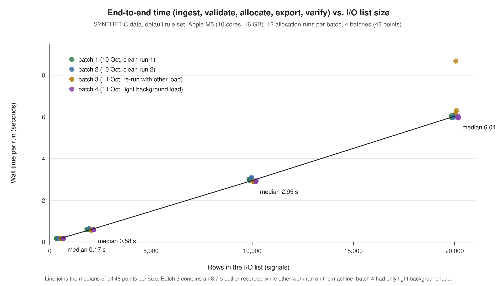

*Figure I1. End-to-end time per run against list size, 48 points from four batches (synthetic; Apple M5). The line joins the medians per size: 0.17 s (≈500 rows), 0.585 s (≈2,000), 2.95 s (≈10,000), 6.04 s (≈20,000). Sample size: 12 points per size. Data: `docs/assets/slotsmith/data/benchmark_runs_summary.json`.*

Stage breakdown at about 20,000 signals (batch 4, median of three): ingest 0.44 s, validate 0.16 s, **allocate 0.012 s**, export 1.5 s, verify 3.7 s. The allocation itself is negligible; Excel reading, writing and the independent re-check dominate **[Meas]**. Between 502 and 20,033 rows (40×) the time grew 35× in these runs. That is an observation at four sizes, not a complexity claim: the verifier and exporter were not analysed asymptotically.

### 19.5 Revision

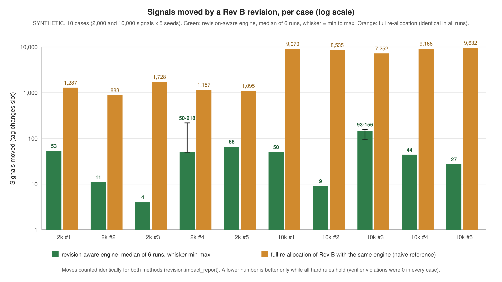

*Figure I2. Signals moved per revision case on a log scale, synthetic data. Green: revision-aware engine, median of six runs with min–max whisker; orange: from-scratch allocation of the same Rev B. Sample size: 6 runs for the revision-aware engine (four benchmark batches and two status audits), 1 deterministic value for the from-scratch run (identical in all runs).*

| Run | Total moved, 10 cases | Verifier violations | Accepted CP-SAT windows (OPTIMAL / FEASIBLE) | Slowest case |
|---|---|---|---|---|
| Batch 1 | 429 | 0 | 7 / 4 | 53.9 s |
| Status audit, 10 Oct | 446 | 0 | strict exact 7 of 11 | 56.1 s |
| Batch 2 | 470 | 0 | 7 / 4 | 58.1 s |
| Batch 3 | 575 | 0 | 7 / 4 | 54.6 s |
| Batch 4 | 467 | 0 | 6 / 5 | 56.1 s |
| Status audit, 12 Oct | 470 | 0 | strict exact 6 of 11 | 58.7 s |
| **From-scratch re-allocation** | **49,805** (same in every run) | 0 | – | – |

- Eight of the ten cases gave identical move counts in every run. The variation comes from two cases (`2k #4`: 50 in five runs, **218** in batch 3; `10k #3`: 93 to 156), where CP-SAT returned best-found solutions at the time limit. The cause of the 218 was not isolated (batch 3 overlapped other CPU load) **[Unv]**.
- "Moved" is defined identically on both sides ([`impact_report`](../src/slotsmith/revision.py#L289)): the same tag has a different (cabinet, CIOC, baseplate, slot). The from-scratch baseline allocates Rev B with the same engine ignoring Rev A; it is a naive reference, **not** an optimum and not a competing product.
- 10 cases are **10 revisions**; seven of them needed CP-SAT; those seven produced **11 accepted windows** (other windows were tried and rejected as INFEASIBLE or UNKNOWN). "Cases" and "windows" are different counts.
- Fallback to full re-allocation occurred in 0 of 10 cases in every run.

### 19.6 Discrepancies with earlier presentation material

| Earlier statement (Round 1 deck, `docs/validation_plan.md`, README) | Finding in this evaluation |
|---|---|
| "429–470 moved vs 49,805 (10 cases, 3 runs)" | Six runs gave 429, 446, 467, 470, 470 and **575**. The range 429–470 does not hold. Updated here; README and `docs/validation_plan.md` still show the old range (stale, to be corrected by the team) |
| "CP-SAT proven exact in 7/11 window repairs" | 7 of 11 in one status audit, **6 of 11** in another; status-OPTIMAL counts were 7, 7, 7 and 6. The number varies between runs and the two definitions differ ([§12.6](#126-what-best-found-and-proven-exact-mean-here)) |
| "5.99 s for 20,033 signals" | 5.96–6.31 s medians across four batches; one outlier of 8.7 s under load |
| "31 automated tests" | 122 (31 engine + 91 UI) |
| "Near-linear runtime" | Not claimed here; four sizes only |

### 19.7 What was reproduced and what was not

- **Reproduced on 11–12 Oct 2026:** all 122 tests; the full benchmark (batches 3–4); the exhaustive and larger-group exact-solver audits (identical); the revision status audit (second run); a fresh-clone setup ([§23](#23-reproducible-setup-and-execution)).
- **Not reproduced exactly (and not expected to be):** revision move totals and CP-SAT window statuses.
- **Unverified:** any result on organiser or customer data; hidden-test performance; performance on other hardware; memory use; behaviour above 30,000 signals.

No confidence intervals or significance tests are given: with 3 seeds per size and 6 revision runs, they would not be meaningful.

---

## 20. Testing and quality assurance

### 20.1 Commands and results

```bash
python -m pytest -q                       # 122 tests
```

| Environment | Result |
|---|---|
| Worktree `.venv`, 12 Oct 2026 (`artifacts/dossier_repro/pytest_dossier.log`) | **122 passed in 38.83 s** |
| Fresh clone of commit `47a26b6` with a new virtual environment from `requirements.lock.txt` (`artifacts/dossier_repro/fresh_clone_setup.log`) | **122 passed in 65.43 s** |

Coverage percentages were **not measured** and none is claimed.

### 20.2 Test areas

| Test area | File (count) | What it verifies | What it does not verify | Result |
|---|---|---|---|---|
| Ingestion | `tests/test_core.py` (3) | PS header names and variants map; title rows are skipped; source row numbers | Real customer layouts, merged cells, non-English headers | pass |
| Worked PS example, hardware, names | `test_core.py` (2) | The six PS example rows allocate with 0 violations, correct CHARM/block, A/B in different CIOCs, naming; a 24-pair cable takes two baseplates with 2 spares | Other rule interpretations | pass |
| Validation and TQs | `test_core.py` (3 tests + 1 test with 5 parametrised cases) | Each defect kind yields the intended TQ and the rest still allocate; 18 injected errors are all detected; coverage stays 100 % | False-positive rate; unknown defect kinds | pass |
| Verifier mutations | `test_core.py` (5) | Seven corruption types are caught ([§11.6](#116-tests-and-a-concrete-defect-and-response)) | C-2, M-1 mutations; shared-misreading errors | pass |
| Packing optimality | `test_core.py` (property, 200 examples) | FFD uses ⌈Σ/12⌉ baseplates for sizes {2, 6, 12} | Other sizes; layout level | pass |
| Property: random MDBs | `test_core.py` (property, 25 examples, 50–1,500 signals) | 0 violations and 100 % coverage on random synthetic lists | Real data distributions | pass |
| Rules as data | `test_core.py` (2) | JSON parameters change behaviour without code; disabling A/B is caught by the strict verifier | New rule types | pass |
| Revisions | `test_core.py` (2), `test_audit_regressions.py` (2) | Unchanged signals stay; spare-pair additions cost zero moves; fewer than half the from-scratch moves on one 3,000-signal case; fallback raises a warning TQ; oversized new cable gets a capacity TQ | Repair optimality; determinism | pass |
| Audit regressions | `tests/test_audit_regressions.py` (6 in total, two of them also listed under Revisions) | Oversized cable no longer unplaces its group; tag both allocated and not allocated is flagged; exact-minimum formula equals the allocator on all 0/1 combinations and a 3,000-signal list | – | pass |
| Export | `test_core.py` (1) | Required sheets exist; Rule Check all PASS | Template compliance; Excel opening in other applications | pass |
| UI logic | `tests/test_ui_core.py` (50) | Fingerprints, staleness chain, failed actions keep previous results, `safe_read_mdb` errors, mapping rows, preflight audit, KPI numbers, TQ filtering, verifier-banner logic | Rendering | pass |
| UI components | `tests/test_ui_components.py` (20) | Stylesheet size and reduced motion; colour-contrast ratios of the theme tokens; HTML escaping; cabinet model equals engine rows; search and filter; rule summary computed from values; honest solver summary; demo is real engine output | Screen-reader behaviour; real browsers | pass |
| UI journeys | `tests/test_ui_app.py` (21, Streamlit AppTest) | Landing, empty states, Input, Review, Allocate (no duplicate keys), stale marking, Results, Cabinets, Revise, Deliverables, failure handling, session persistence across pages | File uploader (AppTest limitation; checked in a browser), real browsers | pass |

### 20.3 Critical edge cases covered

Oversized cables; duplicate tags and pairs; A and B on one cable; spare 95 % leaving one usable baseplate; revision with an unplaceable new cable; forced fallback (monkey-patched solver); corrupted and missing files; a failed allocation or ingest never overwrites previous results; rule changes mark results stale.

### 20.4 Not tested

Real MDBs; the organiser's template; the CLI as a program (only exercised manually and in the fresh-clone run); CP-SAT determinism; load beyond 20,000 signals in tests; concurrency or multiple users; Safari and Firefox; screen readers; security testing; memory profiling. Some UI behaviours (upload, theme switching, dialogs) were verified by hand in a Chromium browser only.

---

## 21. Failure modes and limitations

Each item says how it affects practical use and what would settle it. **C** = confirmed in code or measurement; **U** = untested; **H** = hypothetical risk; **F** = future improvement.

### 21.1 Confirmed limitations (C)

| # | Limitation | Practical effect | Evidence needed or workaround |
|---|---|---|---|
| 1 | **All evidence is synthetic** and from the same rulebook the engine implements | Passing shows internal consistency only | Run on the organiser's sample MDB and on real projects, with an engineer's review |
| 2 | **Organiser's template and sample MDB were not available**; export layout is SlotSmith's own | An export may need re-mapping; `COLUMNS` in `export.py` is the single place to change | Obtain the template; add a compliance test |
| 3 | **Three of seven rule switches are inert** (`R3-capacity`, `R4-cable`, `R7-naming`); `allow_cable_straddle` and `multi_baseplate_cables_same_cioc` have no effect on the allocator | The UI offers controls that do nothing; PS "add, edit, switch rules" is only partly met | Remove or implement them; a generic rule type needs code |
| 4 | **New kinds of rule need code**; the hardware table and most naming patterns are editable only in the rule-set JSON, not in the UI | Contradicts the PS "no code change" requirement for new rule types | Design a declarative rule type (see [§24](#24-research-questions-and-future-work)) |
| 5 | **Input**: `.xlsx`/`.csv` only; no manual column-mapping override; tags, groups case-sensitive; pair/size read as the first digits; blank-header or unusual layouts untested | A real MDB with other conventions may be mis-mapped or mis-read | Test on real MDBs; expose `mapping_override` |
| 6 | **Layout is not minimal in CIOCs or cabinets** (next-fit); only baseplates per group are exactly minimal for sizes 2/6/12 | May use more cabinets than necessary | Exact or improved layout algorithm and comparison |
| 7 | **Revision repair is window-local, heuristic and non-deterministic**; only 6–7 of 11 accepted windows were strictly proven; OPTIMAL status can mean "within 5 %"; repairs can take about a minute and the UI blocks | "Fewest moves" is not guaranteed; results differ between runs | Deterministic single-worker mode; gap 0; larger windows; measured study |
| 8 | **Verifier limits**: shares the rule set, the MDB reading and the authors' interpretation; does not check group sequence or minimal cabinet span; K-1 trusts the exported cable size; no mutation tests for C-2 and M-1 | "0 violations" ≠ correct engineering | Review by a domain engineer; a second independent implementation; more mutations |
| 9 | **Held rows count towards "100 % coverage"** | A high coverage figure can hide many unplaced signals | Always read the held count and the TQ list |
| 10 | **Spare and fill definitions are interpretations** (⌈10 % × 32⌉ baseplates; two fill bases) | Cabinet counts depend on the reading | Mentor confirmation |
| 11 | **Session state is not persisted**; a browser refresh starts a new session; uploads and workbooks are written to OS temp directories that the app never deletes | Work is lost on refresh; temporary data stays on the server host | Download deliverables first; add cleanup and persistence (not planned) |
| 12 | **Exported `Run Info` contains absolute local paths**; the **Rule Set sheet omits rule switches and aliases** | Information leak when sharing; a run cannot be reproduced from the sheet alone | Strip paths; export all fields |
| 13 | **Accessibility**: map slots are not individually focusable; no screen-reader test; Streamlit's sidebar raises an `aria-allowed-attr` warning; contrast of the theme tokens is tested, native widgets are Streamlit's | Keyboard and screen-reader use is limited | Audit with assistive technology |
| 14 | **Browsers**: only Chromium was used | Other browsers unknown | Cross-browser test |
| 15 | **Direct navigation** to a page such as `/input` produced two `404` console errors (`/input/_stcore/host-config`, `/input/_stcore/health`) in Chromium on 12 Oct; the page still worked | Cosmetic or a deep-link edge case; cause not investigated | Investigate with Streamlit's server logs |
| 16 | **GitHub repository is private** (checked 11 Oct) | Reviewers cannot open it without access | Make it public or share it |
| 17 | **Revision matching is by tag** | A renamed tag is a delete plus an add | Optional key columns |
| 18 | **Unmodelled domain constraints**: AC/LV separation, power-injection limits, thermocouple terminal blocks, intrinsically safe segregation, physical cable routing, heat | Not checked, not claimed | Domain requirements and mentor input |

### 21.2 Untested areas (U)

Merged cells, hidden sheets, formulas and very large workbooks; revisions with 10–30 % changes and group splits; behaviour above 30,000 signals; multiple simultaneous users; Safari, Firefox and mobile; screen readers; Windows and Linux environments (only macOS used); behaviour when the 10 s solver limit is changed.

### 21.3 Hypothetical risks (H)

A rule interpreted differently by the project engineer (all outputs "valid" and wrong); a customer MDB whose header conventions defeat the 0.8 fuzzy match without a TQ; a defect in the shared MDB reading mirrored by the verifier; load on a shared deployment (the app is designed for one local user).

### 21.4 Future improvements (F)

See [§24](#24-research-questions-and-future-work): exact small-instance benchmarking, better stability metrics, adaptive windows, official-template export, declarative new rule types, accessibility audit, deployment hardening.

---

## 22. Security, safety and responsible-use boundaries

**Intended use.** SlotSmith is an *engineering-planning assistance prototype* for a hackathon. It does not connect to any controller or control system, does not write to DeltaV, and must not be used for safety-critical or production decisions. Allocation outputs must be checked against the applicable engineering requirements and validated by qualified personnel before any real-world use. The verifier's "no violations" statement is limited to the 11 implemented checks on the given data and rules.

**Trust boundaries (as implemented).**

| Topic | Current state | Evidence |
|---|---|---|
| File upload handling | Files are read by pandas/openpyxl after being written to a fresh temporary directory (`tempfile.mkdtemp()`) under the *original file name* ([`save_uploads`](../app/views/_common.py#L14)); there is no size, type or content check beyond Streamlit's extension filter and its 200 MB default limit. Whether a hostile file name containing path separators can escape the temporary directory was **not verified** | **[Impl]**; **[Unv]** |
| Data retention and session lifetime | Session data lives in server memory for the Streamlit session; temporary directories are **never deleted** by the application; no database; no authentication | **[Impl]** |
| External network requests | The engine imports no network library. The UI loads fonts and icons through Streamlit; an earlier UI review recorded one external request and the 11–12 Oct browser sessions served fonts from the local server. Not audited under an isolated network | **[Impl]** engine; **[Unv]** UI |
| Credentials | None used or stored; no API keys; no LLM calls | **[Impl]** |
| Export risks | **(a)** A tag or cell text that starts with `=` is written as an Excel **formula** (checked with the real exporter: openpyxl cell type `f` for the tag `=1+1`), so an untrusted MDB can place formulas in the deliverable; **(b)** `Run Info` records absolute input paths. Both are present in the committed code | **[Meas]** for (a), **[Impl]** for (b) |
| Dependency management | Versions pinned in `requirements.lock.txt`; `pyproject.toml` uses lower bounds; no vulnerability scan was run | **[Impl]**; **[Unv]** |
| Deployment assumptions | Local, single user, `headless = true`, usage statistics off, `toolbarMode = viewer`; the committed Streamlit config does not disable CORS or XSRF protection | **[Impl]** (`.streamlit/config.toml`) |
| Input validation | Row-level validation produces TQs; there is no schema validation of file structure beyond header mapping; rule-set JSON is validated by pydantic | **[Impl]** |
| Error disclosure | On failure the UI shows the exception type and message and, on the Input page, a "Technical detail" expander; messages can contain local file paths | **[Impl]** |

No security testing was performed and nothing here is a claim of security. Recommended before any shared deployment: neutralise leading `=`, `+`, `-`, `@` in exported text cells, remove local paths from `Run Info`, delete temporary files, sanitise upload names, run a dependency audit, and put the app behind authentication.

---

## 23. Reproducible setup and execution

Everything in the "tested" blocks below was run on 12 Oct 2026 in a **fresh clone** of commit `47a26b6` (a local clone of the repository, because the GitHub repository was private; cloning from GitHub itself was not tested), with a new virtual environment, on macOS 27.0 with Python 3.12.13. Log: `artifacts/dossier_repro/fresh_clone_setup.log`.

### 23.1 Quick start (tested)

```bash
git clone https://github.com/Sidd927/SlotSmith.git      # needs access while the repository is private
cd SlotSmith
python3.12 -m venv .venv                                # Python >= 3.11 is declared; 3.12.13 was tested
.venv/bin/pip install -r requirements.lock.txt          # about 24 s on the test machine
.venv/bin/pip install --no-deps -e .
.venv/bin/python -m pytest -q                           # expected: 122 passed (65 s in the fresh clone)

# command line, synthetic data
.venv/bin/slotsmith generate --signals 600 --seed 3 --errors 6 --out demo_mdb.xlsx --rev-b demo_revb.xlsx
.venv/bin/slotsmith allocate demo_mdb.xlsx --out alloc.xlsx
.venv/bin/slotsmith verify alloc.xlsx --mdb demo_mdb.xlsx
.venv/bin/slotsmith revise --prev alloc.xlsx --mdb demo_revb.xlsx --out alloc_revB.xlsx

# web UI
.venv/bin/streamlit run app/streamlit_app.py            # the first start serves HTTP 200 on port 8501
```

**Expected results (as recorded).**

| Command | Result |
|---|---|
| `generate` | `wrote demo_mdb.xlsx (614 rows, synthetic)` |
| `allocate` | JSON with `mdb_rows 614`, `signals_allocated 602`, `signals_with_tq 12`, `coverage_pct 100.0`, `tqs 6`, `cabinets 3`, `ciocs 9`, `baseplates 62`, `violations 0`; exit code 0 |
| `verify` | 11 lines `PASS …` (Q-1 … M-1), exit code 0 |
| `revise` | `moved 0`, `added 36`, `deleted 18`, `modified_in_place 9`, `unchanged 575`, no CP-SAT window needed, `violations 0`; exit code 0 |
| UI | The landing page opens; follow [§13.2](#132-operational-sequence-for-a-first-time-user). Downloads appear on the Deliverables page (the browser's download folder) |

The UI journey itself was exercised in the working tree and by the 21 AppTest journeys that ran in the fresh clone; the clicks of [§13.2](#132-operational-sequence-for-a-first-time-user) were performed in the working tree, not repeated in the fresh clone.

### 23.2 Detailed reproducibility procedure

1. **Environment.** `requirements.lock.txt` pins 63 packages (including `ortools==9.15.6755`, `pandas==3.0.6`, `streamlit==1.65.0`). `pyproject.toml` declares looser bounds (`ortools>=9.10`, `pandas>=2.2`, `streamlit>=1.65` in the `ui` extra); only the locked set was tested.
2. **Tests.** `python -m pytest -q`. `pyproject.toml` sets `pythonpath = ["src"]`, so an editable install is not required for the tests.
3. **Benchmark.** `SLOTSMITH_BENCH_JSON=out.json SLOTSMITH_BENCH_DIR=/tmp/bench .venv/bin/python scripts/benchmark.py` (about 4 minutes on the test machine; revision cases take up to about a minute each).
4. **Exact-solver audits.** `.venv/bin/python scripts/audit_ffd_exact.py` (about 3 minutes), `scripts/audit_lb_gap.py`, `scripts/audit_revision_status.py`. These scripts write into `artifacts/audit/`; run them in a scratch copy to avoid overwriting recorded results.
5. **Worked examples of this dossier.** `.venv/bin/python scripts/dossier_examples.py --revision` writes `docs/assets/slotsmith/data/*.json`.
6. **Figures.** `scripts/dossier_figures.py` (charts), `scripts/dossier_diagrams.py` (diagrams A, B, D, G, H, J); the four Mermaid diagrams are rendered from the `.mmd` files with Mermaid 11 in headless Chromium using `docs/assets/slotsmith/diagrams/render_mermaid.html`.
7. **This document.** `scripts/check_dossier.py` verifies links and source line anchors; `scripts/build_dossier_pdf.py` renders the PDF from this Markdown.

### 23.3 Troubleshooting

| Symptom | Likely cause and fix |
|---|---|
| `ModuleNotFoundError: slotsmith` in the CLI | Run `pip install --no-deps -e .` (the CLI is the editable install's entry point) |
| `.xls` upload fails | Not supported (`xlrd` is not installed); save as `.xlsx` |
| "No sheet with required IO columns found" | A sheet needs columns for tag, I/O type, cable and pair; rename headers to common synonyms ([§8](#8-data-model-and-input-specification)) |
| Revision takes about a minute and the page does not respond | CP-SAT is searching windows (10 s each); wait |
| Results show "out of date" and downloads are disabled | Rules or data changed after the last run; run Allocate again |
| Port 8501 busy | `streamlit run app/streamlit_app.py --server.port 8610` |
| Icons missing offline | The UI's icon font is loaded by Streamlit; labels remain |

Do not commit generated workbooks, local `.venv` directories, credentials or private datasets; the repository's `.gitignore` already excludes `reference/official/` and the virtual environment. The README's one-line `pip install -e ".[dev,ui]"` was **not** re-tested in a fresh environment **[Unv]**; use the locked install above.

---

## 24. Research questions and future work

These are proposals, not results.

| # | Research question | Why it matters | Method | Data / evidence needed | Success criterion | Risks |
|---|---|---|---|---|---|---|
| 1 | How far from the optimum are the layout (CIOCs, cabinets) and the revision repair? | Only baseplates per group are known to be optimal | Compare against an exact whole-problem model (CP-SAT or MILP) on small and medium synthetic instances | Seeded instances up to a size the exact model can solve | Reported optimality gap per instance size with solver status | Exact models may not scale; the gap may depend on the generator |
| 2 | Which stability metric reflects real rework? | "Signals moved" ignores wiring changes, labels and drawings | Weighted metrics: cables moved, cabinets touched, wires re-landed; sensitivity of the objective | Engineer interviews or real revisions | Metric ranks revisions as engineers do | Subjective; needs domain input |
| 3 | Can repair windows be chosen adaptively? | Window size drives solve time and quality | Learn or heuristically pick the window; large-neighbourhood search; deterministic single-worker mode | The 10-case benchmark plus larger sets | Same or fewer moves at lower time; reproducible results | Overfitting to synthetic revisions |
| 4 | What is a good multi-objective formulation (moves, baseplates, cabinets, spare balance)? | Engineers trade these off | Pareto or lexicographic variants | Same instances | A documented front and a default | Weights are subjective |
| 5 | How robust is ingestion to incomplete or inconsistent inputs? | The PS hidden test uses an unseen MDB | Schema fuzzing (renamed, merged, missing columns, extra sheets, case and format variants) | Generated variants; real MDBs when available | Mapping accuracy and no silent mis-reads | Real MDBs may differ from any generator |
| 6 | Does SlotSmith reproduce a real project's allocation and revisions? | All evidence is synthetic | Run on a real (permitted) project; expert review of differences | Customer or organiser data and an engineer | Documented agreement and disagreement list | Data access; confidentiality |
| 7 | Can the organiser's allocation template be filled exactly? | The deliverable format is part of the problem | Map `COLUMNS`; add a compliance test | The template and a sample | Template opens and validates; round-trip through the verifier | Template may require new fields |
| 8 | Can testing find more defects? | The verifier and allocator share assumptions | Differential testing against a second implementation; stateful property tests; mutation testing of the verifier (add C-2, M-1) | Existing generator | Coverage of the 11 families by named mutants | Effort |
| 9 | How accessible and portable is the UI? | Keyboard and screen-reader users, other browsers | WCAG-oriented audit; Safari/Firefox tests; focusable slots | Test users | Documented pass/fail list | Streamlit limits |
| 10 | What does it take to deploy safely? | Current boundaries are local and single-user | Hardening list in [§22](#22-security-safety-and-responsible-use-boundaries) | Threat model | Checklist implemented and tested | Out of hackathon scope |
| 11 | Can new rule types be declared without code? | PS "flexible" requirement | A small declarative constraint language compiled to both allocator checks and verifier checks | The PS rule list and mentor-provided examples | A new rule added by configuration only, with tests | Expressiveness versus complexity |
| 12 | Can infeasible windows be explained to the user? | A TQ should say *why* | Minimal unsatisfiable subsets (QuickXplain; Liffiton & Sakallah) | Existing INFEASIBLE windows | Explanations a user can act on | Solver integration complexity |

---

## 25. Conclusion

**The problem.** Allocating field signals to cabinets, CIOCs, baseplates and CHARM slots under interacting project rules is manual work in Excel according to the organiser, and every revision repeats it.

**What is implemented.** A tested Python engine and a Streamlit workbench that ingest I/O lists, report data defects as traceable queries, place whole cables under parameterised rules, export an Excel workbook, re-check that workbook with a separately implemented verifier, and revise an allocation with pinned cables and a local CP-SAT repair.

**Most defensible contribution.** A reproducible prototype that applies established methods (first-fit-decreasing packing, constraint programming, minimal-perturbation repair, independent checking) to this workflow, with an exact result for per-group baseplate counts (a short proof plus 19,682 + 150 exact-solver checks) and a measured, run-to-run-variable reduction of signal moves on synthetic revisions (4–218 versus 883–9,632 per case). It is not a new algorithm, and an adjacent patent shows that rule-based hardware engineering from a wiring index is not new as a concept.

**Strongest verified evidence.** 122 tests pass in the working tree and in a fresh clone; 48 allocation runs had 0 verifier violations, full coverage and baseplate counts equal to the exact per-group minimum; the revision benchmark recorded 0 violations in 60 revision runs (10 cases × 6 runs).

**Maturity.** A working hackathon prototype on synthetic data. Not validated on real data, not matched to the organiser's template, not certified, not for production or safety-critical use.

**Most important next step.** Validate on the organiser's sample MDB and template (or on real project data with an engineer's review), and in the same step fix the identified inconsistencies: the three inert rule switches, the formula-injection and path-leak issues in the export, and the stale revision figures in the README and the validation plan.

---

## 26. Glossary, references and evidence index

### 26.1 Glossary

| Term | Definition |
|---|---|
| A/B (side) | Segregation value on a signal; A and B signals must not share a CIOC (PS rule 2) |
| Baseplate | Carrier with 12 slots (terminal block + CHARM); up to 8 per CIOC |
| Best-found | In this project: an accepted CP-SAT window whose objective is not proven equal to its bound (`proven_exact = false`) |
| Cable block | A whole cable as one placement unit of `size` consecutive slots, spares included |
| Cabinet (marshalling) | Cabinet housing CIOCs and baseplates; "up to 4 CIOCs" is a PS project rule |
| CHARM | Single-channel I/O module for a baseplate slot (Emerson term) |
| CIOC | CHARM I/O Card: 8 baseplates, 96 channels, serves up to four controllers (Emerson) |
| CP-SAT | OR-Tools constraint-programming solver on a SAT core |
| DCS | Distributed control system |
| Electronic marshalling | Landing field cables on generic terminal blocks and assigning type and controller in software |
| Feasible allocation | A placement satisfying every hard rule |
| FFD | First-fit-decreasing bin-packing heuristic |
| Fallback | Full re-allocation used when no local repair is found; raises warning TQ `R-2` |
| Held (TQ) row | A slot kept for a blocked signal so the rest of its cable still lands in order |
| Independent verification | Re-checking the exported workbook with code that imports only the rule set |
| IO group | "Grp" column; signals of one group stay together |
| Late binding | Assigning a channel's identity after installation (Emerson) |
| MDB | The customer's signal list in the PS; here an Excel or CSV table |
| Pair | One conductor pair of a multi-pair cable; one pair = one signal = one CHARM |
| Pinned | Cable kept at its Rev A slots in a revision |
| Proven exact | `|objective − bound| < 1e-6` for a CP-SAT window |
| Revision-aware allocation | Producing Rev B from Rev A while keeping unchanged assignments |
| Spare capacity | Empty baseplates reserved per cabinet; also wired spare pairs inside a cable |
| Technical query (TQ) | A traceable question about data that cannot be placed (ID, severity, rule, sources, action) |
| Terminal block | Field wiring terminal of a slot (standard, fused/injected power, relay) |
| Window | Set of cabinets in which CP-SAT may re-place cables during repair |

### 26.2 References

External sources (accessed 10–12 Oct 2026). "Verified" = bibliographic data checked against Crossref or arXiv.

**Organiser and event sources (not redistributed here).** AISF / Emerson. *Track 1 Problem Statements, #02 "Project IO SIGNAL SUDOKU"*, pp. 4–6, 2026 (local copy under `reference/official/`, git-ignored). AISF VIT Pune. *Code Apex 3.0 handbook* (timeline).

**Emerson.**

1. Emerson. *DeltaV Electronic Marshalling Product Data Sheet*, Aug 2026. <https://www.emerson.com/is/content/emerson/en/systems-and-software/deltav-distributed-control-system-dcs/product-data-sheets/documents/deltav-electronic-marshalling.pdf>
2. Emerson. *DeltaV Electronic Marshalling* (product page). <https://www.emerson.com/en/automation-systems/distributed-control-systems-dcs/deltav-distributed-control-system/deltav-controllers-io/deltav-electronic-marshalling>
3. Emerson. *Smart Commissioning for DeltaV v14* (white paper), Oct 2021. <https://www.emerson.com/documents/automation/white-paper-smart-commissioning-for-deltav-v14-en-57870.pdf>
4. Emerson. *DeltaV Bulk Edit* (white paper), Sep 2022. <https://www.emerson.com/documents/automation/white-paper-deltav-bulk-edit-deltav-en-57262.pdf>
5. Emerson. *DeltaV CHARMs Commissioning* (white paper, doc. en-56728), Oct 2016 (copy retrieved 10 Oct 2026; see `docs/source_register.md` S-05).

**Other industry sources.**

6. AVEVA. *Unified Engineering* (product page). <https://www.aveva.com/en/products/unified-engineering/> (read 11 Oct 2026; no I/O allocation content).
7. ISA. *ISA101 committee page*. <https://www.isa.org/standards-and-publications/isa-standards/isa-standards-committees/isa101> (read 11 Oct 2026; HMI standards, not cited in the argument).
8. P. Bodanapu, D. Gondhi, M. Seshadri, S. Kondejkar, J. G. Luth. *Automated process control hardware engineering using schema-represented requirements.* US Patent 10,354,343 B2, Schneider Electric Systems USA (formerly Invensys), filed 14 Nov 2016, granted 16 Jul 2019. <https://patents.google.com/patent/US10354343B2/en> (read 12 Oct 2026).
9. Jundt et al. (Fisher-Rosemount Systems). *Methods and apparatus to configure process control system inputs and outputs.* US 7,684,875 B2 (filed 2007, granted 2010), recorded 10 Oct 2026 in `docs/source_register.md` S-12; not re-read.

**Solver documentation.**

10. Google. *OR-Tools: CP-SAT solver guide*. <https://developers.google.com/optimization/cp/cp_solver> and `ortools/sat/sat_parameters.proto` (<https://raw.githubusercontent.com/google/or-tools/stable/ortools/sat/sat_parameters.proto>) (read 11–12 Oct 2026).
11. Google. *OR-Tools: bin packing*. <https://developers.google.com/optimization/pack/bin_packing> (read 11–12 Oct 2026).

**Papers (all verified).**

12. D. S. Johnson, A. Demers, J. D. Ullman, M. R. Garey, R. L. Graham. Worst-Case Performance Bounds for Simple One-Dimensional Packing Algorithms. *SIAM J. Comput.* 3(4), 1974. doi:10.1137/0203025
13. E. G. Coffman Jr., M. R. Garey, D. S. Johnson. Bin packing with divisible item sizes. *J. Complexity* 3(4), 1987. doi:10.1016/0885-064X(87)90009-4
14. E. G. Coffman, J. Csirik, G. Galambos, S. Martello, D. Vigo. Bin Packing Approximation Algorithms: Survey and Classification. *Handbook of Combinatorial Optimization*, 2013. doi:10.1007/978-1-4419-7997-1_35
15. V. Delorme, M. Iori, S. Martello. Bin packing and cutting stock problems: Mathematical models and exact algorithms. *EJOR* 255(1), 2016. doi:10.1016/j.ejor.2016.04.030
16. M. Gendreau, G. Laporte, F. Semet. Heuristics and lower bounds for the bin packing problem with conflicts. *Computers & Operations Research* 31(3), 2004. doi:10.1016/S0305-0548(02)00195-8
17. K. Jansen. An Approximation Scheme for Bin Packing with Conflicts. *J. Combinatorial Optimization* 3, 1999. doi:10.1023/A:1009871302966
18. H. Shachnai, T. Tamir. Polynomial time approximation schemes for class-constrained packing problems. *J. Scheduling* 4(6), 2001. doi:10.1002/jos.86
19. R. Barták, T. Müller, H. Rudová. A New Approach to Modeling and Solving Minimal Perturbation Problems. *CSCLP 2003*, LNCS 3010, 2004. doi:10.1007/978-3-540-24662-6_13
20. T. Müller, H. Rudová, R. Barták. Minimal Perturbation Problem in Course Timetabling. *PATAT 2004*, LNCS 3616, 2005. doi:10.1007/11593577_8
21. R. Zivan, A. Grubshtein, A. Meisels. Hybrid search for minimal perturbation in Dynamic CSPs. *Constraints* 16, 2011. doi:10.1007/s10601-011-9108-5
22. G. Verfaillie, N. Jussien. Constraint Solving in Uncertain and Dynamic Environments: A Survey. *Constraints* 10, 2005. doi:10.1007/s10601-005-2239-9
23. R. M. McConnell, K. Mehlhorn, S. Näher, P. Schweitzer. Certifying algorithms. *Computer Science Review* 5(2), 2011. doi:10.1016/j.cosrev.2010.09.009
24. U. Junker. QuickXplain: Preferred Explanations and Relaxations for Over-Constrained Problems. *AAAI 2004*. <https://cdn.aaai.org/AAAI/2004/AAAI04-027.pdf> (URL live; not otherwise re-verified)
25. M. H. Liffiton, K. A. Sakallah. Algorithms for Computing Minimal Unsatisfiable Subsets of Constraints. *J. Automated Reasoning* 40, 2008. doi:10.1007/s10817-007-9084-z
26. M. Gamba, B. Bogaerts, T. Guns. Efficiently Explaining CSPs with Unsatisfiable Subset Optimization. *IJCAI 2021*, doi:10.24963/ijcai.2021/191; *JAIR* 2023, doi:10.1613/jair.1.14260
27. K. Claessen, J. Hughes. QuickCheck: a lightweight tool for random testing of Haskell programs. *ICFP 2000*. doi:10.1145/351240.351266
28. D. R. MacIver, Z. Hatfield-Dodds et al. Hypothesis: A new approach to property-based testing. *JOSS* 4(43), 2019. doi:10.21105/joss.01891
29. B. Vogel-Heuser, A. Fay, I. Schaefer, M. Tichy. Evolution of software in automated production systems: Challenges and research directions. *J. Systems and Software* 110, 2015. doi:10.1016/j.jss.2015.08.026

**Preprints (arXiv; titles, authors and dates verified on the arXiv API).**

30. A. Gupta, G. Guruganesh, A. Kumar, D. Wajc. Fully-Dynamic Bin Packing with Limited Repacking. arXiv:1711.02078 (2017).
31. Y. Mordechai. Optimization and Reoptimization in Scheduling Problems. arXiv:1509.01630 (2015).
32. M. A. Bender, M. Farach-Colton, S. P. Fekete, J. T. Fineman, S. Gilbert. Cost-oblivious storage reallocation. arXiv:1404.2019 (2014).
33. R. Zakirzyanov. Bio-inspired metaheuristic optimization for hierarchical architecture design of industrial control systems. arXiv:2603.16617 (17 Mar 2026).
34. R. Zakirzyanov. Hybrid Metaheuristic Optimization of Distributed Control System Hardware Architecture with Model-Based Verification. arXiv:2605.14788 (14 May 2026).
35. D. Tsouros, H. Verhaeghe, S. Kadıoğlu, T. Guns. Holy Grail 2.0: From Natural Language to Constraint Models. arXiv:2308.01589 (2023).
36. M. Parciak, B. Vandevoort, F. Neven et al. Schema Matching with Large Language Models: an Experimental Study. arXiv:2407.11852 (2024).

### 26.3 Repository source index (revision `47a26b6`)

| Path | Lines | Role |
|---|---|---|
| [`src/slotsmith/model.py`](../src/slotsmith/model.py) | 67 | data classes |
| [`src/slotsmith/rules.py`](../src/slotsmith/rules.py) | 164 | rule set |
| [`src/slotsmith/ingest.py`](../src/slotsmith/ingest.py) | 110 | reading and mapping |
| [`src/slotsmith/validate.py`](../src/slotsmith/validate.py) | 206 | validation and TQs |
| [`src/slotsmith/allocator.py`](../src/slotsmith/allocator.py) | 295 | packing and layout |
| [`src/slotsmith/export.py`](../src/slotsmith/export.py) | 170 | rows and workbook |
| [`src/slotsmith/verifier.py`](../src/slotsmith/verifier.py) | 244 | independent verification |
| [`src/slotsmith/pipeline.py`](../src/slotsmith/pipeline.py) | 98 | one allocation run |
| [`src/slotsmith/revision.py`](../src/slotsmith/revision.py) | 395 | revision |
| [`src/slotsmith/repair_cpsat.py`](../src/slotsmith/repair_cpsat.py) | 207 | CP-SAT repair |
| [`src/slotsmith/generator.py`](../src/slotsmith/generator.py) | 185 | synthetic data |
| [`src/slotsmith/cli.py`](../src/slotsmith/cli.py) | 89 | command line |
| [`app/streamlit_app.py`](../app/streamlit_app.py), `app/views/` (10 files), `app/core/` (6), `app/ui/` (6) | 2,536 in total for `app/` | Streamlit workbench |
| [`pyproject.toml`](../pyproject.toml), [`requirements.lock.txt`](../requirements.lock.txt), [`.streamlit/config.toml`](../.streamlit/config.toml) | – | packaging and configuration |

### 26.4 Test index

| File | Tests collected | Scope |
|---|---|---|
| [`tests/test_core.py`](../tests/test_core.py) | 25 | ingestion, validation, PS example, verifier mutations, packing, property tests, rules as data, revisions, export |
| [`tests/test_audit_regressions.py`](../tests/test_audit_regressions.py) | 6 | audit regressions and exact-minimum checks |
| [`tests/test_ui_core.py`](../tests/test_ui_core.py) | 50 | UI logic |
| [`tests/test_ui_components.py`](../tests/test_ui_components.py) | 20 | UI components and theme |
| [`tests/test_ui_app.py`](../tests/test_ui_app.py) | 21 | UI journeys (AppTest) |
| [`tests/_page_harness.py`](../tests/_page_harness.py) | – | helper for AppTest |

### 26.5 Benchmark and evidence index

| Evidence | Path |
|---|---|
| Benchmark script | [`scripts/benchmark.py`](../scripts/benchmark.py) |
| Batches 1–4 | `artifacts/benchmarks.json`, `artifacts/repro/benchmarks_clean_run2.json`, `artifacts/pitch_deck_repro/benchmarks_rerun.json`, `artifacts/dossier_repro/benchmarks_dossier.json` |
| Revision status audits | `artifacts/audit/revision_status.json`, `artifacts/dossier_repro/revision_status_run2.json` |
| Exact-solver audits | `artifacts/audit/ffd_exact.json`, `artifacts/audit/lb_gap.json` and the 11 Oct re-runs in `artifacts/pitch_deck_repro/` |
| Test logs, fresh-clone log | `artifacts/dossier_repro/pytest_dossier.log`, `artifacts/dossier_repro/fresh_clone_setup.log` |
| Worked examples | `docs/assets/slotsmith/data/examples_fast.json`, `example_revision.json`, `benchmark_runs_summary.json` |

### 26.6 Figure index

| Figure | Content | File |
|---|---|---|
| A | Physical context | `assets/slotsmith/diagrams/figA_physical_context.png` |
| B | End-to-end architecture | `figB_architecture.png` |
| C | Allocation workflow | `figC_allocation_workflow.png` |
| D | Constraint interaction | `figD_constraint_interaction.png` |
| E | Allocator and verifier | `figE_verifier.png` |
| F | Revision-aware repair | `figF_revision_repair.png` |
| G | Technology stack | `figG_technology_stack.png` |
| H | User journey | `figH_user_journey.png` |
| I1, I2 | Runtime; revision moves | `assets/slotsmith/charts/` |
| J | Source-code map | `figJ_source_map.png` |
| K | Interaction sequence | `figK_sequence.png` |
| U1–U11 | Screenshots of the workbench | `assets/slotsmith/screens/ui01…ui11` |

### 26.7 Table index

| Section | Tables |
|---|---|
| 1 | Fact sheet |
| 2 | Assumptions beyond the PS |
| 3 | Domain terms |
| 5 | Functional, non-functional requirements |
| 6 | Part descriptions; source-code mapping |
| 7 | Technology |
| 8 | Field table; bad-input behaviour; illustrative records |
| 9 | Rule catalogue; hardware table |
| 11 | Check families; mutation outcomes |
| 12 | Window evidence; worked example |
| 13–15 | Stage table; workbook sheets |
| 16–18 | Contributions; literature; comparison matrix |
| 19 | Methodology; metrics; revision runs; discrepancies |
| 20–22 | Test areas; limitations; trust boundaries |
| 24 | Research directions |

### 26.8 Claim-verification index

| Claim | Evidence kind | Where verified |
|---|---|---|
| 11 verifier families; imports only `rules.py` | Impl | [`CHECKS`](../src/slotsmith/verifier.py#L19), file header; §11 |
| Verifier reads the exported workbook | Impl | `run()` lines 92–96; `load_allocation`; §11.2 |
| Baseline allocation is not CP-SAT | Impl | `allocator.py` has no solver import; §10 |
| CP-SAT only repairs revisions, 10 s, 5 % gap, 8 workers | Impl | [`repair_window`](../src/slotsmith/repair_cpsat.py#L23); §12.5 |
| FFD optimal per class for sizes {2, 6, 12} | Proof + Test | §10.5; `test_ffd_divisible_sizes_is_optimal` |
| Group baseplates equal exact optimum on 19,682 + 150 groups | Meas | `ffd_exact.json`, `lb_gap.json` (reproduced) |
| 0 violations in 48 runs; coverage 100 % | Meas | four batches; §19.3 |
| Revision moves 429–575 vs 49,805 | Meas | six runs; §19.5 |
| 6–7 of 11 windows strictly exact | Meas | two status audits; §12.6 |
| 122 tests pass (also in a fresh clone) | Test | logs; §20 |
| Three rule switches have no effect | Impl | `enabled(` search; §9.4 |
| Formula written for a tag starting with `=` | Meas | real exporter; §22 |
| `Run Info` records absolute paths | Impl + Meas | `pipeline.py` meta; fresh-clone workbook |
| Template compliance | Unv | no template available |
| Performance on real data | Unv | none available |
| No public equivalent found | Qualified Ext | §16.1 (adjacent patent found) |

### 26.9 Repository inventory and documentation conflicts resolved

**State inspected.** Branch `claude/slotsmith-vit-apex-presentation-e9e650`, HEAD `47a26b6` ("Ignore local development configuration"), which `origin/main` (`95c149d`) contains through pull request #1. Tracked files under `src/`, `app/`, `tests/`, `pyproject.toml` and `requirements.lock.txt` were unmodified when this dossier was written. Untracked at that time: pitch-deck files (`deliverables/pitch_deck/`, `docs/pitch_deck/`, `scripts/build_final_deck.py`), `scripts/dossier_*.py`, `scripts/check_dossier.py`, re-run artefacts, and this dossier with its assets. The main checkout (`ux/phase-2a-state-hygiene`) has its own uncommitted work and was not touched. The old Streamlit prototype and screenshots in `docs/ux/screens/` predate the 11 Oct redesign; only screenshots captured on 12 Oct are used here.

**Conflicts found between documents and code, and the resolution used in this dossier.**

| Document statement | Code or measurement | Used here |
|---|---|---|
| `docs/architecture.md`: "Toggles R1–R7" | Only four switches are read | §9.4 |
| `docs/requirements.md` F4/F12: rule panel UI "planned" | UI is built | §14 |
| `docs/technology_decisions.md`: UI "planned" | built | §7 |
| README, `docs/validation_plan.md`: "429–470 … 3 runs", "7 of 11 proven exact", "31 tests" | six runs 429–575; 6–7 of 11; 122 tests | §19.6 |
| `docs/known_limitations.md`: "CP-SAT repair up to ~55 s" | 56–59 s observed | §12.8 |
| Round 1 deck: SQLite run log "planned" | not present in code or documents | omitted |
| `allocator.py` docstring "FFD uses the minimum number of baseplates for each class" | proof covers sizes 2/6/12 and baseplates only | §10.5 |
| `CableBlock.n_baseplates` returns 1 | unused property | not relied on |
| `is_verifier_certified` function name | UI text says "no violations" | §11.3 |

The README and the other stale documents were **not** edited beyond the pointer to this dossier, as the task required.


### 26.10 Red-team review record

The document was reviewed as a sceptical hackathon judge and technical auditor. Defects found, and what was done:

| # | Defect found | Severity | Resolution |
|---|---|---|---|
| 1 | "7 of 11 windows proven exact" (earlier material) was one run's value; a second audit gave 6 of 11, and the benchmark summary counts status OPTIMAL, not the strict flag | High | Both definitions explained and tabulated ([§12.6](#126-what-best-found-and-proven-exact-mean-here), [§19.6](#196-discrepancies-with-earlier-presentation-material)) |
| 2 | CP-SAT status OPTIMAL can mean "within the 5 % gap" (`relative_gap_limit = 0.05`); the worked example shows it | High | Stated in §12.6 with the example's objective and bound |
| 3 | "429–470 moved" no longer holds (a re-run gave 575) | High | Six runs reported; range 429–575; stale README/validation-plan values listed |
| 4 | Three rule switches are inert; `allow_cable_straddle` is ignored by the allocator | High | [§9.4](#94-rules-that-are-switches-but-do-nothing), §21 |
| 5 | Export writes a tag starting with `=` as an Excel formula; `Run Info` leaks absolute paths | High | Demonstrated with the real exporter; §22, §15, §21 |
| 6 | Verifier independence overstated in earlier summaries (shared rule set, MDB reading, authors' interpretation; cable size not cross-checked) | Medium | [§11.4–11.5](#114-what-independence-the-code-structure-actually-provides) |
| 7 | An unverified claim about a "third-party engineering article" and one about an icon-font CDN | Medium | Removed or reworded as unverified |
| 8 | A sentence quoted a documentation paraphrase as a direct quotation | Low | Rewritten as a paraphrase |
| 9 | An example cited bound 34,606 from an earlier run; the final run gave 35,364 | Medium | Example table regenerated from `example_revision.json` |
| 10 | A link label pointed at the wrong symbol | Low | Found by `scripts/check_dossier.py`; fixed |
| 11 | PDF: lists collapsed, wide tables unreadable, tall and wide figures split or tiny | Medium | List spacing, landscape pages for wide tables and diagrams, size limits, Figure E redrawn |
| 12 | The repository is private; the GitHub URL returns 404 for outsiders | High (for judges) | Stated on the title page and in §21 |

**The 20 review questions.** (1) Every important claim has an evidence tag or a source link: yes, with the exceptions marked [Unv]. (2) Architecture reconciles with the code: yes (diagrams generated from module and function names; line anchors machine-checked). (3) Implemented versus planned: separated in every section. (4) Benchmarks reproducible: allocation yes, revision statistically only. (5) Ambiguous metrics: "moved", "proven exact", "coverage" and "exact minimum" are defined. (6) Verifier independence: scoped in §11.4. (7) CP-SAT claims scoped: yes (§12). (8) Novelty supported by a counterexample search: yes; an adjacent patent is reported. (9) Competing products described fairly: yes, labelled by evidence. (10) Limitations prominent: front matter and §21. (11) Clean-checkout setup: tested on a local clone; GitHub clone untested. (12) UI workflow followable: §13–14 with real screenshots. (13) Screenshots genuine and current: captured 12 Oct from commit `47a26b6`. (14) An AI assistant can answer implementation questions: tagged claims, symbol anchors and an index (§26). (15) Repetition: some figures repeat the executive summary by design. (16) Filler: none intended. (17) Industrial-readiness claims: none. (18) Broken links: none among local links (302 checked); the GitHub URL is private. (19) Test versus proof: kept separate by the tags. (20) What a judge would challenge first: that everything is synthetic, and that the revision repair is not deterministic or provably minimal; both are stated in the first page.

**Open items (not changed because they are outside a documentation task):** the README and `docs/validation_plan.md` still show the old revision figures; the inert switches, the formula and path issues, and the `.xls` and mapping-override gaps remain in the code.

---

*End of the SlotSmith Technical Dossier, version 1.0. The editable source is this Markdown file; the PDF is generated from it.*
